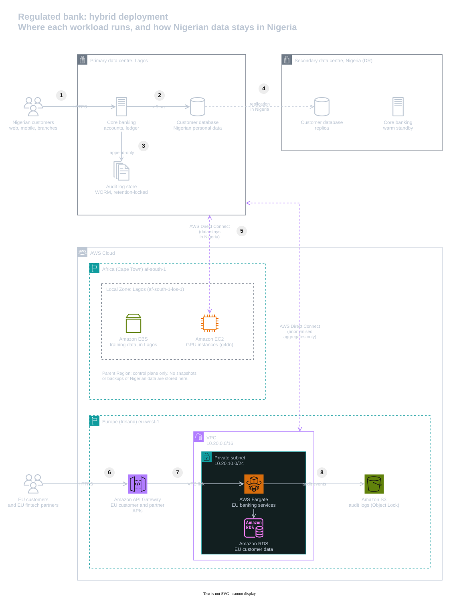

# 02 | Cloud Deployment Models

**Exercise date:** 21 February 2026 | **Type:** design exercise, no AWS resources | **Status:** rebuilt and corrected

## The task, in my own words

A bank with customers in Nigeria and the European Union wants to modernise its infrastructure. Choose a deployment model (public, private, community or hybrid cloud) and decide where each workload runs, under nine constraints that pull in different directions:

| Category | Constraint | What it means technically |
|---|---|---|
| Financial | The board wants infrastructure cost cut by 20% | Pay for capacity only when it is used; avoid buying private capacity for peaks |
| Integration | Third-party fintech APIs must be integrated | A managed API layer with controlled external access |
| Performance | Core banking latency under 5 ms | The application and its database must sit on the same site, which rules out distant cloud Regions |
| Workload | AI training needs GPU capacity in bursts | Elastic GPU capacity, paid for by the hour |
| Regulatory | EU users' data falls under GDPR | EU personal data is stored and processed in the EU |
| Regulatory | Nigerian users' data must not leave Nigeria | Every copy (replicas, backups, logs, caches) stays in the country, not just the primary database |
| Regulatory | Audit logs must be immutable | Write-once storage (WORM) that no one, administrators included, can alter or delete |
| Resilience | Recovery time under 15 minutes | Replicated data and automated failover |
| Security | Hardware isolation | No shared hardware: the bank's own data centres, or dedicated hosts |

## What I did in the exercise

- Turned each constraint into its technical implication (the table above, lightly edited from my original).
- Compared the four deployment models against the constraints. Public cloud met the GPU, EU and recovery needs but not Nigerian residency or 5 ms latency; private cloud met residency, latency and isolation but not elastic GPUs or the cost cut; community cloud offered compliance features but no residency guarantee; hybrid fitted best, at the price of complexity.
- Recommended a hybrid, multi-cloud design: the bank's data centres in Nigeria for core banking and Nigerian data, Microsoft Azure in the EU for EU data and the partner API gateway, and AWS for GPU bursting and immutable audit logs.
- Named the trade-offs and how to contain them: data transfer costs, identity spread across three systems, cross-cloud latency (solved by keeping core banking synchronous and AI work asynchronous), and recovery automated with Terraform.

## The rebuilt solution

Select the diagram to open it at full resolution, then click the image to zoom in. The editable source is [`diagrams/hybrid-deployment.drawio`](diagrams/hybrid-deployment.drawio).

1. **Nigerian customers** reach **core banking** in the primary Lagos data centre.
2. Core banking and the **customer database** share a site, so the round trip stays under 5 ms. No cloud Region can match that: Lagos to Cape Town is about 4,800 km, at least 48 ms there and back in fibre.
3. Every transaction is written to an on-premises **WORM audit store**, so logs that contain personal data never leave Nigeria.
4. The database replicates to a **secondary data centre in Nigeria**. Automated failover meets the 15-minute recovery time without moving data abroad.
5. AI training on Nigerian data bursts to **GPU instances in the AWS Lagos Local Zone** over **AWS Direct Connect**. The data stays on **Amazon EBS** in Lagos, with no snapshots.
6. **EU customers and EU fintech partners** call **Amazon API Gateway** in eu-west-1. Partner APIs that carry Nigerian data end in the Lagos data centre instead.
7. EU services on **AWS Fargate** keep EU personal data in **Amazon RDS** in a private subnet (GDPR).
8. Audit events go to **Amazon S3** with Object Lock in compliance mode, so no one can alter or delete them.

The second Direct Connect link, to eu-west-1, carries anonymised aggregates only. With one public cloud, **IAM Identity Center** federates with the bank's on-premises directory, so there is one source of identities. **AWS Outposts** racks, available in Nigeria, are an option for running AWS services inside the data centres.

### Where each workload runs

| Workload | Where it runs | Why |
|---|---|---|
| Core banking and ledgers | The bank's primary data centre in Lagos | Under 5 ms to its database, hardware isolation, and the data stays in Nigeria |
| Nigerian customer data | The primary data centre, replicated to a secondary data centre in Nigeria | Residency and a recovery site in the same country |
| Audit logs with Nigerian personal data | A retention-locked (WORM) store in the data centres | Immutable, and they never leave Nigeria |
| AI training on Nigerian data | GPU instances in the AWS Lagos Local Zone, on demand | Elastic GPUs that are physically in Lagos; no snapshots, because those are stored in the parent Region |
| Partner APIs that carry Nigerian data | An API gateway in the Lagos data centre | Requests and responses with Nigerian data never transit another country |
| EU customer data and EU services | AWS eu-west-1: AWS Fargate and Amazon RDS in private subnets, behind Amazon API Gateway | GDPR, with managed services and multi-AZ availability |
| EU audit logs | Amazon S3 with Object Lock in compliance mode | No one can alter or delete them before the retention period ends |

### Decisions

Two choices changed from my original design, and each has its own record:

- [ADR-0001: Use one public cloud, AWS, alongside the bank's data centres](decisions/0001-use-one-public-cloud.md)
- [ADR-0002: Keep Nigerian personal data, its backups and its logs in Nigeria](decisions/0002-keep-nigerian-data-in-nigeria.md)

### Recovery

| Workload | Strategy | Target |
|---|---|---|
| Core banking and Nigerian data | Warm standby in the secondary Nigerian data centre, replication between the two sites, automated failover | Recovery under 15 minutes, proven by a quarterly drill |
| EU services | Two Availability Zones in eu-west-1, Amazon RDS Multi-AZ | Survives the loss of an Availability Zone |
| AI training | Stateless jobs, re-run from the source data | No standby needed |
| Audit logs | WORM copies in both Nigerian data centres; S3 Object Lock in the EU | No log lost or altered |

## Mistakes I fixed

1. **Two public clouds.** Azure for EU workloads plus AWS for AI meant two identity systems, two sets of private links and charges for moving data between them, all working against the 20% cost cut. One public cloud meets every constraint ([ADR-0001](decisions/0001-use-one-public-cloud.md)).
2. **Tenancy is not residency.** I marked Nigerian data "dedicated / isolated", but tenancy decides who shares the hardware, not which country it is in. Residency comes from location ([ADR-0002](decisions/0002-keep-nigerian-data-in-nigeria.md)).
3. **Copies that would have left the country.** My recovery plan replicated databases across Regions, and my audit logs went to AWS. Both would have sent Nigerian personal data abroad, because AWS has no Region in Nigeria. Recovery and logs for that data now stay in the country.
4. **A contradiction.** One of my tables ran core banking "active-active in the same Region", while my summary kept it on premises. It runs on premises, with a warm standby in a second Nigerian site.
5. **The API gateway in the wrong place.** An EU-hosted gateway for all partners would route Nigerian customers' data through Europe. APIs that carry Nigerian data now end in Lagos.
6. **A vague recovery plan.** "Warm standby in a localised community cloud" named no site and no test. The secondary site is now named, and the 15-minute target is proven by a drill.
7. **Inaccurate claims.**
   - "Favours a Nigeria Region": there is no AWS Region in Nigeria. The in-country options are the bank's own data centres, AWS Outposts racks installed in them, and the AWS Lagos Local Zone.
   - "Mathematically immutable" logs: the accurate claim is write-once storage in compliance mode with a retention period.
   - "Under 5 ms": I never said between what. It is the round trip between core banking and its database. Physics rules out a cloud Region here: Lagos to Cape Town is about 4,800 km, so light in fibre needs at least 48 ms there and back.

## Design vs production

| Concern | In this design | Before going to production | Well-Architected pillar |
|---|---|---|---|
| Private connectivity | One Direct Connect link drawn per path | Two connections at different Direct Connect locations, plus a Site-to-Site VPN as backup | Reliability |
| Recovery | A target of 15 minutes | A quarterly failover drill that measures recovery time and data loss | Reliability, Operational Excellence |
| EU services | One private subnet drawn | Two Availability Zones, RDS Multi-AZ, and the API layer behind AWS WAF | Reliability, Security |
| Encryption keys | Not specified | Customer-managed AWS KMS keys in the cloud; hardware security modules for core banking keys | Security |
| Residency enforcement | Tags and a snapshot guardrail | Data classification enforced in Terraform, an AWS Config check and regular data-flow reviews | Security |
| Spend | On-demand GPUs | Savings Plans for the steady EU workload, scheduled training windows, budgets with alerts | Cost Optimization |
| GPU use | Elastic | Right-sized instance types, and nothing left running between training runs | Sustainability |
| Latency | A 5 ms target | Per-transaction latency measured against a service level objective | Performance Efficiency |

## What I learned

- Data residency covers every copy: replicas, backups, logs, caches and the path an API request takes, not only the main database.
- Physics sets the floor for latency. Distance decides what can run in the cloud and what must stay close to the data.
- Each additional cloud means building, running and auditing every control again.

## Sources

- AWS Outposts racks available in Nigeria: [AWS What's New, November 2021](https://aws.amazon.com/about-aws/whats-new/2021/11/aws-outposts-new-regions) and [January 2026](https://aws.amazon.com/about-aws/whats-new/2026/01/availability-second-generation-aws-outposts-racks-more-countries).
- AWS Local Zone in Lagos, launched January 2023: [Nairametrics](https://nairametrics.com/2023/01/26/aws-launches-new-aws-local-zones-location-in-lagos-nigeria/).
