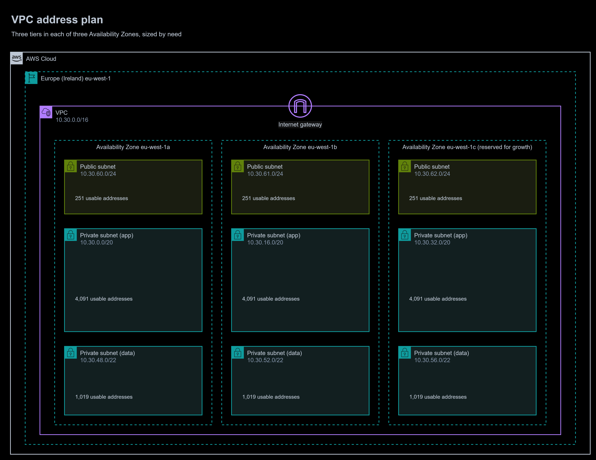

# 03 | VPC and CIDR Design

**Exercise date:** 5 March 2026 | **Type:** address planning on paper | **Status:** rebuilt as a tested planning tool

## The task, in my own words

Plan the IP addresses for a VPC: choose its CIDR block, split it into subnets for each tier of an application, and leave room to grow.

## What I did in the exercise

I worked it out by hand. Each bit borrowed from the host part of the address doubles the number of subnets:

| Subnets | Bits borrowed | New prefix (from /16) |
|---:|---:|---|
| 2 | 1 | /17 |
| 4 | 2 | /18 |
| 8 | 3 | /19 |
| 16 | 4 | /20 |
| 32 | 5 | /21 |

Six tiers were needed, so I borrowed 3 bits and split `10.10.0.0/16` into eight /19 blocks of 8,192 addresses, gave six to the tiers and kept two spare. The arithmetic was right: the tool below reproduces my handwritten table exactly.

```console
$ python cidr_plan.py split 10.10.0.0/16 --count 6
10.10.0.0/16 split into 8 blocks of /19 (6 needed, 2 spare):
```

| Subnet | CIDR | Range | Usable addresses |
|---|---|---|---:|
| Block 1 | `10.10.0.0/19` | 10.10.0.0 to 10.10.31.255 | 8,187 |
| Block 2 | `10.10.32.0/19` | 10.10.32.0 to 10.10.63.255 | 8,187 |
| Block 3 | `10.10.64.0/19` | 10.10.64.0 to 10.10.95.255 | 8,187 |
| Block 4 | `10.10.96.0/19` | 10.10.96.0 to 10.10.127.255 | 8,187 |
| Block 5 | `10.10.128.0/19` | 10.10.128.0 to 10.10.159.255 | 8,187 |
| Block 6 | `10.10.160.0/19` | 10.10.160.0 to 10.10.191.255 | 8,187 |
| Block 7 | `10.10.192.0/19` | 10.10.192.0 to 10.10.223.255 | 8,187 |
| Block 8 | `10.10.224.0/19` | 10.10.224.0 to 10.10.255.255 | 8,187 |

## The rebuilt solution

[`cidr_plan.py`](cidr_plan.py) is a small command-line tool with no dependencies beyond Python's standard library. It:

- splits a block into equal subnets, or allocates **right-sized subnets for each tier in each Availability Zone**;
- places the largest subnets first, each in the smallest free block that fits, so nothing overlaps and the free space stays in a few large pieces;
- reports **usable** addresses: AWS reserves five in every subnet (the network address, the VPC router, the DNS server, one for future use and the broadcast address);
- enforces AWS's limits (subnets between /16 and /28);
- **refuses a VPC range that overlaps** on-premises networks or other VPCs, which would break routing over a VPN or Direct Connect.

```console
$ python cidr_plan.py plan 10.30.0.0/16 --azs a,b,c \
    --tier public=24 --tier app=20 --tier data=22 \
    --avoid 10.0.0.0/16 --avoid 172.16.0.0/12
```

| Subnet | CIDR | Range | Usable addresses |
|---|---|---|---:|
| app (a) | `10.30.0.0/20` | 10.30.0.0 to 10.30.15.255 | 4,091 |
| app (b) | `10.30.16.0/20` | 10.30.16.0 to 10.30.31.255 | 4,091 |
| app (c) | `10.30.32.0/20` | 10.30.32.0 to 10.30.47.255 | 4,091 |
| data (a) | `10.30.48.0/22` | 10.30.48.0 to 10.30.51.255 | 1,019 |
| data (b) | `10.30.52.0/22` | 10.30.52.0 to 10.30.55.255 | 1,019 |
| data (c) | `10.30.56.0/22` | 10.30.56.0 to 10.30.59.255 | 1,019 |
| public (a) | `10.30.60.0/24` | 10.30.60.0 to 10.30.60.255 | 251 |
| public (b) | `10.30.61.0/24` | 10.30.61.0 to 10.30.61.255 | 251 |
| public (c) | `10.30.62.0/24` | 10.30.62.0 to 10.30.62.255 | 251 |

Allocated 16,128 of 65,536 addresses (25%); free blocks: `10.30.63.0/24`, `10.30.64.0/18`, `10.30.128.0/17`.



To zoom in, right-click the diagram and open the image in a new tab. The editable source is [`diagrams/vpc-address-plan.drawio`](diagrams/vpc-address-plan.drawio).

### How it is tested

Twelve unit tests in [`test_cidr_plan.py`](test_cidr_plan.py) check the reserved-address arithmetic, that my original /19 split is reproduced, that no allocated subnets overlap, that allocated plus free space adds up to the whole VPC exactly, that running out of space and out-of-range sizes are errors, and that an overlapping VPC is refused. The [`python` workflow](../.github/workflows/python.yml) runs them on every push.

```console
$ python -m unittest discover -s 03-vpc-cidr-design
Ran 12 tests in 0.010s
OK
```

## Mistakes I fixed

1. **One Availability Zone.** A subnet lives in a single Availability Zone, so a highly available design needs every tier in at least two. Six tiers in two zones is twelve subnets, which eight /19 blocks cannot provide. The new plan repeats every tier in each zone.
2. **Equal sizes.** A public tier that holds only a load balancer and NAT gateways had 8,187 usable addresses. Tiers are now sized by what they hold: /24 public, /20 app, /22 data.
3. **No room to grow.** I allocated the whole /16 at once and kept two blocks spare. The new plan uses a quarter of the VPC, keeps a third zone allocated but empty, and leaves 75% free for new tiers. A VPC's primary CIDR can never be changed later, so this matters.
4. **Overlap with other networks.** `10.10.0.0/16` sits inside `10.0.0.0/8`, a range many companies already use on premises. Overlapping ranges cannot be routed over a VPN or Direct Connect. The tool now refuses a VPC that overlaps a listed range.
5. **Usable addresses.** I wrote 8,192 addresses per block. That is the block size; AWS reserves five in every subnet, so 8,187 are usable.
6. **Range notation.** I wrote ranges as `10.10.0.0/19 - 10.10.31.0/19`. A /19 block runs from `10.10.0.0` to `10.10.31.255`, and the tool prints ranges that way.

## Lab vs production

| Concern | In the exercise | In production | Well-Architected pillar |
|---|---|---|---|
| Who allocates ranges | Me, by hand | Amazon VPC IP Address Manager (IPAM) pools hand out non-overlapping ranges per account and Region, and track use | Operational Excellence |
| Overlap checks | None | Every new VPC checked against on premises and all other VPCs, enforced by IPAM | Reliability |
| IPv4 exhaustion | Not considered | Dual-stack subnets with IPv6, and as few public IPv4 addresses as possible, since AWS charges for every public IPv4 address | Cost Optimization |
| Growth | Two spare blocks | A reserved third zone and 75% of the VPC free | Reliability |
| Subnet sizing | Equal | Sized by tier; container and Lambda workloads take one address per task or interface, so the app tier is the largest | Performance Efficiency |
| Where the plan lives | A notebook | Generated by the tool, kept in the repository, and fed to Terraform (see module 12) | Operational Excellence |

## What I learned

- Usable addresses on AWS are always the block size minus five.
- Plan for Availability Zones first: subnets are zonal, so the number of zones multiplies everything else.
- Leave space. Adding a secondary CIDR block later is possible, but renumbering a busy VPC is not something anyone wants to do.
