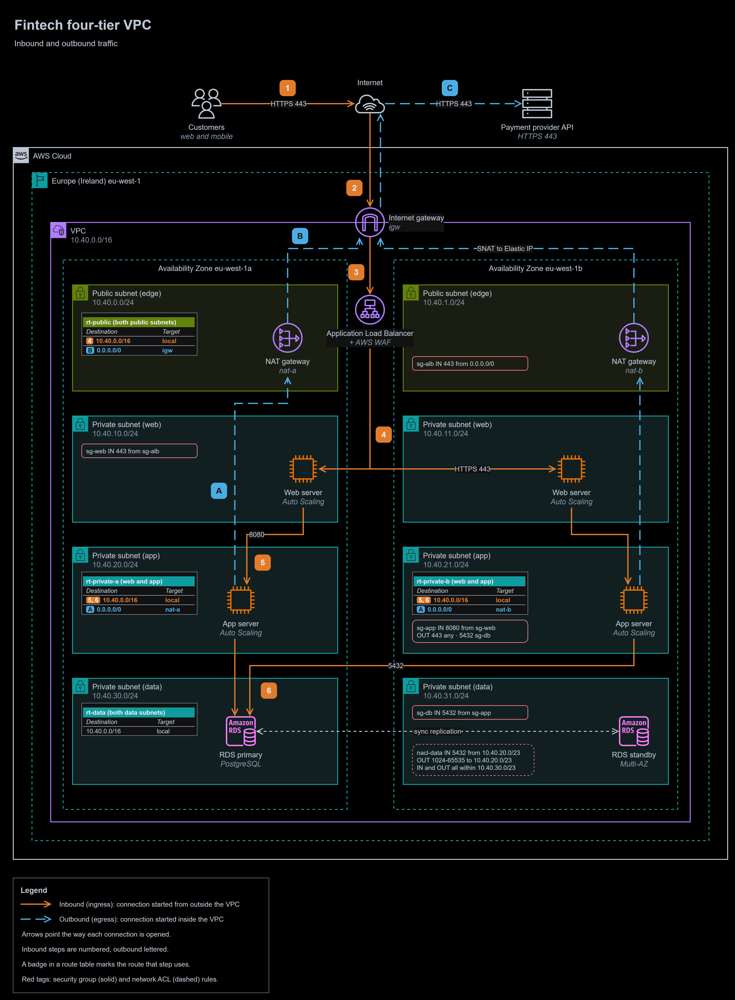
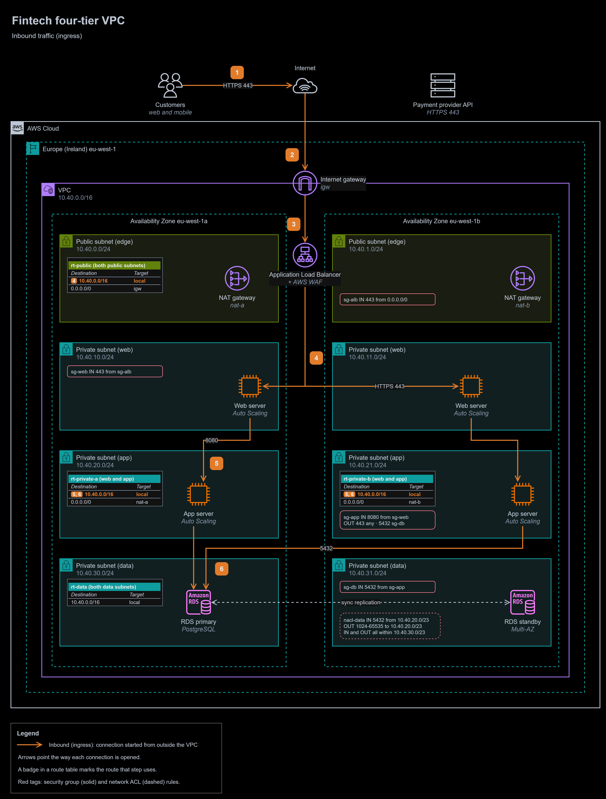
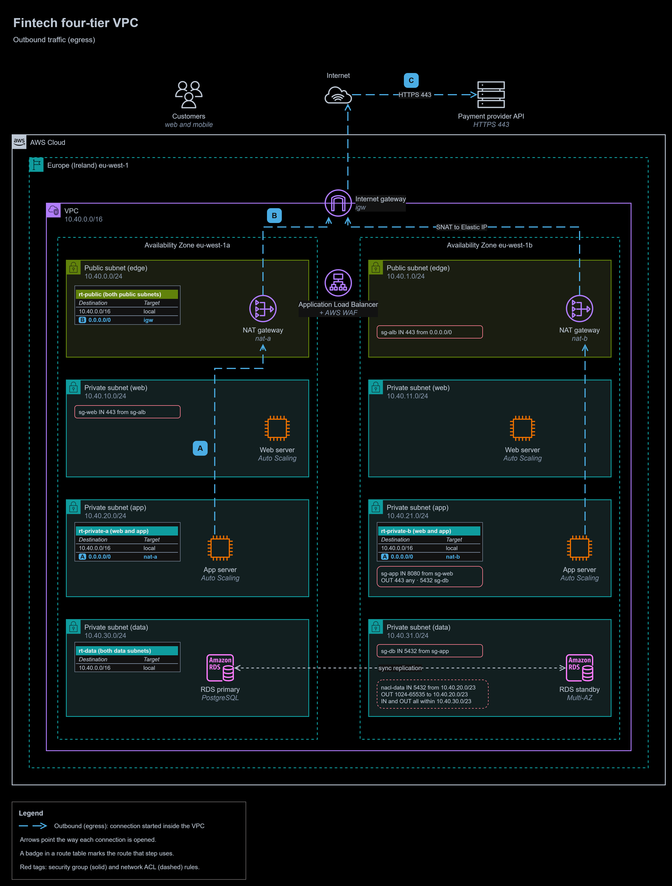

# 04 | Public and Private Subnets

**Exercise date:** 12 March 2026 | **Type:** design exercise, no AWS resources | **Status:** rebuilt and corrected

## The task, in my own words

A fintech's network fails basic security: its main database has a public IP address in a public subnet, every tier shares one flat public subnet, and the web servers keep customer balances. Redesign it as a segmented VPC, decide which tiers must be public and which private, trace how internet traffic reaches each tier, and work through ten common misconfigurations: what is wrong with each, how to fix it, and what part the internet gateway plays.

## What I did in the exercise

- Wrote a 26-slide design document: problem statement, inbound and outbound flow diagrams, a network diagram, route tables, security groups, the ten scenarios, the internet traffic path, tier classification, a secure versus insecure comparison and the business impact of an exposed database.
- Classified the load balancer and NAT gateway as public and the application and database tiers as private, with a route table for each tier.
- For each scenario, stated the fault, the redesign, the internet gateway's part and a justification. Most of the analysis held up; the corrections are under [Mistakes I fixed](#mistakes-i-fixed).

## The rebuilt solution

Four tiers, each with its own subnet in each of two Availability Zones, in VPC `10.40.0.0/16` in eu-west-1.

To zoom in, right-click the diagram and open the image in a new tab. The editable source is [`diagrams/fintech-vpc-traffic.drawio`](diagrams/fintech-vpc-traffic.drawio). It has three pages: both directions together (above), inbound only and outbound only.

**Inbound (numbered)**

1. A customer opens the banking app; the HTTPS 443 request crosses the **internet**.
2. It enters through the VPC's **internet gateway**, the only way in. The gateway maps the load balancer's public address to its private one.
3. The **Application Load Balancer**, in the public subnets of both zones, terminates TLS. `sg-alb` admits 443 from anywhere, and **AWS WAF** filters the request.
4. It forwards to a healthy **web server** in either zone over the `local` route. `sg-web` admits 443 only from `sg-alb`.
5. Web servers call the **app servers** on 8080. `sg-app` admits 8080 only from `sg-web`.
6. App servers query the **RDS primary** on 5432. `sg-db` admits 5432 only from `sg-app`, and `nacl-data` only from the app subnets.

**Outbound (lettered)**

- **A.** An app server calls a payment provider's API. `rt-private-a` and `rt-private-b` send `0.0.0.0/0` to the **NAT gateway in the same zone**, so losing one zone never cuts the other's outbound access.
- **B.** The **NAT gateway** replaces the private source address with its Elastic IP and, through `rt-public` (`0.0.0.0/0` to `igw`), passes the packet to the **internet gateway**.
- **C.** The request reaches the **payment provider's API** on 443. Replies come back through the same NAT gateway; nothing on the internet can open a connection to an app server.

**Return traffic** is not drawn: replies retrace each request's path. Every hop uses the route table of the subnet it leaves, so the database's replies use `rt-data`. Security groups are stateful and let replies back automatically; network ACLs are stateless, so `nacl-data` must also allow replies out on ephemeral ports 1024-65535.

Inbound traffic only

Outbound traffic only

### Tiers

| Tier | Subnets (zone a, zone b) | Holds | Public or private | Why |
|---|---|---|---|---|
| Edge | `10.40.0.0/24`, `10.40.1.0/24` | Application Load Balancer with AWS WAF; one NAT gateway per zone | Public | The only tier that routes to the internet gateway. It accepts customers' HTTPS connections and carries the private tiers' outbound calls |
| Web | `10.40.10.0/24`, `10.40.11.0/24` | Stateless web servers in an Auto Scaling group | Private | Reached only through the load balancer; no public IP addresses |
| App | `10.40.20.0/24`, `10.40.21.0/24` | The application servers that move money | Private | Reached only from the web tier; calls the payment provider through the NAT gateway in its own zone |
| Data | `10.40.30.0/24`, `10.40.31.0/24` | Amazon RDS for PostgreSQL, Multi-AZ | Private, with no route out of the VPC | Can neither reach nor be reached from the internet |

### Route tables

A route table belongs to the subnet that traffic is leaving, and it chooses a route by the destination address.

| Route table | Subnets | Destination | Target | Carries |
|---|---|---|---|---|
| `rt-public` | Both edge subnets | `10.40.0.0/16` | local | Load balancer to web servers (step 4) |
| | | `0.0.0.0/0` | `igw` | NAT gateways to the internet (B); the load balancer's replies to customers |
| `rt-private-a` | Web and app, zone a | `10.40.0.0/16` | local | Web to app (5) and app to database (6) |
| | | `0.0.0.0/0` | `nat-a` | App servers to the payment provider (A) |
| `rt-private-b` | Web and app, zone b | `10.40.0.0/16` | local | As in zone a |
| | | `0.0.0.0/0` | `nat-b` | As in zone a, through zone b's own NAT gateway |
| `rt-data` | Both data subnets | `10.40.0.0/16` | local | The database's replies only |

### Security groups

Security groups are stateful: the reply to an allowed connection is always let back in, so replies need no rules. Each rule names the next tier's security group instead of an address range, so it stays correct as instances come and go.

| Security group | Attached to | Inbound | Outbound |
|---|---|---|---|
| `sg-alb` | Load balancer | 443 from `0.0.0.0/0` | 443 to `sg-web` |
| `sg-web` | Web servers | 443 from `sg-alb` | 8080 to `sg-app` |
| `sg-app` | App servers | 8080 from `sg-web` | 443 to `0.0.0.0/0` (the payment provider, through the NAT gateway); 5432 to `sg-db` |
| `sg-db` | Database | 5432 from `sg-app` | None: the default allow-all rule is removed |

### Network ACL on the data subnets

Network ACLs are stateless and act at the subnet boundary, so replies need rules of their own. The other subnets keep the default network ACL, which allows everything and leaves filtering to the security groups; the data tier gets a second, independent layer.

| Rule | Direction | Protocol | Ports | Source or destination | Action |
|---:|---|---|---|---|---|
| 100 | Inbound | TCP | 5432 | `10.40.20.0/23` (both app subnets) | Allow |
| 110 | Inbound | All | All | `10.40.30.0/23` (both data subnets) | Allow |
| * | Inbound | All | All | `0.0.0.0/0` | Deny |
| 100 | Outbound | TCP | 1024-65535 | `10.40.20.0/23` | Allow |
| 110 | Outbound | All | All | `10.40.30.0/23` | Allow |
| * | Outbound | All | All | `0.0.0.0/0` | Deny |

Rules 110 let the two data subnets talk freely. I could not find AWS documentation of the ports that Multi-AZ replication uses, so I don't filter traffic between the primary and the standby.

### The ten misconfigurations

| # | Misconfiguration | Why it is dangerous | Fix | The internet gateway's part |
|---:|---|---|---|---|
| 1 | Database with a public IP address in a public subnet | Anyone on the internet can try to connect: password guessing, flaws in the database engine, stolen credentials | Data subnets in two zones; RDS "Publicly accessible" set to No; `sg-db` admits 5432 only from `sg-app` | The data subnets' route table has no route to it, so nothing in them can talk to the internet, whatever addresses they hold |
| 2 | Web tier in a private subnet with nothing public in front | Not wrong in itself: private is the right place for web servers. Without a public entry point, though, customers cannot reach the application | An internet-facing Application Load Balancer in both edge subnets, forwarding to the web servers | Only the load balancer's subnets route to it; the web servers have no public addresses |
| 3 | All tiers in the public subnet | No defence in depth: one compromised server can reach every other tier directly | Separate edge, web, app and data subnets | Only the edge subnets route to it |
| 4 | App tier with public IP addresses | The servers that move money can be attacked straight from the internet | Remove the public addresses and keep the tier in private subnets, reachable only from `sg-web` | The app subnets send `0.0.0.0/0` to a NAT gateway, which lets them call out but lets nothing call in |
| 5 | Database in a "public" subnet with no internet gateway | By AWS's definition a subnet without a route to an internet gateway is private, so the database is not exposed today. The danger is the misleading name and a shared route table: one added route would expose it | A dedicated data subnet with its own route table and network ACL, named for what it is | None, and a Config rule alerts if the database ever becomes publicly accessible |
| 6 | Web server stores customer balances | Web servers are the tier closest to the internet, and Auto Scaling replaces them at any time, so the data is both exposed and easily lost. It also escapes the database's encryption, backups and audit trail | Stateless web servers: balances live only in the database, and session state in a managed store such as Amazon ElastiCache or Amazon DynamoDB | None: this is a fault in where data lives, not in routing |
| 7 | App and web tiers share a subnet | Security groups can still separate them, but the subnet-level layer is lost: one network ACL, one set of flow logs, no boundary between the tiers | Separate web and app subnets in each zone; `sg-app` admits 8080 only from `sg-web` | Neither subnet routes to it |
| 8 | Private subnets removed | Every resource with a public address is reachable from the internet, guarded only by its security group | Recreate the web, app and data subnets and move the resources back | Only the edge subnets route to it |
| 9 | Internet gateway attached and the database public | The worst case: a public address and a route to the internet gateway, so only the security group stands between the internet and the database | As in 1, plus a review of every rule in `sg-db` | Move the database to `rt-data`, which has no route to it |
| 10 | The payment application has one subnet | One subnet means one route table, one network ACL and one zone: the load balancer cannot be exposed while the database stays hidden, and a zone failure stops everything | Four tiers in two zones: eight subnets | Only the two edge subnets route to it |

## Mistakes I fixed

1. **"Forward proxy."** I described the load balancer as a forward proxy. It is a reverse proxy: it accepts connections on behalf of the servers behind it and opens new connections to them. A forward proxy works the other way round, for clients going out to the internet.
2. **Routing by source.** My traffic walkthrough had the router check "the source IP (0.0.0.0/0)" and send packets "through the switch back to the default gateway". A VPC route table ignores the source: it picks the most specific route that matches the destination (longest prefix match), and the table used is the one belonging to the subnet the packet leaves. There is no switch to configure. The VPC router is built in, and every route table starts with a local route for the whole VPC.
3. **The internet gateway as a router.** I called the internet gateway "the attached router" and wrote that it "should have no route to the DB subnet". An internet gateway is a highly available VPC component that translates between public and private IPv4 addresses. It holds no routes of its own; subnets' route tables point at it. To be reachable from the internet, a resource needs four things at once: a route to the internet gateway in its subnet's route table, a public IPv4 or Elastic IP address, a security group rule and a network ACL rule.
4. **A diagram that contradicted scenario 7.** My route table and network diagram put the web and app servers in one "Tier 2 (Private Web / App)" subnet, the very layout scenario 7 calls a flaw. They now have separate subnets in each zone. They share a route table, which is fine: their routes are identical, and the subnet boundaries and security groups still separate them.
5. **Outbound traffic through the web server.** My outbound diagram sent the app server's internet calls through the web server before the NAT gateway. A web server is not a router; the app subnet's route table sends `0.0.0.0/0` straight to a NAT gateway.
6. **One Availability Zone.** Everything sat in one zone, so losing it would stop payments. Each tier now has a subnet in two zones, each zone has its own NAT gateway, the load balancer spans both, and the database runs Multi-AZ. An Application Load Balancer and an RDS DB subnet group each need subnets in at least two zones anyway.
7. **Loose security group rules.** Each tier allowed "all traffic" out to the next one, and the database allowed all outbound traffic to `0.0.0.0/0`. Security groups are stateful, so the database needs no outbound rule to answer queries. Every rule now names one port and one security group.
8. **Overclaimed compliance.** My comparison table said the secure design "meets PCI-DSS, GDPR, and banking regulations". No network design meets a regulation by itself. Segmentation covers part of PCI DSS v4.0.1 Requirement 1, such as 1.4.4 (systems that store cardholder data are not directly reachable from untrusted networks), and it narrows what an assessment has to cover. Meeting the standard takes all twelve requirements and an assessment.
9. **Scenario 5 misread.** I treated a database in a "public" subnet with no internet gateway as exposed. AWS defines a public subnet as one whose route table has a route to an internet gateway, so that subnet is private in everything but name. The real risks are the misleading name and a shared route table, which the fix now addresses.

## Design vs production

| Concern | In this design | Before going to production | Well-Architected pillar |
|---|---|---|---|
| Edge protection | AWS WAF on the load balancer | AWS managed rule groups and rate-based rules in WAF; certificates from AWS Certificate Manager | Security |
| Outbound control | `sg-app` allows 443 to any address | A managed prefix list of the payment provider's addresses, or AWS Network Firewall filtering by domain (see module 09) | Security |
| Visibility | None | VPC Flow Logs on every subnet, load balancer access logs, AWS CloudTrail and Amazon GuardDuty | Security, Operational Excellence |
| Administrator access | Not shown | AWS Systems Manager Session Manager instead of SSH: no port 22 open anywhere and no bastion host | Security |
| Data protection | RDS Multi-AZ | Encryption at rest with AWS KMS, TLS to the database, automated backups with point-in-time recovery, credentials in AWS Secrets Manager with rotation | Security, Reliability |
| Public database check | Design review | The AWS Config rule `rds-instance-public-access-check`, alerting on any publicly accessible database | Security |
| Zone failure | Two zones, a NAT gateway in each | Health checks and Auto Scaling replacing lost instances; database failover tested with a reboot with failover | Reliability |
| NAT cost | One NAT gateway per zone | Kept in production; one shared NAT gateway in development; gateway endpoints for Amazon S3 and DynamoDB so that traffic avoids NAT data charges | Cost Optimization |
| Scaling | Auto Scaling groups drawn | Target tracking on requests per target; instance types right-sized from Amazon CloudWatch metrics | Performance Efficiency |
| Efficiency | Not considered | AWS Graviton instances, and scaling in when traffic drops at night | Sustainability |
| How it is built | Drawn by hand | Terraform, reviewed in pull requests (see module 12) | Operational Excellence |

## What I learned

- A subnet is public or private because of its route table, not its name.
- Reaching a resource from the internet takes a route, a public address, a security group rule and a network ACL rule. A sensitive tier should be missing more than one of them, so that no single mistake exposes it.
- The route table that matters is the one belonging to the subnet a packet is leaving, and it matches on the destination.

## Sources

- Public and private subnets: [Amazon VPC User Guide, subnets](https://docs.aws.amazon.com/vpc/latest/userguide/configure-subnets.html)
- [Internet gateways](https://docs.aws.amazon.com/vpc/latest/userguide/VPC_Internet_Gateway.html) and [NAT gateways](https://docs.aws.amazon.com/vpc/latest/userguide/vpc-nat-gateway.html)
- Longest prefix match: [How route priority works](https://docs.aws.amazon.com/vpc/latest/userguide/route-tables-priority.html)
- Two zones for a load balancer: [Application Load Balancers](https://docs.aws.amazon.com/elasticloadbalancing/latest/application/application-load-balancers.html); for a DB subnet group: [Amazon RDS in a VPC](https://docs.aws.amazon.com/AmazonRDS/latest/UserGuide/USER_VPC.WorkingWithRDSInstanceinaVPC.html)
- [AWS Config rule rds-instance-public-access-check](https://docs.aws.amazon.com/config/latest/developerguide/rds-instance-public-access-check.html)
- PCI DSS v4.0.1, Requirement 1.4.4: [PCI Security Standards Council document library](https://www.pcisecuritystandards.org/document_library/)
