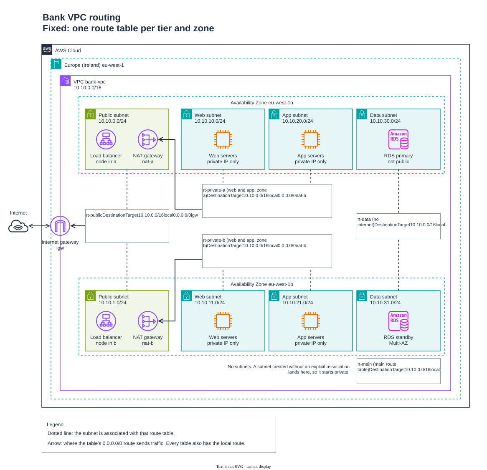
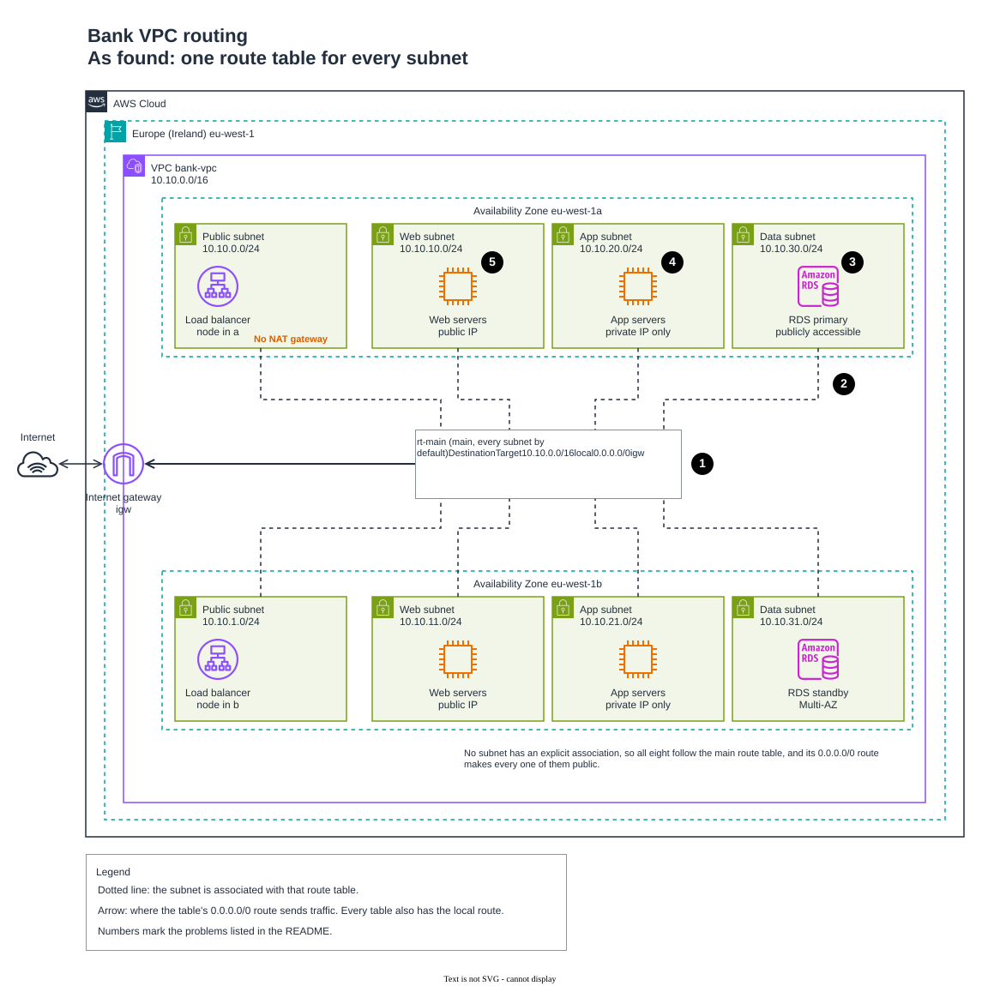

# 05 | Route Tables and Routing

**Exercise date:** 12 March 2026 | **Type:** design exercise, no AWS resources | **Status:** rebuilt as a tested routing checker

## The task, in my own words

A bank's VPC has routing faults: a database subnet with a default route to the internet gateway, tiers sharing one route table, internal traffic sent the wrong way, payment calls timing out. For ten such faults, say what is wrong, how the traffic actually flows, what the route tables should look like and what the fault risks for a bank. Then trace a request from the internet through the web, app and database tiers of a correctly routed VPC, say which subnets have a default route and why, and assess what happens when a database subnet routes `0.0.0.0/0` to the internet gateway.

## What I did in the exercise

- Wrote a 20-slide document: problem statement, inbound and outbound flow diagrams, a network diagram, route tables, security groups, the ten scenarios (mistake, traffic flow, redesign, exposure risk), a phase-by-phase traffic trace, a route table and internet gateway diagram, and a risk report on a database subnet routed to the internet.
- Got the core design right: only the edge subnet routes to the internet gateway, the private tiers go out through a NAT gateway, and the database tier has only the local route.
- Several scenario answers described the risk without the mechanism behind it, and a few mechanisms were wrong. The corrections are under [Mistakes I fixed](#mistakes-i-fixed).

## The rebuilt solution

Rather than describe routing on slides, I wrote [`route_check.py`](route_check.py). It reads a VPC described in JSON and applies the VPC router's rules, so it can trace any connection hop by hop and audit a design for the faults in this exercise before anything is built. It needs nothing beyond Python's standard library. It follows AWS's documented rules:

- each subnet uses the route table explicitly associated with it, or else the main route table;
- every route table has a local route covering the whole VPC;
- the most specific matching route wins (longest prefix match);
- a route more specific than the local route must cover a whole subnet and point at a NAT gateway, a network interface or a Gateway Load Balancer endpoint;
- an internet gateway carries IPv4 traffic only for resources with a public IPv4 address, which it translates to and from the private one.

It checks routing only. Security groups and network ACLs are [module 06](../README.md#modules).

```console
$ python route_check.py tables examples/bank-vpc.json     # the route tables and their subnets
$ python route_check.py trace examples/bank-vpc.json internet alb-node-a web-server-a app-server-a db-primary
$ python route_check.py audit examples/as-found.json       # exit code 1 on any critical or high finding
```

### The fixed design

VPC `10.10.0.0/16` in eu-west-1, four tiers in two Availability Zones, described in [`examples/bank-vpc.json`](examples/bank-vpc.json).

<a href="diagrams/bank-vpc-routing-fixed.drawio.svg">
<picture>
  <source media="(prefers-color-scheme: dark)" srcset="diagrams/dark/bank-vpc-routing-fixed.drawio.svg">
  
</picture>
</a>

Select the diagram to open it full size. The editable source is [`diagrams/bank-vpc-routing.drawio`](diagrams/bank-vpc-routing.drawio), with a second page for the as-found VPC below.

| Route table | Subnets | Routes | Why |
|---|---|---|---|
| `rt-public` | public-a `10.10.0.0/24`, public-b `10.10.1.0/24` | local, `0.0.0.0/0` to `igw` | The load balancer must answer customers, and the NAT gateways must reach the internet. These are the only subnets with a route to the internet gateway |
| `rt-private-a` | web-a `10.10.10.0/24`, app-a `10.10.20.0/24` | local, `0.0.0.0/0` to `nat-a` | Web and app servers call out (payment provider, patches) but cannot be called in. Each zone uses its own NAT gateway |
| `rt-private-b` | web-b `10.10.11.0/24`, app-b `10.10.21.0/24` | local, `0.0.0.0/0` to `nat-b` | The same for zone b, so losing one zone never cuts the other off |
| `rt-data` | data-a `10.10.30.0/24`, data-b `10.10.31.0/24` | local | The database has no reason to reach the internet, and no route lets it |
| `rt-main` (main) | none | local | Left as AWS creates it. A subnet created without an explicit association lands here and starts private, as AWS recommends |

**Which subnets have a default route, and why.** The two public subnets send `0.0.0.0/0` to the internet gateway because they hold the only things the internet must reach (the load balancer) and the NAT gateways, which forward outbound traffic through it. The web and app subnets send `0.0.0.0/0` to their zone's NAT gateway: outbound only, since a NAT gateway never accepts a connection from outside. The data subnets have no default route at all.

### Traffic trace: internet to database

```console
$ python route_check.py trace examples/bank-vpc.json internet alb-node-a web-server-a app-server-a db-primary
internet -> alb-node-a: delivered
  internet      igw translates the public address to 10.10.0.10
  alb-node-a    rt-public     0.0.0.0/0 -> igw           reply
  alb-node-a is reachable from the internet
alb-node-a -> web-server-a: delivered
  alb-node-a    rt-public     10.10.0.0/16 -> local      local delivery inside the VPC
  web-server-a  rt-private-a  10.10.0.0/16 -> local      reply
  alb-node-a reaches web-server-a over the local route
web-server-a -> app-server-a: delivered
  web-server-a  rt-private-a  10.10.0.0/16 -> local      local delivery inside the VPC
  app-server-a  rt-private-a  10.10.0.0/16 -> local      reply
  web-server-a reaches app-server-a over the local route
app-server-a -> db-primary: delivered
  app-server-a  rt-private-a  10.10.0.0/16 -> local      local delivery inside the VPC
  db-primary    rt-data       10.10.0.0/16 -> local      reply
  app-server-a reaches db-primary over the local route
```

1. **Internet to load balancer.** The customer's HTTPS request goes to the load balancer's public address. The internet gateway translates it to the private address of the load balancer node in zone a (`10.10.0.10`) and delivers it inside the VPC. The reply leaves through `rt-public`'s `0.0.0.0/0` route to the internet gateway, which is the reason this subnet needs that route.
2. **Load balancer to web server.** The load balancer is a reverse proxy: it opens a new connection to a web server. The VPC router uses `rt-public`, the table of the subnet the packet leaves, and `10.10.10.10` matches the local route.
3. **Web to app.** `rt-private-a` decides. Its `0.0.0.0/0` route matches too, but the local route is more specific, so it wins.
4. **App to database.** `rt-private-a` again, local route. The database's reply leaves by `rt-data`, which has only the local route, so the database can answer the app server and nothing else.

The VPC router is built in: it answers at the second address of every subnet (`10.10.20.1` in app-a). There is no switch or default router to configure, and route tables match on the destination only.

Outbound traffic takes the NAT gateway in the same zone, and the database can go nowhere:

```console
$ python route_check.py trace examples/bank-vpc.json app-server-b internet
app-server-b -> internet: delivered
  app-server-b  rt-private-b  0.0.0.0/0 -> nat-b         to the NAT gateway
  nat-b         rt-public     0.0.0.0/0 -> igw           translated to the NAT gateway's Elastic IP
  app-server-b reaches internet through nat-b and igw
$ python route_check.py trace examples/bank-vpc.json db-primary internet
db-primary -> internet: dropped
  db-primary    rt-data       no matching route          dropped
  rt-data has no route to 203.0.113.10
```

The tool uses `203.0.113.10`, a documentation address (RFC 5737), to stand for the internet.

### The as-found VPC

[`examples/as-found.json`](examples/as-found.json) puts several of the exercise's faults in one VPC: the layout a default VPC gives you, where the main route table sends `0.0.0.0/0` to the internet gateway, used for a bank's tiers.

<a href="diagrams/bank-vpc-routing-as-found.drawio.svg">
<picture>
  <source media="(prefers-color-scheme: dark)" srcset="diagrams/dark/bank-vpc-routing-as-found.drawio.svg">
  
</picture>
</a>

1. **One route table for all eight subnets, used implicitly.** No subnet has an explicit association, so every one follows `rt-main`, and its `0.0.0.0/0` route makes them all public, including any subnet created later (scenarios 4 and 9).
2. **The data subnets route `0.0.0.0/0` to the internet gateway** (scenario 1).
3. **The database is publicly accessible.** With that route, it is reachable from the internet (scenario 8).
4. **The app servers have no public addresses and there is no NAT gateway**, so their calls to the payment provider fail at the internet gateway (scenarios 3 and 10).
5. **The web servers have public addresses**, so anyone can reach them directly, around the load balancer.

```console
$ python route_check.py audit examples/as-found.json
as-found.json: 15 findings (6 critical, 7 high, 1 medium, 1 low)
  CRITICAL flow-not-blocked                           db-primary -> internet
           db-primary reaches internet through igw
  CRITICAL isolated-subnet-routes-to-internet         data-a
           data-a should have no internet access, but rt-main sends 0.0.0.0/0 to igw
  CRITICAL isolated-subnet-routes-to-internet         data-b
           data-b should have no internet access, but rt-main sends 0.0.0.0/0 to igw
  CRITICAL reachable-from-internet                    db-primary
           db-primary in data-a has a public IPv4 address and a route to the internet gateway
  CRITICAL reachable-from-internet                    web-server-a
           web-server-a in web-a has a public IPv4 address and a route to the internet gateway
  CRITICAL reachable-from-internet                    web-server-b
           web-server-b in web-b has a public IPv4 address and a route to the internet gateway
  HIGH     flow-broken                                app-server-a -> internet
           app-server-a has no public IPv4 address, so the internet gateway cannot translate its traffic
  HIGH     flow-broken                                app-server-b -> internet
           app-server-b has no public IPv4 address, so the internet gateway cannot translate its traffic
  HIGH     main-table-routes-to-internet              rt-main
           the main route table rt-main routes to an internet gateway, so any new subnet without an explicit association is public
  HIGH     private-subnet-routes-to-internet-gateway  app-a
           app-a should only call out, but rt-main sends internet traffic to igw: servers without a public address lose internet access, and any with one are exposed
  HIGH     private-subnet-routes-to-internet-gateway  app-b
           app-b should only call out, but rt-main sends internet traffic to igw: servers without a public address lose internet access, and any with one are exposed
  HIGH     private-subnet-routes-to-internet-gateway  web-a
           web-a should only call out, but rt-main sends internet traffic to igw: servers without a public address lose internet access, and any with one are exposed
  HIGH     private-subnet-routes-to-internet-gateway  web-b
           web-b should only call out, but rt-main sends internet traffic to igw: servers without a public address lose internet access, and any with one are exposed
  MEDIUM   route-table-shared-across-tiers            rt-main
           rt-main serves subnets with different internet needs (none, outbound, public), so one route can never suit them all
  LOW      implicit-association                       rt-main
           public-a, public-b, web-a, web-b, app-a, app-b, data-a, data-b have no explicit association, so they follow whatever the main route table says
```

The fixed design returns `bank-vpc.json: 0 findings`.

### The ten scenarios

Each row has unit tests named after its number in [`test_route_check.py`](test_route_check.py): they start from the fixed design, break it the way the scenario describes, and check the finding and the traced effect.

| # | Fault | What actually happens to the traffic | Fix | Risk for a bank |
|---|---|---|---|---|
| 1 | Database subnet routes `0.0.0.0/0` to the internet gateway | Nothing visible yet: without a public address the gateway cannot translate the database's traffic either way. With one, the database is reachable from anywhere | Remove the route: `rt-data` keeps only the local route. Keep RDS "Publicly accessible" off | One setting away from exposing customer data |
| 2 | Internet-facing subnet has no route to the internet gateway | Requests to the load balancer arrive, but the replies have no route out, so customers time out. The NAT gateways in that subnet stop working too | Add `0.0.0.0/0` to `igw` to `rt-public`, and only there | Every customer channel down |
| 3 | App subnet uses the public route table | App servers have no public address, so their calls through the internet gateway fail: payments time out. Any app server with a public address would be exposed instead | Associate the app subnets with `rt-private-a` and `rt-private-b` | Failed payments, or business logic open to the internet |
| 4 | All tiers share one route table | One route cannot suit every tier: either the data tier routes to the internet or the edge cannot. Traffic between tiers is unaffected, because every route table has the local route | One route table per tier and zone | The data tier made public, as on the as-found page |
| 5 | The default route is removed | Internet traffic stops: the load balancer cannot answer and outbound calls fail. Traffic inside the VPC, and over more specific routes such as a VPN, carries on | Restore `rt-public`'s route and the NAT routes. If it was deliberate, give every tier a private path instead (VPC endpoints, private connectivity) | An outage if accidental; a hardened design if deliberate |
| 6 | Internal traffic misrouted | A route for a whole subnet can send its traffic to a NAT gateway, network interface or Gateway Load Balancer endpoint: that is how inspection appliances are inserted. A wrong or deleted target sends that traffic to the wrong place or into a blackhole. If only one direction goes through the appliance, the replies bypass it and a stateful appliance drops the connection | Remove the route, or send both directions through a redundant appliance | Failed or silently uninspected transactions |
| 7 | Web cannot reach the app tier | Inside one VPC the local route always connects subnets unless a more specific route diverts the traffic. If routing is fine, the cause is a security group, a network ACL without the ephemeral reply ports, or the app not listening | Fix the diverting route or the blocking rule. VPC Reachability Analyzer names the component that blocks | The website loads, but nothing behind it works |
| 8 | Database reachable from the internet | Takes a route to the internet gateway and a public address together. Then only the database's security group stands between the internet and the data | Remove both. The AWS Config rule `rds-instance-public-access-check` alerts if it happens again | A breach of customer data |
| 9 | Wrong route table association | With the tables swapped, the data subnets are public and the edge subnets are cut off. A subnet with no association falls back to the main route table | Associate every subnet explicitly, and keep the main route table local only | Exposure and outage at once |
| 10 | Payment system times out | The app subnet has no route to a NAT gateway, or the NAT gateway sits in a subnet without a route to the internet gateway, so calls to the payment provider die at the VPC router | A NAT gateway in each public subnet, and `0.0.0.0/0` to that zone's NAT gateway in each private route table | Failed payments and lost revenue |

### Risk analysis: a database subnet that routes to the internet

**What the route does on its own.** A `0.0.0.0/0` route to the internet gateway makes the data subnets public by AWS's definition, but the database still needs a public IPv4 address before any traffic can pass. So the route removes one of the two controls that keep the database off the internet. One change to the database's "Publicly accessible" setting, or an Elastic IP on an instance in that subnet, completes the path, and from then on only the security group stands in the way. The route also gives anything with a public address in that subnet a direct way out, around the NAT gateways and any egress filtering.

**Operational impact.** Internet-wide scanners continuously probe public IPv4 addresses for open database ports, so an exposed database faces password guessing and attacks on the database engine from the moment it becomes reachable. Containing a breach can mean taking the database offline, which stops every payment that depends on it.

**Financial impact.** Fraud through altered records, the cost of investigation and recovery, compensation for affected customers, and the business lost when customers and partners leave.

**Regulatory impact.**
- **PCI DSS v4.0.1**, Requirement 1.4.4: system components that store cardholder data must not be directly accessible from untrusted networks. A database reachable from the internet fails it outright.
- **Nigeria Data Protection Act 2023**: a breach likely to put people at risk must be reported to the Nigeria Data Protection Commission within 72 hours of the bank becoming aware of it (section 40). Fines for a data controller of major importance can reach the greater of ₦10 million or 2% of its annual gross revenue from Nigeria in the previous financial year (section 48).

**Controls that stop it.** `rt-data` with only the local route; the database not publicly accessible; the AWS Config rules `rds-instance-public-access-check` and `subnet-auto-assign-public-ip-disabled`; VPC Block Public Access (see below); and `route_check.py audit` on every change to the design.

### How it is tested

Thirty-three unit tests in [`test_route_check.py`](test_route_check.py) cover AWS's routing rules (the local route in every table, implicit association with the main route table, longest prefix match, one route table per subnet, the limits on routes more specific than local, reserved addresses), the fixed design's traces, every one of the ten scenarios, and the as-found audit. The [`python` workflow](../.github/workflows/python.yml) runs them on every push, then audits both example designs.

```console
$ python -m unittest discover -s 05-route-tables
Ran 33 tests in 0.027s
OK
```

## Mistakes I fixed

Four mistakes from the [module 04](../04-public-private-subnets/README.md#mistakes-i-fixed) exercise appeared here too and are fixed the same way: the load balancer called a "forward proxy" (it is a reverse proxy), outbound traffic drawn through the web server, a single Availability Zone, and packets sent "through the switch to the default router". My security group table also had module 04's loose rules; [module 06](../README.md#modules) covers security groups and network ACLs. The mistakes specific to routing:

1. **"The VPC, also known as the Supernet."** A VPC is not a supernet. A supernet is a block that aggregates smaller networks into one route. A VPC's CIDR block does contain its subnets, but the two terms are not interchangeable.
2. **Inconsistent addresses.** The network diagram used `10.0.0.0/16` and the text `10.10.0.0/16`. Everything now uses `10.10.0.0/16`, from one JSON model that the diagram and the tests share.
3. **The route alone does not expose the database** (scenarios 1 and 8). I wrote that a `0.0.0.0/0` route to the internet gateway gives "Internet -> IGW -> DB instance". It also takes a public IPv4 address; without one the internet gateway cannot translate the database's traffic. The route is dangerous because it removes one of the two controls, as the risk analysis now explains.
4. **Scenario 3's symptom.** I said an app subnet on the public route table exposes the business logic. App servers normally have no public address, so the first symptom is the opposite: their outbound calls fail and payments time out. Exposure only follows if someone gives them public addresses.
5. **"A breach in the web tier guarantees lateral routing across the entire network"** (scenario 4). Separate route tables never stop traffic between tiers: every route table has the local route. Route tables decide how traffic enters and leaves the VPC; security groups and network ACLs separate the tiers inside it.
6. **Removing the default route is not always a mistake** (scenario 5). Regulated workloads are often built with no internet route at all, reaching AWS services through VPC endpoints and partners over private connections. It breaks things only when the internet-facing tier loses it or nothing replaces it. A test now shows such a VPC passing the audit.
7. **"A custom route overrides the local route"** (scenario 6), fixed by making sure the local route is "prioritized". Routes have no priority setting: the most specific match wins. The local route cannot be deleted, but AWS accepts a route for a whole subnet's CIDR block that points at a NAT gateway, network interface or Gateway Load Balancer endpoint, which wins because it is more specific. The local route's own target can also be replaced. That is how inspection appliances are inserted, and how internal traffic gets misrouted.
8. **"Corrupted local route"** (scenario 7). There is no such state. Web-to-app failures inside a VPC come from a more specific route, a security group, a network ACL or the application itself.
9. **What the internet gateway does.** My trace had the internet gateway pass the packet to a default router that "identifies the local route". The internet gateway translates the public address to the private one and delivers the packet inside the VPC. The VPC router applies the route table of the subnet the packet leaves, so the load balancer's reply is what uses `rt-public`'s `0.0.0.0/0` route.
10. **The risk report overclaimed.** It said an exposed database relies "solely on instance-level credentials" (its security group still filters traffic), called it "a direct violation of PCI-DSS, which strictly mandates that cardholder data environments must be isolated" (the requirement is 1.4.4, quoted above), and warned of "revocation of its banking license" with no source. The regulatory section now cites PCI DSS and the Nigeria Data Protection Act by section.
11. **Diagrams.** The network diagram used generic icons and did not show which subnet uses which route table. Both pages are redrawn with the official AWS icons from the same model the tool checks.

## Design vs production

| Concern | In this design | Before going to production | Well-Architected pillar |
|---|---|---|---|
| Catching routing mistakes | `route_check.py` audits the JSON model in CI | Planned: build the model from the Terraform plan (modules 12 and 13) so every pull request is audited before it is applied | Operational Excellence, Security |
| Checking the live network | Not covered | VPC Reachability Analyzer, a configuration analysis tool like this one but for the deployed VPC, run after each change: internet to database must be unreachable, app server to payment provider reachable | Operational Excellence |
| Account-wide guardrail | Route tables only | VPC Block Public Access in ingress-only mode for the Region, with a bidirectional exclusion for the two public subnets only, so no route mistake can expose the data tier | Security |
| Drift on the live account | Not covered | The AWS Config rules `rds-instance-public-access-check` and `subnet-auto-assign-public-ip-disabled`, and VPC Flow Logs | Security |
| NAT availability | A zonal NAT gateway in each zone | Either keep one per zone, or move to a regional NAT gateway (available since November 2025): one route target for every private subnet and no public subnet to host it. It can take up to 60 minutes to expand into a new zone, and private NAT still needs zonal gateways | Reliability |
| Partner allowlisting | Not covered | The payment provider allowlists the NAT gateways' Elastic IP addresses; a regional NAT gateway in manual mode keeps those addresses under the bank's control | Security |
| NAT charges | Two NAT gateways | Gateway endpoints for Amazon S3 and DynamoDB (no charge) so that traffic skips NAT processing; no zone ever routed through another zone's NAT gateway, which adds cross-zone data charges | Cost Optimization |
| Private access to AWS services | Through the NAT gateways | Interface endpoints for AWS Systems Manager, AWS Secrets Manager and Amazon CloudWatch, so instances reach them without the internet | Security, Performance Efficiency |
| Idle capacity | Two NAT gateways running all the time | A regional NAT gateway contracts from zones that have no workloads | Sustainability, Cost Optimization |

## What I learned

- The route table that decides is the one belonging to the subnet the packet leaves. It matches the destination, the most specific route wins, and only a route for a whole subnet is more specific than the local route.
- Route tables decide how traffic enters and leaves a VPC. They do not separate the tiers inside it.
- A route to the internet gateway is only half of exposure; a public address is the other half. A sensitive tier should be missing both.
- Keep the main route table local only and associate every subnet explicitly, so a forgotten subnet is private by default.

## Sources

- Subnet route tables, the main route table and routes more specific than local: [Amazon VPC User Guide, subnet route tables](https://docs.aws.amazon.com/vpc/latest/userguide/subnet-route-tables.html) and [route table concepts](https://docs.aws.amazon.com/vpc/latest/userguide/RouteTables.html)
- Longest prefix match: [How route priority works](https://docs.aws.amazon.com/vpc/latest/userguide/route-tables-priority.html); [Replace or restore the target of a local route](https://docs.aws.amazon.com/vpc/latest/userguide/replace-local-route-target.html)
- [Internet gateways](https://docs.aws.amazon.com/vpc/latest/userguide/VPC_Internet_Gateway.html), [NAT gateways](https://docs.aws.amazon.com/vpc/latest/userguide/vpc-nat-gateway.html) and [regional NAT gateways](https://docs.aws.amazon.com/vpc/latest/userguide/nat-gateways-regional.html)
- [VPC Block Public Access](https://docs.aws.amazon.com/vpc/latest/userguide/security-vpc-bpa.html) and [VPC Reachability Analyzer](https://docs.aws.amazon.com/vpc/latest/reachability/what-is-reachability-analyzer.html)
- AWS Config rules [rds-instance-public-access-check](https://docs.aws.amazon.com/config/latest/developerguide/rds-instance-public-access-check.html) and [subnet-auto-assign-public-ip-disabled](https://docs.aws.amazon.com/config/latest/developerguide/subnet-auto-assign-public-ip-disabled.html)
- PCI DSS v4.0.1, Requirement 1.4.4: [PCI Security Standards Council document library](https://www.pcisecuritystandards.org/document_library/)
- Nigeria Data Protection Act 2023, sections 40 and 48: [Nigeria Data Protection Commission](https://ndpc.gov.ng/)
- Documentation addresses: [RFC 5737](https://www.rfc-editor.org/rfc/rfc5737)
