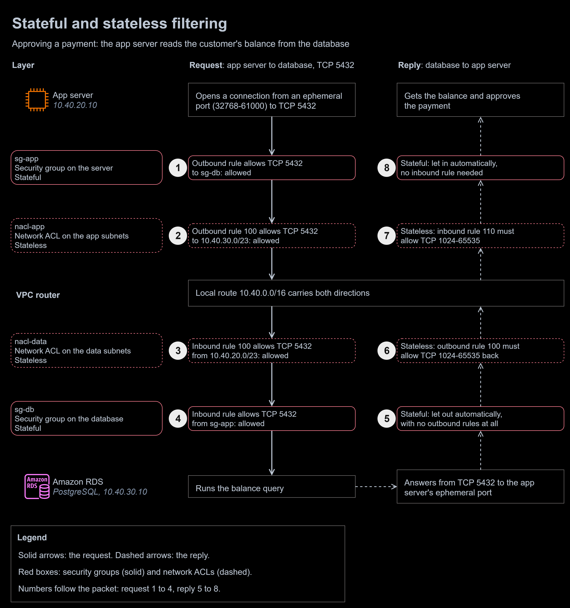

# 06 | Security Groups and Network ACLs

**Exercise date:** 12 March 2026 | **Type:** design exercise, no AWS resources | **Status:** rebuilt as a tested filter checker

**At a glance**

- **Outcome:** least-privilege security groups and a custom network ACL for every tier of the [module 04](../04-public-private-subnets/) VPC, proven to let each required connection through in both directions and to stop everything else.
- **Built:** `filter_check.py` (tables, trace, audit), a fixed and an as-found design, and a diagram of stateful and stateless filtering.
- **Stack:** Python 3 (standard library only), JSON, unittest, GitHub Actions.
- **Proof:** 25 unit tests and two design audits pass in CI on every push.



To zoom in, right-click the diagram and open the image in a new tab. The editable source is [`diagrams/stateful-stateless.drawio`](diagrams/stateful-stateless.drawio).

1. **sg-app**, the app server's security group, allows the query out: TCP 5432 to `sg-db`.
2. **nacl-app**, on the app subnets, allows it out of the subnet with rule 100.
3. **nacl-data**, on the data subnets, allows it in with rule 100.
4. **sg-db** allows it in: TCP 5432 from `sg-app`.
5. The reply leaves the database: **sg-db** is stateful, so it passes without any outbound rule.
6. **nacl-data** is stateless, so its outbound rule 100 must allow the reply to the app server's ephemeral ports.
7. **nacl-app** must allow the reply back in with rule 110, for the same reason.
8. **sg-app** lets the reply in automatically: it remembers the request.

## The task, in my own words

A bank's three-tier VPC has security group and network ACL faults: a database open to the whole internet, a web tier open on every port, missing outbound rules, network ACLs that drop replies or allow everything, and an app tier that cannot reach its database. For ten such faults, name the flaw and which layer causes it, write a least-privilege rule set, and explain the risk for a bank. Then compare stateful and stateless filtering with a payment example, showing how each handles return traffic, and map every fault to its financial, regulatory and reputational impact.

## What I did in the exercise

- Wrote a 20-slide document: problem statement, the ten scenarios (flaw, layer, redesign, traffic flow, risk), a stateful versus stateless comparison with a payment example, default deny, a risk impact table and a conclusion.
- Got the core ideas right: security groups are stateful and network ACLs stateless, replies through a network ACL need the ephemeral ports, rules should name the next tier's security group, and a correct security group can still be undone by a network ACL.
- Several redesigns and two of the principles needed correcting. They are under [Mistakes I fixed](#mistakes-i-fixed).

## The rebuilt solution

[`filter_check.py`](filter_check.py) reads a VPC described in JSON and applies AWS's filtering rules, so it can trace any TCP connection check by check, request then reply, and audit a design for the faults in this exercise. It needs nothing beyond Python's standard library. It follows AWS's documented behaviour:

- a security group is stateful: if a request is allowed, its reply is allowed back without any rule;
- a network ACL is stateless: the reply is a new packet and needs a rule for the client's ephemeral ports;
- network ACL rules are evaluated lowest number first, the first match decides, and the `*` rule denies whatever is left;
- network ACLs filter traffic entering and leaving a subnet, not traffic within one;
- a NAT gateway has no security group, but the network ACL on its subnet applies in both directions.

Ephemeral ranges follow the client, as AWS documents them: Linux 32768-61000, Windows Server 2008 and later 49152-65535, load balancers, NAT gateways and Lambda 1024-65535. For clients on the internet the tool assumes 1024-65535, the range AWS recommends opening. Routing is [module 05](../05-route-tables/); this tool checks the filters only.

```console
$ python filter_check.py tables examples/bank-filters.json   # Markdown rule tables, as below
$ python filter_check.py trace examples/bank-filters.json app-a db-a 5432
$ python filter_check.py audit examples/as-found.json        # exit code 1 on any critical or high finding
```

### The rule sets

The design is module 04's VPC `10.40.0.0/16`: a public tier for the load balancer and NAT gateways, then web, app and data tiers, each in two Availability Zones. Module 04 left three tiers on the default network ACL; here every tier gets its own. Security groups do the fine-grained work: every rule names one port and, inside the VPC, the next tier's security group rather than an address range. Network ACLs are the coarse, subnet-level guardrail, with replies allowed explicitly. These tables are printed by the tool from [`examples/bank-filters.json`](examples/bank-filters.json):

| Security group | Attached to | Inbound | Outbound |
|---|---|---|---|
| `sg-alb` | alb-a | TCP 443 from 0.0.0.0/0 | TCP 443 to sg-web |
| `sg-web` | web-a | TCP 443 from sg-alb | TCP 8080 to sg-app |
| `sg-app` | app-a | TCP 8080 from sg-web | TCP 5432 to sg-db; TCP 443 to 0.0.0.0/0 |
| `sg-db` | db-a | TCP 5432 from sg-app | none |

**`nacl-public`** (public-a, public-b)

| Rule | Direction | Protocol | Ports | Source or destination | Action | Purpose |
|---:|---|---|---|---|---|---|
| 100 | Inbound | TCP | 443 | `0.0.0.0/0` | Allow | Customers to the load balancer; app servers' HTTPS calls on their way to the NAT gateways |
| 110 | Inbound | TCP | 1024-65535 | `0.0.0.0/0` | Allow | Replies: from the internet to the NAT gateways, and from the web servers to the load balancer |
| * | Inbound | All | All | `0.0.0.0/0` | Deny | Everything else |
| 100 | Outbound | TCP | 443 | `0.0.0.0/0` | Allow | Load balancer to the web servers; NAT gateways to the internet |
| 110 | Outbound | TCP | 1024-65535 | `0.0.0.0/0` | Allow | Replies to customers, and from the NAT gateways back to the app servers |
| * | Outbound | All | All | `0.0.0.0/0` | Deny | Everything else |

**`nacl-web`** (web-a, web-b)

| Rule | Direction | Protocol | Ports | Source or destination | Action | Purpose |
|---:|---|---|---|---|---|---|
| 100 | Inbound | TCP | 443 | `10.40.0.0/23` | Allow | From the load balancer |
| 110 | Inbound | TCP | 1024-65535 | `10.40.20.0/23` | Allow | Replies from the app servers |
| * | Inbound | All | All | `0.0.0.0/0` | Deny | Everything else |
| 100 | Outbound | TCP | 8080 | `10.40.20.0/23` | Allow | To the app servers |
| 110 | Outbound | TCP | 1024-65535 | `10.40.0.0/23` | Allow | Replies to the load balancer |
| * | Outbound | All | All | `0.0.0.0/0` | Deny | Everything else |

**`nacl-app`** (app-a, app-b)

| Rule | Direction | Protocol | Ports | Source or destination | Action | Purpose |
|---:|---|---|---|---|---|---|
| 100 | Inbound | TCP | 8080 | `10.40.10.0/23` | Allow | From the web servers |
| 110 | Inbound | TCP | 1024-65535 | `0.0.0.0/0` | Allow | Replies from the database, and from the payment provider through the NAT gateways |
| * | Inbound | All | All | `0.0.0.0/0` | Deny | Everything else |
| 100 | Outbound | TCP | 5432 | `10.40.30.0/23` | Allow | To the database |
| 110 | Outbound | TCP | 443 | `0.0.0.0/0` | Allow | To the payment provider, through the NAT gateways |
| 120 | Outbound | TCP | 1024-65535 | `10.40.10.0/23` | Allow | Replies to the web servers |
| * | Outbound | All | All | `0.0.0.0/0` | Deny | Everything else |

**`nacl-data`** (data-a, data-b)

| Rule | Direction | Protocol | Ports | Source or destination | Action | Purpose |
|---:|---|---|---|---|---|---|
| 100 | Inbound | TCP | 5432 | `10.40.20.0/23` | Allow | From the app servers |
| 110 | Inbound | All | All | `10.40.30.0/23` | Allow | Between the primary and the standby (Multi-AZ replication) |
| * | Inbound | All | All | `0.0.0.0/0` | Deny | Everything else |
| 100 | Outbound | TCP | 1024-65535 | `10.40.20.0/23` | Allow | Replies to the app servers |
| 110 | Outbound | All | All | `10.40.30.0/23` | Allow | Between the primary and the standby |
| * | Outbound | All | All | `0.0.0.0/0` | Deny | Everything else |

### Stateful versus stateless, with a payment

A customer's browser sends a payment to the load balancer on TCP 443 from an ephemeral port, say 51234.

- **The security group is stateful.** `sg-alb` admits TCP 443 from anywhere. AWS tracks the connection, so the "payment accepted" reply goes back to port 51234 with no outbound rule at all.
- **The network ACL is stateless.** `nacl-public` admits TCP 443 with inbound rule 100, but keeps no record of it. The reply is just another packet leaving the subnet, so outbound rule 110 must allow TCP 1024-65535. Without it, the customer sees a timeout, not an error, which makes the fault hard to find.

The same difference inside the VPC, when the app server reads the balance before approving the payment. Every check, in order:

```console
$ python filter_check.py trace examples/bank-filters.json app-a db-a 5432
app-a -> db-a tcp/5432: allowed
  request  sg-app       outbound  allow  TCP 5432 to sg-db
  request  nacl-app     outbound  allow  rule 100: TCP 5432 to 10.40.30.0/23
  request  nacl-data    inbound   allow  rule 100: TCP 5432 from 10.40.20.0/23
  request  sg-db        inbound   allow  TCP 5432 from sg-app
  reply    sg-db        outbound  allow  stateful: the reply to an allowed request is allowed
  reply    nacl-data    outbound  allow  rule 100: TCP 1024-65535 to 10.40.20.0/23 (covers 32768-61000)
  reply    nacl-app     inbound   allow  rule 110: TCP 1024-65535 from 0.0.0.0/0 (covers 32768-61000)
  reply    sg-app       inbound   allow  stateful: the reply to an allowed request is allowed
  app-a reaches db-a on TCP 5432, and the replies get back
```

Calls out to the payment provider cross two network ACLs each way, because the NAT gateway sits in the public subnet:

```console
$ python filter_check.py trace examples/bank-filters.json app-a internet 443
app-a -> internet tcp/443: allowed
  request  sg-app       outbound  allow  TCP 443 to 0.0.0.0/0
  request  nacl-app     outbound  allow  rule 110: TCP 443 to 0.0.0.0/0
  request  nacl-public  inbound   allow  rule 100: TCP 443 from 0.0.0.0/0
  request  nacl-public  outbound  allow  rule 100: TCP 443 to 0.0.0.0/0
  reply    nacl-public  inbound   allow  rule 110: TCP 1024-65535 from 0.0.0.0/0 (covers 1024-65535)
  reply    nacl-public  outbound  allow  rule 110: TCP 1024-65535 to 0.0.0.0/0 (covers 32768-61000)
  reply    nacl-app     inbound   allow  rule 110: TCP 1024-65535 from 0.0.0.0/0 (covers 32768-61000)
  reply    sg-app       inbound   allow  stateful: the reply to an allowed request is allowed
  app-a reaches internet on TCP 443, and the replies get back
```

And the web tier cannot reach the database at all. Four independent layers each stop it:

```console
$ python filter_check.py trace examples/bank-filters.json web-a db-a 5432
web-a -> db-a tcp/5432: blocked
  request  sg-web       outbound  DENY   no outbound rule for TCP 5432 to 10.40.30.10
  request  nacl-web     outbound  DENY   TCP 5432 to 10.40.30.10 is denied by the * rule
  request  nacl-data    inbound   DENY   TCP 5432 from 10.40.10.10 is denied by the * rule
  request  sg-db        inbound   DENY   no inbound rule for TCP 5432 from 10.40.10.10
  blocked at sg-web outbound (request): no outbound rule for TCP 5432 to 10.40.30.10
```

### The as-found design

[`examples/as-found.json`](examples/as-found.json) combines several of the exercise's faults, the way they usually arrive together: every private subnet on the default network ACL, the database open to `0.0.0.0/0`, the web tier open on every port, the app tier open on every port to the web tier, and the default allow-all outbound rules left in place.

```console
$ python filter_check.py audit examples/as-found.json
as-found.json: 11 findings (7 critical, 2 high, 2 medium)
  CRITICAL flow-not-blocked            db-a -> internet tcp/443
           db-a reaches internet on TCP 443, and the replies get back
  CRITICAL flow-not-blocked            internet -> db-a tcp/5432
           internet reaches db-a on TCP 5432, and the replies get back
  CRITICAL flow-not-blocked            internet -> web-a tcp/443
           internet reaches web-a on TCP 443, and the replies get back
  CRITICAL flow-not-blocked            web-a -> app-a tcp/22
           web-a reaches app-a on TCP 22, and the replies get back
  CRITICAL flow-not-blocked            web-a -> db-a tcp/5432
           web-a reaches db-a on TCP 5432, and the replies get back
  CRITICAL sg-all-ports                sg-web
           sg-web admits all traffic from 0.0.0.0/0: least privilege means one port per purpose
  CRITICAL sg-inbound-from-anywhere    sg-db
           sg-db admits TCP 5432 from 0.0.0.0/0 on a data tier, which only its neighbouring tier should reach
  HIGH     sg-all-ports                sg-app
           sg-app admits all traffic from sg-web: least privilege means one port per purpose
  HIGH     sg-inbound-from-anywhere    sg-web
           sg-web admits all traffic from 0.0.0.0/0 on a web tier, which only its neighbouring tier should reach
  MEDIUM   data-tier-egress            sg-db
           sg-db lets the database open connections to 0.0.0.0/0: a ready path for stolen data. A database needs no outbound rule to answer queries
  MEDIUM   nacl-allows-all             default
           web-a, web-b, app-a, app-b, data-a, data-b use default, which allows all inbound traffic: no subnet-level guardrail if a security group is wrong
```

The fixed design returns `bank-filters.json: 0 findings`.

### The ten scenarios

Each row has unit tests named after its number in [`test_filter_check.py`](test_filter_check.py): they start from the fixed design, break it the way the scenario describes, and check both the finding and the layer that stops the traffic.

| # | Scenario | Layer | What actually happens | Least-privilege fix | Risk for a bank |
|---|---|---|---|---|---|
| 1 | Database security group allows `0.0.0.0/0` inbound | Security group | Anything that can route to the database can try its port: every instance in the VPC, peered networks, on-premises over a VPN, and the internet too if the database also has a public address and route | `sg-db` admits TCP 5432 from `sg-app` only. In this design `nacl-data` still stops everything except the app subnets | Credential guessing and attacks on the database engine; theft of customer data |
| 2 | Web security group blocks outbound traffic | Security group | Web servers cannot open connections to the app tier. They still answer the load balancer, because replies to allowed requests need no outbound rule | `sg-web` allows TCP 8080 out to `sg-app`, and nothing else | Pages load but every transaction fails |
| 3 | Network ACL denies the ephemeral ports | Network ACL | Requests leave, replies are dropped at the subnet boundary: calls to the database and the payment provider time out | Inbound rule 110 on `nacl-app` allows TCP 1024-65535; the NAT gateway's subnet allows replies both ways | Payments hang and time out, then customers retry |
| 4 | App security group allows all ports | Security group | A compromised web server can probe every port on the app servers, including SSH | `sg-app` admits TCP 8080 from `sg-web` only. Here `nacl-web` and `nacl-app` still stop other ports | Lateral movement towards the systems that move money |
| 5 | Database has no outbound rule | Neither: this is correct | The database answers queries anyway, because its security group is stateful. With no outbound rules it cannot open a connection to anything, which blocks data theft and reverse shells | Keep `sg-db` with no outbound rules. Amazon RDS is patched by AWS; a self-managed database is patched through VPC endpoints, without internet access | None. Adding an outbound rule to `0.0.0.0/0` would create the risk |
| 6 | Web tier open to all ports | Security group | Every service on the web servers is reachable by anything that can route to them | `sg-web` admits TCP 443 from `sg-alb` only, and the web servers have no public addresses (module 04) | Server takeover, phishing pages served from the bank's own servers |
| 7 | Network ACL allows all traffic | Network ACL | Security groups become the only filter, so a single wrong rule exposes a tier | A custom network ACL per tier that allows only that tier's traffic and its replies | One mistake away from a breach, with nothing to catch it |
| 8 | The bank blocks port 443 | Either | Inbound: customers cannot reach the load balancer, so every channel is down. Outbound from the app tier: payment providers and AWS service APIs, all HTTPS, become unreachable | Allow TCP 443 in `nacl-public` rule 100 and `sg-alb`, and out of the app tier in `nacl-app` rule 110 and `sg-app` | Total outage. The dangerous workaround is reopening port 80, which sends card data unencrypted |
| 9 | App cannot reach the database | Security group or network ACL | The request or its reply is dropped at one of four layers; the trace names which | `sg-app` out and `sg-db` in on TCP 5432; `nacl-app` and `nacl-data` allow the request and its replies | The front end works, but no balance or payment can be read |
| 10 | Security groups correct, network ACL blocks | Network ACL | The security groups allow the connection, but a network ACL rule (here, port 3306 instead of 5432) drops it before it reaches them | Write network ACL rules from the same port list as the security groups, and test both together | A hard-to-find outage, and false confidence that the security groups are the whole story |

### Risk for a bank

| # | Financial | Regulatory | Reputational |
|---|---|---|---|
| 1 | Fraud and theft of funds through altered records; ransom; incident costs | PCI DSS v4.0.1 Requirement 1.3.1 (inbound traffic to the cardholder data environment limited to what is necessary) and 1.4.4 (stored card data not directly accessible from untrusted networks); a reportable breach under the Nigeria Data Protection Act 2023 | Severe and lasting: customers and partners leave |
| 2 | Lost transactions for the length of the outage | No direct breach | Customers see the bank as unreliable |
| 3 | Failed and duplicated payments to reconcile | No direct breach | Frustrated customers, support load |
| 4 | Higher chance of a deep compromise | PCI DSS 1.3.1 and 1.3.2 (traffic into and out of the cardholder data environment limited to what is necessary) | Severe if exploited |
| 5 | None | None | None |
| 6 | Fraud through phishing hosted on the bank's own servers | PCI DSS 1.3.1 | Severe: phishing under the bank's own name |
| 7 | None directly; raises the cost of any later mistake | Weakens the defence in depth that PCI DSS Requirement 1 is built on | None until a breach |
| 8 | All digital revenue for the outage | None if it is fixed properly; serving card data over plain HTTP instead would breach PCI DSS 4.2.1 (strong cryptography over open, public networks) | Severe: the bank appears offline |
| 9 | Lost transactions | No direct breach | High: the site works but nothing in it does |
| 10 | Lost transactions while the fault is hunted | No direct breach | Moderate |

Under the Nigeria Data Protection Act 2023, a breach likely to put people at risk must be reported to the Nigeria Data Protection Commission within 72 hours (section 40), and fines for a data controller of major importance can reach the greater of ₦10 million or 2% of its annual gross revenue from Nigeria (section 48). No network rule meets a regulation by itself; the rows above name the requirements each fault works against.

### How it is tested

Twenty-five unit tests in [`test_filter_check.py`](test_filter_check.py) cover AWS's rules (first match wins, the `*` rule, the default and new custom network ACLs, no network ACL inside a subnet, ephemeral ranges by client, security group references, the NAT gateway's subnet, invalid rules refused), the fixed design, each of the ten scenarios and the as-found audit. The [`python` workflow](../.github/workflows/python.yml) runs them on every push, then audits both example designs.

```console
$ python -m unittest discover -s 06-security-groups-nacls
Ran 25 tests in 0.037s
OK
```

## Mistakes I fixed

Two habits from earlier modules showed up again and are fixed the same way: packets moving "through the switch to the DR (Default Router)" ([module 05](../05-route-tables/README.md#mistakes-i-fixed): a VPC has no switch; security groups act at each network interface, network ACLs at the subnet boundary), and regulatory overclaims ([module 04](../04-public-private-subnets/README.md#mistakes-i-fixed)). The mistakes specific to this exercise:

1. **Scenario 5 is not a flaw.** I treated a database with no outbound rule as broken and added HTTPS to `0.0.0.0/0` "for patches". Security groups are stateful, so the database answers queries with no outbound rule at all, and having none stops a compromised database from sending data out. Amazon RDS is patched by AWS; a self-managed database gets patches through VPC endpoints. My fix created the exfiltration path it was meant to prevent; a test now proves both points.
2. **"Both layers operate on a default deny principle for inbound traffic."** A new security group denies inbound traffic but allows all outbound. The default network ACL allows everything both ways (rule 100); only a new custom network ACL starts by denying everything. Every network ACL ends with the `*` rule that denies what no other rule matched.
3. **Who can use a rule open to `0.0.0.0/0`** (scenario 1). I traced the attack from the internet straight to the database. From the internet it also takes a route and a public address (module 05). The wider risk is inside: every compromised instance in the VPC, and every connected network, can reach that port.
4. **Ephemeral rules "to and from the associated subnets"** (scenario 3). Replies from the payment provider come from the provider's address, not a subnet, and the NAT gateway's subnet needs rules both ways too. The range must also match the client: AWS's own example network ACL opens 32768-65535, which drops replies to a load balancer, since it uses 1024-65535. A test reproduces that.
5. **A blocklist in the network ACL** (scenario 7). I suggested denying known malicious address ranges with low rule numbers. A network ACL holds 20 rules per direction by default and 40 at most, so it cannot hold a real blocklist. That belongs in AWS WAF on the load balancer or AWS Network Firewall; network ACLs stay coarse, one set per tier.
6. **Blocking port 443 called an encryption violation** (scenario 8). Blocking HTTPS causes an outage, not an encryption breach. The breach would come from the workaround: reopening port 80 sends card data in clear text, against PCI DSS 4.2.1. I also covered only inbound; blocking 443 out of the app tier cuts off the payment provider and AWS's own APIs.
7. **The web tier in a public subnet** (scenario 6). My trace sent attackers' packets to web servers in the public subnet. In this design the web servers sit in private subnets behind the load balancer, and `sg-web` admits only HTTPS from `sg-alb`; plain HTTP on port 80 is not needed between them.
8. **"Revocation of banking license"** in the risk table, with "total violation (PCI-DSS, GDPR)". The table now names the PCI DSS v4.0.1 requirements each fault works against and the Nigeria Data Protection Act sections, and no longer claims outcomes I cannot source.

## Design vs production

| Concern | In this design | Before going to production | Well-Architected pillar |
|---|---|---|---|
| Catching rule mistakes | `filter_check.py` audits the JSON model in CI | Planned: build the model from the Terraform plan (modules 12 and 13), together with the routing checker from module 05 | Operational Excellence, Security |
| Drift on the live account | Not covered | AWS Config rules `vpc-sg-open-only-to-authorized-ports`, `vpc-default-security-group-closed` and `nacl-no-unrestricted-ssh-rdp`; AWS Firewall Manager to apply security group policies across accounts | Security |
| Finding which layer blocks | The tool's trace | VPC Reachability Analyzer names the blocking component in the deployed VPC; VPC Flow Logs record each `REJECT` | Operational Excellence |
| Blocklists and attack traffic | None | AWS WAF on the load balancer (managed rule groups, rate-based rules, IP sets) instead of network ACL deny rules | Security |
| Outbound control | `sg-app` allows HTTPS to any address | AWS Network Firewall allowing only the payment provider's domains (module 09) | Security |
| Administrator access | No port 22 anywhere | AWS Systems Manager Session Manager: no SSH rules and no bastion host | Security |
| Rule growth | 4 security groups, 4 network ACLs with at most 3 rules per direction | Security group references scale as instances come and go; network ACLs stay well under the 20-rule quota | Performance Efficiency |
| Logging cost | Not covered | Flow logs to Amazon S3, rejected traffic only where that is enough, with lifecycle rules to cheaper storage | Cost Optimization |
| Data kept | Not covered | Flow logs kept only as long as the retention policy requires, then expired | Sustainability |

## What I learned

- A security group remembers a connection; a network ACL does not. Every network ACL rule that lets a request in needs a partner rule that lets its reply out, on the client's ephemeral ports.
- A database with no outbound rules is the goal, not a fault.
- Security groups do the fine-grained work and network ACLs the coarse guardrail. Neither is enough alone: in this design, four independent layers stop the web tier reaching the database.
- Test the two layers together. A correct security group proves nothing if a network ACL drops the packet first.

## Sources

- [Security groups](https://docs.aws.amazon.com/vpc/latest/userguide/vpc-security-groups.html) and [network ACLs](https://docs.aws.amazon.com/vpc/latest/userguide/vpc-network-acls.html) in the Amazon VPC User Guide
- [Default network ACL](https://docs.aws.amazon.com/vpc/latest/userguide/default-network-acl.html), [network ACL rules](https://docs.aws.amazon.com/vpc/latest/userguide/nacl-rules.html) and [custom network ACLs and ephemeral ports](https://docs.aws.amazon.com/vpc/latest/userguide/custom-network-acl.html)
- [Amazon VPC quotas](https://docs.aws.amazon.com/vpc/latest/userguide/amazon-vpc-limits.html) (rules per network ACL and per security group)
- [VPC Reachability Analyzer](https://docs.aws.amazon.com/vpc/latest/reachability/what-is-reachability-analyzer.html)
- AWS Config rules [vpc-sg-open-only-to-authorized-ports](https://docs.aws.amazon.com/config/latest/developerguide/vpc-sg-open-only-to-authorized-ports.html), [vpc-default-security-group-closed](https://docs.aws.amazon.com/config/latest/developerguide/vpc-default-security-group-closed.html) and [nacl-no-unrestricted-ssh-rdp](https://docs.aws.amazon.com/config/latest/developerguide/nacl-no-unrestricted-ssh-rdp.html)
- PCI DSS v4.0.1, Requirements 1.3.1, 1.3.2, 1.4.4 and 4.2.1: [PCI Security Standards Council document library](https://www.pcisecuritystandards.org/document_library/)
- Nigeria Data Protection Act 2023, sections 40 and 48: [Nigeria Data Protection Commission](https://ndpc.gov.ng/)
