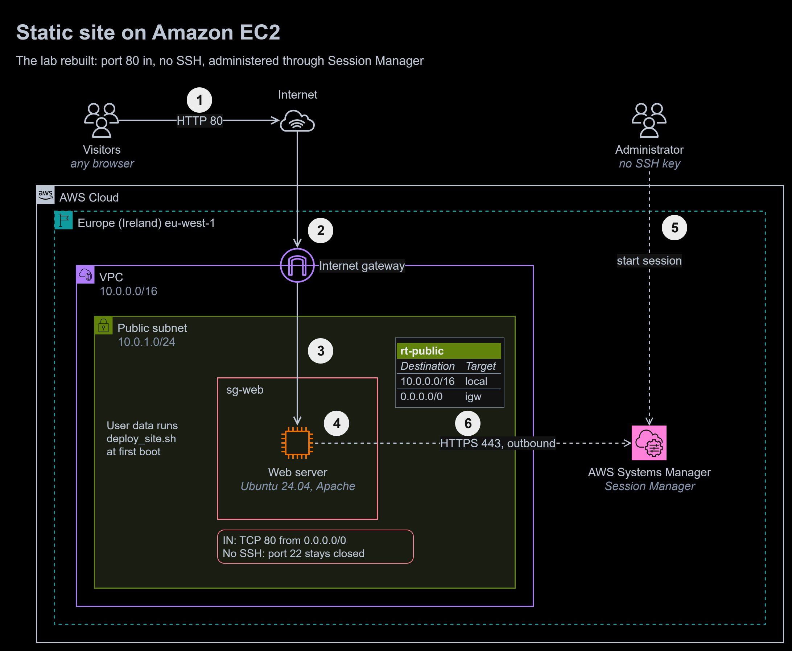

# 07 | EC2 Web Server

**Exercise date:** 13 March 2026 | **Type:** hands-on lab in a training account | **Status:** rebuilt as a tested deploy script

**At a glance**

- **Outcome:** a deploy script that publishes a static site with Apache on Ubuntu and fixes the fault that stopped my lab: another web server already holding port 80. It is safe to run again and is written to run as EC2 user data.
- **Built:** `deploy_site.sh`, an original page to serve, 8 end-to-end tests, and a diagram of the rebuilt instance.
- **Stack:** Bash, Apache 2.4, Ubuntu 24.04, systemd, EC2 user data, ShellCheck, GitHub Actions.
- **Proof:** the 8 tests run on GitHub's Ubuntu 24.04 runner on every push. They recreate the lab's failure, then show the script fixing it.



To zoom in, right-click the diagram and open the image in a new tab. The editable source is [`diagrams/ec2-web-server.drawio`](diagrams/ec2-web-server.drawio).

1. A visitor's browser requests the page over HTTP on port 80.
2. The **internet gateway** translates the instance's public IPv4 address to its private address and back. `rt-public` sends replies for the internet through it.
3. **`sg-web`** admits TCP 80 only. No rule opens port 22.
4. **Apache** serves `/var/www/html`, which `deploy_site.sh` published when it ran as user data at first boot.
5. The **administrator** starts a Session Manager session from the console or the AWS CLI: no SSH key and no open inbound port.
6. The **SSM Agent** on the instance connects out to Systems Manager on HTTPS 443, and the session travels over that connection. The instance needs an instance profile with the `AmazonSSMManagedInstanceCore` policy. Ubuntu 24.04 AMIs ship with the agent installed.

## The task, in my own words

Launch a Linux instance in a public subnet, install a web server on it, publish a free website template, and show that the site loads in a browser from the internet. Document the steps, the network and security settings, and the architecture.

## What I did in the lab

- Launched an Ubuntu 24.04.3 LTS instance in a public subnet in eu-west-1 and connected to it with EC2 Instance Connect from the console.
- Installed Apache and published the "Paradigm Shift" template by [HTML5 UP](https://html5up.net/), unchanged. HTML5 UP templates are licensed under [Creative Commons Attribution 3.0](https://html5up.net/license); the design is theirs and is not included in this repository.
- Submitted a 12-page write-up with screenshots, a browser test and an architecture diagram.
- Got the site working, but by trial and error. The session, redacted: the prompt is shortened, addresses are removed and the apt output is trimmed.

```console
ubuntu@web:~$ sudo yum install httpd -y
sudo: yum: command not found
ubuntu@web:~$ sudo install httpd -y
install: invalid option -- 'y'
Try 'install --help' for more information.
ubuntu@web:~$ sudo yum install httpd -y
sudo: yum: command not found
ubuntu@web:~$ sudo apt install apache2 -y
Reading package lists... Done
[apt output trimmed]
ubuntu@web:~$ sudo systemctl start apache2
Job for apache2.service failed because the control process exited with error code.
See "systemctl status apache2.service" and "journalctl -xeu apache2.service" for details.
ubuntu@web:~$ sudo systemctl start apache2
Job for apache2.service failed because the control process exited with error code.
See "systemctl status apache2.service" and "journalctl -xeu apache2.service" for details.
ubuntu@web:~$ sudo systemctl stop nginx
ubuntu@web:~$ sudo systemctl start apache2
ubuntu@web:~$ sudo systemctl enable apache2
Synchronizing state of apache2.service with SysV service script with /usr/lib/systemd/systemd-sysv-install.
Executing: /usr/lib/systemd/systemd-sysv-install enable apache2
ubuntu@web:~$ sudo nano /var/www/html/index.html
ubuntu@web:~$ sudo chown -R ec2-user:apache2 /var/www/html/
chown: invalid user: ‘ec2-user:apache2’
ubuntu@web:~$ sudo chown -R ubuntu:apache2 /var/www/html/
chown: invalid group: ‘ubuntu:apache2’
ubuntu@web:~$ sudo chown -R ubuntu:apache /var/www/html/
chown: invalid group: ‘ubuntu:apache’
ubuntu@web:~$ sudo chown -R ubuntu:www-data /var/www/html/
ubuntu@web:~$ sudo chmod -R 755 /var/www/html/
ubuntu@web:~$ sudo systemctl restart httpd
Failed to restart httpd.service: Unit httpd.service not found.
ubuntu@web:~$ sudo systemctl restart apache2
```

Apache would not start because nginx, already installed and running on the instance, held port 80. Stopping nginx fixed it for that session. Most of the other errors come from one cause, Amazon Linux commands typed on Ubuntu. Both are under [Mistakes I fixed](#mistakes-i-fixed).

## The rebuilt solution

[`scripts/deploy_site.sh`](scripts/deploy_site.sh) does what the session above did by hand, in the right order, and checks its own result:

1. **Frees port 80 first.** `ss` names the process holding the port. A known web server (nginx, lighttpd, caddy, httpd) is stopped **and disabled**, so it cannot take the port back at the next boot. Anything else is left running, and the script stops with exit code 3 and names it.
2. **Installs Apache** with `apt-get`, only if it is missing.
3. **Publishes the site read-only:** owned by root, directories 755, files 644. Apache runs as `www-data` and only needs to read.
4. **Checks the configuration** with `apache2ctl -t`, then enables, starts and reloads Apache, so a typo cannot take a running site down.
5. **Proves the page is served:** it fetches `http://127.0.0.1/` and looks for the page title before it reports success.

Exit codes: 0 site live, 1 runtime error, 2 usage error or not Ubuntu, 3 port 80 held by a process the script will not stop. [`site/index.html`](site/index.html) is an original page that replaces the template.

The lab's starting point, nginx on port 80 and Apache not yet installed, then a second run:

```console
$ sudo bash scripts/deploy_site.sh site
deploy: port 80 is held by nginx: stopping and disabling it
deploy: installing apache2
deploy: publishing site to /var/www/html
deploy: site is live: http://127.0.0.1/ serves "Static site on Amazon EC2"
$ sudo bash scripts/deploy_site.sh site      # again: nothing to retire or install
deploy: publishing site to /var/www/html
deploy: site is live: http://127.0.0.1/ serves "Static site on Amazon EC2"
```

### Running it as user data

User data scripts run once, as root, at the first boot, and their output goes to `/var/log/cloud-init-output.log`. User data is limited to 16 KB, so it fetches the site rather than carrying it:

```bash
#!/bin/bash
# EC2 user data: runs once, as root, at first boot. Output: /var/log/cloud-init-output.log
set -euo pipefail
git clone --depth 1 https://github.com/ooseni/TESA-Cloud-Engineering.git /opt/site-src
bash /opt/site-src/07-ec2-web-server/scripts/deploy_site.sh /opt/site-src/07-ec2-web-server/site
```

This rebuild was not run on AWS, to keep it at no cost. The tests run the same script on the same Ubuntu release. In production the site would be baked into an image instead of cloned at boot (see [Design vs production](#design-vs-production)).

### Amazon Linux 2023 and Ubuntu 24.04 side by side

The lab instance ran Ubuntu, but most commands I tried were Amazon Linux commands:

| | Amazon Linux 2023 | Ubuntu 24.04 |
|---|---|---|
| Package manager | `dnf` (`yum` still works) | `apt` |
| Apache package and service | `httpd` | `apache2` |
| Apache user and group | `apache` | `www-data` |
| Default login user | `ec2-user` | `ubuntu` |
| Main configuration file | `/etc/httpd/conf/httpd.conf` | `/etc/apache2/apache2.conf` |
| Logs | `/var/log/httpd/` | `/var/log/apache2/` |
| Document root | `/var/www/html` | `/var/www/html` |

### When Apache will not start, read the logs first

The error message in the lab named the two commands that explain it. The third shows who holds the port:

```console
$ sudo systemctl status apache2 --no-pager     # state and the last log lines
$ sudo journalctl -xeu apache2                  # the full reason
$ sudo ss -ltnp 'sport = :80'                   # which process holds port 80
```

In the lab they would have shown this line, the one the first test reproduces:

```console
(98)Address already in use: AH00072: make_sock: could not bind to address 0.0.0.0:80
```

### How it is tested

[`tests/deploy_site_test.sh`](tests/deploy_site_test.sh) installs packages and stops services, so it refuses to run unless `ALLOW_SYSTEM_CHANGES=1` is set, it is root, and systemd is running. It sets up the lab's starting point (nginx running on port 80, Apache stopped), then checks that:

1. Apache fails to start while nginx holds port 80, with the same error as the lab;
2. the script retires nginx and publishes the site;
3. nginx is stopped **and disabled**, and Apache is active and enabled;
4. `http://127.0.0.1/` serves the page;
5. the document root is owned by root, directories 755 and files 644;
6. a second run succeeds and changes nothing;
7. an unknown process on port 80 is left running, and the script stops with exit code 3 and names it;
8. a missing site folder is a usage error, exit code 2.

The [`shell` workflow](../.github/workflows/shell.yml) runs them on GitHub's Ubuntu 24.04 runner on every push, after ShellCheck. Locally they run in a disposable Ubuntu 24.04 container with systemd:

```console
$ sudo ALLOW_SYSTEM_CHANGES=1 bash tests/deploy_site_test.sh
ok 1 - apache2 fails to start while nginx holds port 80, as in the lab: (98)Address already in use: AH00072: make_sock: could not bind to address 0.0.0.0:80
ok 2 - deploy_site.sh retires nginx and publishes the site
ok 3 - nginx is stopped and disabled; apache2 is active and enabled
ok 4 - http://127.0.0.1/ serves the page
ok 5 - the document root is owned by root, directories 755, files 644
ok 6 - a second run succeeds without changes
ok 7 - an unknown process on port 80 stops the script with exit code 3, and is left running
ok 8 - a missing site folder is a usage error (exit 2)
all 8 tests passed
```

## Mistakes I fixed

1. **Amazon Linux commands on Ubuntu.** `yum`, `httpd`, `ec2-user` and the `apache` group are Amazon Linux names, and `apache2` is Ubuntu's package and service but not a group. Between them they caused six failed commands. The table above maps them, and the script refuses to run where `apt-get` is missing, naming the Amazon Linux package instead.
2. **`sudo install httpd -y`.** `install` is not a package manager: it is the coreutils command that copies files and sets their modes. The script uses it for that purpose, to create the document root with the right owner and mode.
3. **Guessing instead of reading the logs.** I ran the same failing start twice, although the error named `systemctl status` and `journalctl -xeu`. Either would have shown `Address already in use` straight away.
4. **`systemctl stop nginx` lasts only until the next reboot.** nginx stayed enabled, so after a restart both servers would race for port 80 again. The script uses `systemctl disable --now`, and test 3 checks that nginx is disabled, not just stopped.
5. **Permissions.** `chmod -R 755` made every file executable, which no web page needs, and `ubuntu:www-data` left the site writable by the login user. Now root owns the site, with directories 755 and files 644: Apache can read it, and only the deploy can change it.
6. **Access and transport.** EC2 Instance Connect from the console needs port 22 open to the service's address range (`com.amazonaws.eu-west-1.ec2-instance-connect`). Session Manager needs no inbound port, no key and no bastion host, and it can log every session. The site was also served over plain HTTP; production uses HTTPS (see below).
7. **The template as the deliverable, and screenshots that exposed too much.** The write-up presented a downloaded template as the result, and its screenshots showed the account ID, my IAM user name, the instance's public address and other students' instances. Here the page is original, the template is credited, and the evidence is a redacted transcript.
8. **The architecture diagram.** It drew a "default router" as a device and a private subnet that nothing used. A VPC has no router to deploy: routing is the route table, applied by AWS. The diagram above shows only what the site needs.
9. **"Guarantee global browser access".** One instance in one Availability Zone guarantees nothing. Amazon EC2's instance-level SLA is 99.5% uptime per instance; the 99.99% Region-level SLA applies only to instances running in two or more Availability Zones.

## Design vs production

| Concern | In this rebuild | Before going to production | Well-Architected pillar |
|---|---|---|---|
| Encryption in transit | HTTP on port 80 | HTTPS with an AWS Certificate Manager certificate on an Application Load Balancer, or Amazon CloudFront in front | Security |
| Administrator access | Session Manager, no port 22 | Session Manager with sessions logged to CloudWatch Logs or S3, and access granted through IAM | Security |
| Instance metadata | Not covered | IMDSv2 required, so a request forgery bug cannot read the instance's credentials | Security |
| Availability | One instance in one Availability Zone | An Auto Scaling group across two Availability Zones behind an Application Load Balancer, with health checks | Reliability |
| Building the server | User data clones the repository at first boot | An image baked with EC2 Image Builder and launched by Terraform (module 12), so every instance starts identical and boots fast | Operational Excellence, Reliability |
| Patching | Not covered | Systems Manager Patch Manager on a maintenance window | Security, Operational Excellence |
| Logs | Apache logs stay on the instance | The CloudWatch agent ships `/var/log/apache2/` to CloudWatch Logs, with alarms on 5xx errors | Operational Excellence |
| Right tool for a static site | A server running all the time | Amazon S3 behind CloudFront, with no server to patch (module 10) | Cost Optimization, Performance Efficiency |
| Instance choice | Not covered | A Graviton (t4g) instance: better price-performance and lower energy use for Apache | Cost Optimization, Sustainability |
| Storage | Not covered | EBS encryption by default turned on for the Region | Security |

## What I learned

- Check the operating system before typing a command. The package, service, user and group names all change between Amazon Linux and Ubuntu.
- When a service fails, the error message usually names the command that explains it. Read the logs before trying anything else.
- `stop` is for now, `disable` is for every boot after. A fix that does not survive a reboot is not a fix.
- A web server only needs to read its files. Least privilege applies to file permissions as much as to security groups.
- Administration does not need port 22: Session Manager connects outwards from the instance.

## Sources

- [Run commands when you launch an EC2 instance with user data input](https://docs.aws.amazon.com/AWSEC2/latest/UserGuide/user-data.html) in the Amazon EC2 User Guide
- [AWS Systems Manager Session Manager](https://docs.aws.amazon.com/systems-manager/latest/userguide/session-manager.html) and [AMIs with SSM Agent preinstalled](https://docs.aws.amazon.com/systems-manager/latest/userguide/ami-preinstalled-agent.html)
- [EC2 Instance Connect prerequisites](https://docs.aws.amazon.com/AWSEC2/latest/UserGuide/ec2-instance-connect-prerequisites.html)
- [Use IMDSv2](https://docs.aws.amazon.com/AWSEC2/latest/UserGuide/configuring-instance-metadata-service.html) in the Amazon EC2 User Guide
- [Amazon Compute Service Level Agreement](https://aws.amazon.com/compute/sla/)
- [Install a LAMP server on AL2023](https://docs.aws.amazon.com/linux/al2023/ug/ec2-lamp-amazon-linux-2023.html) and [Ubuntu Server: install Apache2](https://ubuntu.com/server/docs/how-to/web-services/install-apache2/)
- [HTML5 UP license](https://html5up.net/license) (Creative Commons Attribution 3.0)
