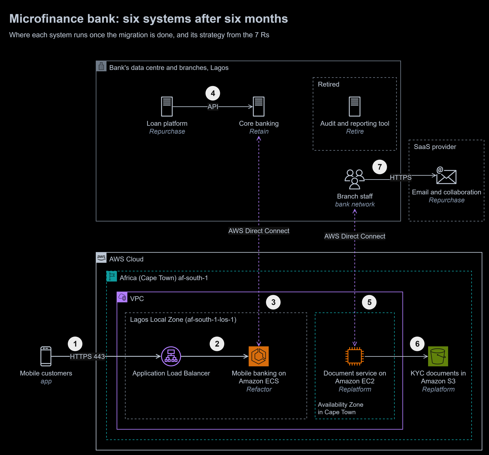

# 08 | Cloud Migration Strategies

**Exercise date:** 18 March 2026 | **Type:** case study, no AWS resources | **Status:** new answer, written after the programme

**At a glance**

- **Outcome:** a six-month migration plan for a microfinance bank's six systems: one strategy from the 7 Rs for each, with the reason and the runner-up it beat, where each system lands, and the order of the work.
- **Built:** a portfolio decision table, a target-state diagram, a month-by-month plan, three architecture decision records and a 17-slide [decision pack (PDF)](decisions/cloud-migration-adr-pack.pdf) for a review board.
- **Stack:** AWS Lagos Local Zone, Amazon ECS, Application Load Balancer, AWS Direct Connect, Amazon S3, AWS DataSync, SaaS email.
- **Proof:** every choice traces to the bank's five pressures and its data rule, and the three contested choices have full decision records that show the options they beat.

To zoom in, right-click the diagram and open the image in a new tab. The editable source is [`diagrams/migration-target.drawio`](diagrams/migration-target.drawio).

1. **Mobile customers** reach an **Application Load Balancer** in the AWS Lagos Local Zone over HTTPS.
2. The **refactored mobile banking services** on Amazon ECS scale out before salary days and as load grows. They store no financial records.
3. Balances and transfers are read and written in **core banking**, retained in the bank's data centre, over **AWS Direct Connect**. Bill payments and airtime top-ups wait in a queue in the data centre first, so a surge cannot overload core banking.
4. The **loan platform**, bought rather than rebuilt, runs in the data centre and calls core banking's API.
5. **Branch staff** reach the document service in Cape Town over the bank's network and Direct Connect.
6. The **document service**, replatformed onto Amazon EC2, keeps KYC documents in **Amazon S3** instead of local file servers.
7. Staff **email and collaboration** move to a SaaS provider.

The old **audit and reporting tool** is switched off, its data archived.

## The task, in my own words

A microfinance bank in Nigeria wants to move to the cloud within six months, under five pressures at once:

1. The regulator requires sensitive financial data to stay on premises, for now.
2. The mobile banking app goes down at peak times.
3. The data centre is expensive and its hardware is ageing.
4. The bank must launch digital products faster to keep up with fintechs.
5. Its internal systems are costly and hard to maintain.

For each of six systems, choose the best migration strategy and explain why: core banking, the mobile banking backend, email and collaboration, loan processing, an old audit and reporting tool, and a document store for customer KYC documents.

## What I did in the exercise

I have no written answer from the programme for this case study, so this module is a new answer rather than a corrected one. Where other modules list my mistakes, this one lists the traps in the case and how the answer avoids them.

## The answer

### The 7 Rs

AWS Prescriptive Guidance names seven migration strategies:

| Strategy | What it means |
|---|---|
| Retire | Switch it off, and archive what must be kept |
| Retain | Keep it where it is for now, and revisit later |
| Rehost | Lift and shift: move it to AWS unchanged |
| Relocate | Move a whole platform, such as VMware, to its cloud version without changing the servers |
| Repurchase | Replace it with a different product, often software as a service (SaaS) |
| Replatform | Move it with a few optimisations, such as a managed service in place of servers |
| Refactor | Re-architect it to use cloud-native features |

### Where the data may go

One rule shapes every answer: sensitive financial data stays on premises. I read it as covering data at rest, so accounts, ledgers, transactions and loan records stay in the bank's data centre. That reading is an assumption for the compliance team to confirm.

AWS has no Region in Nigeria. The nearest is Africa (Cape Town) af-south-1, at least 48 ms from Lagos and back. In Lagos itself, the AWS Local Zone offers Amazon EC2 (T3, C5, R5, G4dn and M5), Amazon EBS gp2, Application Load Balancers, Amazon ECS, Amazon EKS and AWS Direct Connect, but not Amazon S3, Amazon RDS, Amazon ElastiCache, AWS Fargate or NAT gateways. So services that talk to core banking run in the Lagos Local Zone and store nothing, and data goes to Cape Town only with the compliance team's approval.

### One strategy per system

| # | System | Strategy | Why | Why not the runner-up | Where it lands | When |
|---|---|---|---|---|---|---|
| 1 | Core banking | **Retain** | The rule keeps its data on premises. It runs on infrastructure more than 15 years old and is wired into many internal and external systems, which makes it the riskiest system to move, and six months is too short to move it safely. AWS lists data residency, high risk and dependencies as reasons to retain | **Refactor:** breaks the rule today and puts every transaction at risk, for gains the other five moves deliver anyway | The bank's data centre, with an API in front of it | Throughout; revisited at month 6 |
| 2 | Mobile banking backend | **Refactor** | The outages come from the design: it cannot scale and is tied to the legacy backend. Stateless services that scale on a schedule and on load, with non-urgent payments queued, remove the cause and make new products quicker to add | **Replatform:** scales the API tier but leaves core banking as the bottleneck at the peak. **Rehost** in Cape Town adds at least 48 ms to every call | Lagos Local Zone ([ADR-0001](decisions/0001-refactor-mobile-banking-into-the-lagos-local-zone.md)) | Months 2 to 6, one route at a time |
| 3 | Email and collaboration | **Repurchase** (SaaS) | A commodity service that eats the team's time in patching and still goes down. SaaS removes the servers and comes with an availability commitment | **Rehost:** the same patching, on Amazon EC2 instead | A SaaS provider | Months 1 and 2 |
| 4 | Loan processing | **Repurchase** | A proven lending platform brings automated decisions within months, and replaces exactly the kind of in-house system the bank struggles to maintain | **Refactor:** the slowest option, competing with the mobile work for the same team | The bank's data centre, because loan records stay on premises ([ADR-0002](decisions/0002-replace-the-loan-system-with-a-lending-platform.md)) | Months 2 to 5 |
| 5 | Old audit and reporting tool | **Retire** | Used occasionally, most of its reports already come from the newer BI tool, and it still takes servers and support | **Rehost:** paying to move something almost nobody needs | Switched off, its data archived in the data centre | Months 1 and 2 |
| 6 | Document management (KYC) | **Replatform** | The problem is storage: large, growing, and needed by every branch. Amazon S3 is durable, encrypted and grows without hardware | **Retain** on new hardware keeps the ageing-hardware problem; **S3 on Outposts** needs a rack far larger than the bank | Amazon S3 in Cape Town, if compliance approves ([ADR-0003](decisions/0003-move-kyc-documents-to-amazon-s3-in-cape-town.md), proposed) | Months 3 to 5 |

Rehost and relocate are not used. None of the six is a virtualised estate to relocate, and rehosting any of them would move its problem without fixing it. AWS names rehosting as a common strategy for large migrations of many servers; this portfolio is six systems, each with a specific problem to solve.

### What each strategy involves here

- **Core banking (retain)** is not "do nothing". An API layer in front of it gives the mobile services and the loan platform one stable way in. Direct Connect, with a Site-to-Site VPN as backup, links it to AWS. Its ageing hardware is refreshed on its own schedule, and the decision is reviewed at month 6.
- **Email and collaboration (repurchase).** Staff mailboxes move in batches with the provider's migration tools. Customer statements and alerts keep going out through the mail relay that core banking already uses, so they are never stored in staff mailboxes. Data-loss-prevention rules stop staff emailing statements and KYC documents.
- **Audit and reporting tool (retire).** Before it is switched off: list the reports still in use, rebuild those few in the BI tool, and archive its data in the data centre for the retention period the bank's records policy sets.
- **KYC documents (replatform).** AWS DataSync copies the documents over Direct Connect and verifies every file. Branches then switch over one at a time, and the old file servers are switched off last.

### Six months, month by month

| Month | Work |
|---|---|
| 1 | **Foundations:** an AWS landing zone in af-south-1, an opt-in Region, with separate accounts for production and the rest. Direct Connect with a VPN backup, identity federation with the bank's directory, and the data classification signed off by compliance. **Retire:** list the audit reports still in use |
| 2 | **Email:** mailboxes move in batches. **Retire:** reports rebuilt in the BI tool, data archived, servers switched off. **Loans:** platform selected, with on-premises deployment in the requirements. **Mobile:** the first read-only route moves behind the load balancer |
| 3 to 4 | **Documents:** copied, verified and cut over branch by branch, if compliance has approved. **Loans:** platform installed, connected to core banking and the credit bureaus, piloted in one branch. **Mobile:** the transfer route moves, and the queue for bill payments and airtime goes live |
| 5 | **Loans:** live in every branch, open loans migrated and reconciled. **Mobile:** a load test at the last salary-day peak plus a margin, then the remaining routes |
| 6 | **Mobile:** a full salary cycle on the new services, with the old backend as fallback, then the old backend is switched off. **Core banking:** the retain decision is reviewed |

### Risks

| Risk | Mitigation |
|---|---|
| Direct Connect fails and mobile banking loses core banking | Two connections at different Direct Connect locations, plus a Site-to-Site VPN as backup |
| The Lagos Local Zone is a single location | The old backend stays as the fallback during the move; before it is retired, decide and test what happens if the Local Zone is unavailable |
| The team lacks container and CI/CD skills | Training before month 2 and a partner for the first routes |
| Compliance does not allow KYC documents in Cape Town | The documents stay on premises, and ADR-0003 is superseded |
| Lock-in to the lending platform's vendor | API-only integration, and a tested contract clause to export all loan data |

## Traps I avoided

1. **Rehosting everything because it is fastest.** Rehosting the mobile backend moves the outages to the cloud, because the cause is the coupling to core banking, not the servers.
2. **Treating retain as doing nothing.** Core banking stays, but gains an API layer, a link to AWS and a review date.
3. **The nearest Region for anything that talks to core banking.** A mobile request makes several calls to core banking, and each would cross at least 48 ms to Cape Town and back. The Lagos Local Zone keeps those calls in Lagos.
4. **Moving KYC documents without asking whether the rule covers them.** The record is proposed, not accepted, until compliance decides.
5. **SaaS that stores the bank's records abroad.** A hosted lending service would put loan records outside the data centre, and statements sitting in staff mailboxes would do the same for financial data. The lending platform runs on premises, and statements go out through core banking's own mail relay.
6. **Migrating the audit tool because it is there.** Retire it, but rebuild the reports still in use and archive its data first.
7. **Refactoring everything at once.** AWS describes refactoring as the most complex and costly strategy. This plan refactors one system, the one whose problem only a refactor fixes.

## Design vs production

| Concern | In this plan | Before going to production | Well-Architected pillar |
|---|---|---|---|
| Hybrid connectivity | One Direct Connect path drawn | Two connections at different Direct Connect locations and a VPN backup, with alarms on connection state | Reliability |
| Local Zone outage | The old backend as fallback during the move | A tested plan for losing the Local Zone, chosen with compliance, since failing over to Cape Town moves data in transit abroad | Reliability |
| Document service | One instance drawn | Instances in two Availability Zones behind a load balancer | Reliability |
| Accounts and guardrails | Not covered | AWS Organizations and AWS Control Tower, with service control policies that limit use to af-south-1 and its Local Zone | Security, Operational Excellence |
| Encryption | A customer managed KMS key for Amazon S3 | TLS on every path, key policies reviewed, and hardware security modules for core banking's keys | Security |
| Peaks | Scheduled scaling and target tracking | A load test before every salary day and festive season, and synthetic tests of the main app journeys | Performance Efficiency |
| Visibility | Not covered | Amazon CloudWatch alarms on error rates, latency and Direct Connect health, and dashboards per wave | Operational Excellence |
| Spend | On-demand capacity | Savings Plans for the steady base of ECS capacity, S3 Intelligent-Tiering, budgets with alerts per account | Cost Optimization |
| Old systems | Switched off | The audit tool, the old mobile backend and the in-house loan system decommissioned and their hardware recycled | Sustainability |

## What I learned

- A migration strategy is chosen per system, from the problem that system has. "Move to the cloud" is not a strategy.
- Data rules decide placement before technology does. With no AWS Region in Nigeria, the Lagos Local Zone and Direct Connect make the cloud usable without moving records abroad.
- Retain and retire are real answers. The cheapest migration is the one you do not run.
- Refactor only where nothing else fixes the problem, and move one piece at a time so every step can be undone.

## Sources

- [About the migration strategies](https://docs.aws.amazon.com/prescriptive-guidance/latest/large-migration-guide/migration-strategies.html) and the [strangler fig pattern](https://docs.aws.amazon.com/prescriptive-guidance/latest/cloud-design-patterns/strangler-fig.html), AWS Prescriptive Guidance
- [AWS Local Zones features](https://aws.amazon.com/about-aws/global-infrastructure/localzones/features/), for the services in the Lagos Local Zone
- [AWS Outposts rack FAQs](https://aws.amazon.com/outposts/rack/faqs/), for S3 on Outposts and the smallest rack configuration
- [AWS KMS external key stores](https://docs.aws.amazon.com/kms/latest/developerguide/keystore-external.html)
- [Amazon S3 data durability](https://docs.aws.amazon.com/AmazonS3/latest/userguide/DataDurability.html), [AWS DataSync](https://docs.aws.amazon.com/datasync/latest/userguide/what-is-datasync.html) and [scheduled scaling](https://docs.aws.amazon.com/autoscaling/application/userguide/application-auto-scaling-scheduled-scaling.html)
- Lagos to Cape Town is about 4,800 km, so light in fibre needs at least 48 ms there and back ([module 02](../02-cloud-deployment-models/README.md))
