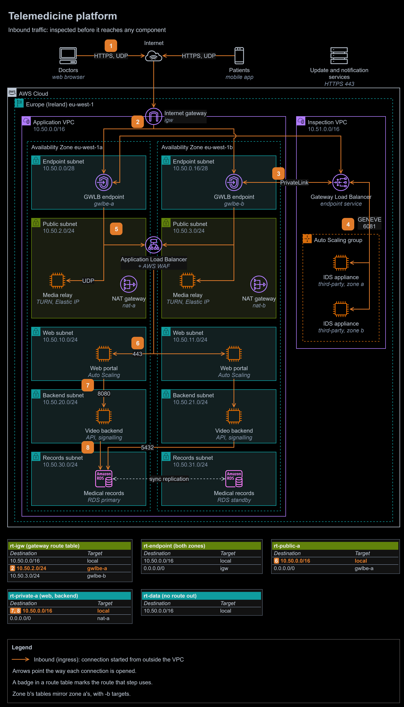
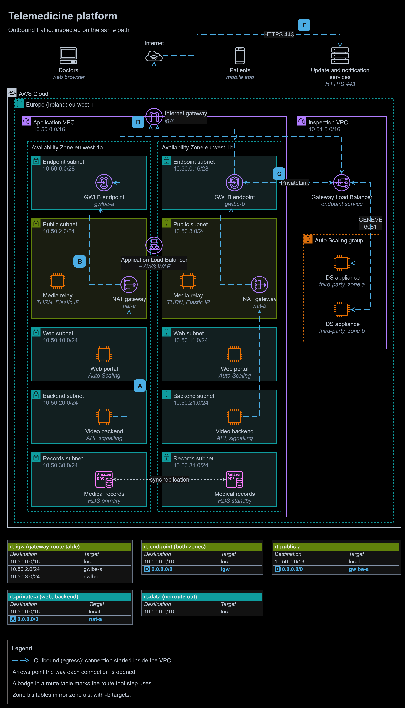

# Study 1 | Inbound inspection for a telemedicine platform

**Question received:** 10 March 2026 | **Type:** design study, no AWS resources | **Status:** new answer, written after the programme

**At a glance**

- **Outcome:** a two-zone platform in which every packet from the internet passes a third-party intrusion detection system before it reaches the load balancer, the media relays or anything else, and the medical records have no route out of the VPC at all.
- **Built:** inbound and outbound traffic-flow diagrams, route tables, security groups, a network ACL for the records tier and two decision records.
- **Stack:** Gateway Load Balancer and its endpoints, internet gateway ingress routing, Application Load Balancer with AWS WAF, NAT gateways, Amazon EC2 Auto Scaling, Amazon RDS Multi-AZ.
- **Proof:** every routing rule is checked against AWS documentation (sources below), including AWS's own statement that asymmetric routing through an appliance is not supported.

To zoom in, right-click the diagram and open the image in a new tab. The editable source is [`diagrams/inbound-inspection.drawio`](diagrams/inbound-inspection.drawio). It has two pages: inbound (above) and outbound.

1. **Doctors** in a web browser and **patients** in the mobile app connect over the internet: HTTPS 443 for the portal, UDP for video.
2. The **internet gateway** has a route table of its own, `rt-igw`. It sends traffic for each public subnet to the **Gateway Load Balancer endpoint** in the same zone (`10.50.2.0/24` to `gwlbe-a`), so nothing reaches a public subnet any other way.
3. The endpoint passes each packet over **AWS PrivateLink** to the **Gateway Load Balancer** in the inspection VPC.
4. The Gateway Load Balancer hands the packet, inside a GENEVE tunnel on UDP 6081, to a healthy **third-party IDS appliance**, and keeps every packet of a flow on the same appliance. The inspected packet returns the same way, to the same endpoint.
5. The endpoint delivers it: HTTPS to the **Application Load Balancer's** node in that zone, UDP to that zone's **media relay**.
6. The load balancer, with **AWS WAF** filtering requests, forwards to a **web portal** server in either zone. `sg-web` admits 443 only from `sg-alb`.
7. The portal calls the **video backend** on 8080. `sg-backend` admits 8080 only from `sg-web`.
8. The backend reads and writes **medical records** on the RDS primary on 5432. `sg-db` admits 5432 only from `sg-backend`, and `nacl-records` only from the backend subnets.

**Return traffic** retraces each request. `rt-public-a` sends `0.0.0.0/0` to `gwlbe-a`, so the load balancer's and the relay's replies pass the same appliance before `rt-endpoint` sends them to the internet gateway. If that route pointed straight at the internet gateway, replies would skip the appliance, and AWS does not support asymmetric routing through an appliance.

Outbound traffic: inspected on the same path

- **A.** A backend or web server calls out, for operating system updates or a push notification service. `rt-private-a` sends `0.0.0.0/0` to `nat-a` in the same zone.
- **B.** The **NAT gateway** replaces the source address with its Elastic IP address, and `rt-public-a` sends `0.0.0.0/0` to `gwlbe-a`.
- **C.** The same IDS fleet inspects the packet, as in steps 3 and 4.
- **D.** Back from the endpoint, `rt-endpoint` sends `0.0.0.0/0` to the **internet gateway**.
- **E.** The request reaches the service on 443. The reply comes back through `rt-igw`, the endpoint, the appliance and the NAT gateway.

## The task, in my own words

A telemedicine company is moving its consultation platform to AWS: a web portal used by doctors in web browsers and by patients in a mobile app, a backend that runs video consultations, and a database of medical records. Its compliance rule has two parts. Medical records must never be directly reachable from the internet, and all traffic entering the platform must be inspected by a third-party intrusion detection system before it reaches any component. Design the network: the tiers, how traffic flows between them, and where the inspection happens.

## Assumptions

- **Region.** The question does not give one. I use Europe (Ireland) eu-west-1; the company's data-protection rules would decide the real Region.
- **Video.** Browsers and the app send audio and video over UDP to TURN media relays. Each relay has an Elastic IP address in a public subnet, the usual way to run TURN, because every relayed session uses a port of its own. The backend handles sign-in, scheduling and call set-up.
- **"Any component"** includes the load balancer and the relays, so inspection has to happen before them: at the internet gateway.
- **The IDS product** is the security team's choice. The design works with any appliance that supports the Gateway Load Balancer's GENEVE protocol.

## The design

### Where the inspection sits

A route table normally belongs to a subnet and decides where traffic leaving that subnet goes. A route table can also be associated with the internet gateway itself (an edge association): it then decides where traffic *entering* the VPC goes, before it reaches any subnet. Its routes may target only the local route, a Gateway Load Balancer endpoint or an appliance's network interface, and each destination must be a whole subnet or the whole VPC. Here, `rt-igw` sends each public subnet to its zone's endpoint, so the first thing any packet meets is an appliance. [ADR-0001](decisions/0001-inspect-inbound-traffic-with-a-gateway-load-balancer.md) compares this with the other places an IDS could sit, and [ADR-0002](decisions/0002-run-the-ids-fleet-in-a-separate-inspection-vpc.md) explains why the appliances live in a VPC of their own.

### Tiers

| Tier | Subnets (zone a, zone b) | Holds | Route out of the VPC |
|---|---|---|---|
| Endpoint | `10.50.0.0/28`, `10.50.0.16/28` | One Gateway Load Balancer endpoint each. A /28 is the smallest subnet AWS allows | `0.0.0.0/0` to the internet gateway |
| Public | `10.50.2.0/24`, `10.50.3.0/24` | The load balancer's nodes, a media relay with an Elastic IP address, a NAT gateway | `0.0.0.0/0` to its own zone's endpoint, so every reply is inspected |
| Web | `10.50.10.0/24`, `10.50.11.0/24` | Web portal servers in an Auto Scaling group | `0.0.0.0/0` to its own zone's NAT gateway |
| Backend | `10.50.20.0/24`, `10.50.21.0/24` | Video backend servers in an Auto Scaling group: API and call signalling | `0.0.0.0/0` to its own zone's NAT gateway |
| Records | `10.50.30.0/24`, `10.50.31.0/24` | Amazon RDS for PostgreSQL, Multi-AZ | None |
| Inspection VPC | `10.51.0.0/24`, `10.51.1.0/24` | The Gateway Load Balancer and the IDS appliances in an Auto Scaling group | Its own path for signature updates (not drawn) |

Each tier's two subnets form one block (`10.50.2.0/23`, `10.50.10.0/23`, `10.50.20.0/23`, `10.50.30.0/23`), so a network ACL rule can name a whole tier at once.

### Route tables

| Route table | Associated with | Destination | Target | Carries |
|---|---|---|---|---|
| `rt-igw` | The internet gateway (edge association) | `10.50.0.0/16` | local | Nothing on its own; a gateway route table always keeps it |
| | | `10.50.2.0/24` | `gwlbe-a` | Everything for public subnet a (step 2) |
| | | `10.50.3.0/24` | `gwlbe-b` | Everything for public subnet b |
| `rt-endpoint` | Both endpoint subnets | `10.50.0.0/16` | local | Inspected packets on to the load balancer and relays (step 5) |
| | | `0.0.0.0/0` | `igw` | Inspected replies and outbound traffic (D) |
| `rt-public-a` | Public subnet a | `10.50.0.0/16` | local | Load balancer to web portal (step 6) |
| | | `0.0.0.0/0` | `gwlbe-a` | Replies from the load balancer and relay; the NAT gateway's outbound traffic (B) |
| `rt-private-a` | Web and backend subnets a | `10.50.0.0/16` | local | Portal to backend (7), backend to records (8) |
| | | `0.0.0.0/0` | `nat-a` | Updates and notifications (A) |
| `rt-data` | Both records subnets | `10.50.0.0/16` | local | The database's replies only |

Zone b has `rt-public-b` and `rt-private-b`, the same with `gwlbe-b` and `nat-b`. A zone never uses the other zone's endpoint or NAT gateway, so losing one zone leaves the other working.

### Security groups

Security groups are stateful, so replies need no rules. A Gateway Load Balancer is transparent: it changes neither the source nor the destination address, so the load balancer and the relays still see each client's real address.

| Security group | Attached to | Inbound | Outbound |
|---|---|---|---|
| `sg-alb` | Application Load Balancer | 443 from `0.0.0.0/0` (already inspected) | 443 to `sg-web` |
| `sg-relay` | Media relays | UDP 3478 and the relay port range (for example 49152-65535) from `0.0.0.0/0` | UDP to `0.0.0.0/0`: media to the other side of the call |
| `sg-web` | Web portal | 443 from `sg-alb` | 8080 to `sg-backend`; 443 to `0.0.0.0/0` for updates, through the NAT gateway |
| `sg-backend` | Video backend | 8080 from `sg-web` | 5432 to `sg-db`; 443 to `0.0.0.0/0` for notifications and updates, through the NAT gateway |
| `sg-db` | RDS | 5432 from `sg-backend` | None: the default allow-all rule is removed |
| `sg-ids` | IDS appliances | UDP 6081 and the health check port from the Gateway Load Balancer's subnets, `10.51.0.0/23` | None for GENEVE: replies are allowed automatically |

### Network ACL on the records subnets

Network ACLs are stateless, so replies need rules of their own. The other subnets keep the default network ACL and rely on their security groups; the records tier gets a second, independent layer.

| Rule | Direction | Protocol | Ports | Source or destination | Action |
|---:|---|---|---|---|---|
| 100 | Inbound | TCP | 5432 | `10.50.20.0/23` (both backend subnets) | Allow |
| 110 | Inbound | All | All | `10.50.30.0/23` (both records subnets) | Allow |
| * | Inbound | All | All | `0.0.0.0/0` | Deny |
| 100 | Outbound | TCP | 1024-65535 | `10.50.20.0/23` | Allow |
| 110 | Outbound | All | All | `10.50.30.0/23` | Allow |
| * | Outbound | All | All | `0.0.0.0/0` | Deny |

### Why the medical records cannot be reached from the internet

The rule needs one barrier; the design has five, so no single mistake exposes the records:

1. **No route.** `rt-data` has only the local route, so the records subnets can neither reach the internet nor be reached from it, through any gateway.
2. **No public address.** The RDS instance is created with "Publicly accessible" set to No.
3. **One security group rule.** `sg-db` admits 5432 only from `sg-backend`.
4. **One network ACL rule.** `nacl-records` admits 5432 only from the backend subnets.
5. **Encryption.** Storage is encrypted with an AWS KMS key, and `rds.force_ssl` makes every connection use TLS.

## Traps I avoided

1. **Inspecting behind the load balancer.** Putting the IDS between the load balancer and the web servers lets it see decrypted HTTP, but the load balancer and the relays are reached first, which breaks "before reaching any component".
2. **Mirroring instead of inspecting.** VPC Traffic Mirroring copies packets from network interfaces that have already received them. It suits monitoring, but by the time the copy is inspected, the component has the packet.
3. **A one-way path.** If the public subnets' default route pointed at the internet gateway, requests would be inspected and replies would not. A stateful IDS then sees half of every conversation, and AWS states that asymmetric routing through an appliance is not supported. The public route tables send `0.0.0.0/0` back through the endpoints.
4. **One endpoint for both zones.** Pointing both public subnets at one endpoint would let a single zone's failure stop the whole platform. Each zone has its own endpoint and NAT gateway.
5. **An endpoint inside the subnet it protects.** AWS requires the endpoint and the servers it protects to be in different subnets, so that the protected subnet's route table can send traffic to the endpoint. The endpoints have small subnets of their own.

## Design vs production

| Concern | In this design | Before going to production | Well-Architected pillar |
|---|---|---|---|
| IDS rules | Appliances in the path, starting in detection mode | Tune signatures against real traffic, then turn on prevention for high-confidence rules; review alerts daily | Security |
| Visibility inside HTTPS | AWS WAF on the load balancer | AWS managed rule groups and rate-based rules in WAF; decide with the security team whether inbound TLS decryption on the appliances is worth copying the portal's private key to them | Security |
| Appliance health | Auto Scaling group in two zones, failing closed | At least two appliances per zone; CloudWatch alarms on each zone's healthy host count; a game day that stops one zone's appliances | Reliability |
| Logging | Not shown | VPC Flow Logs in both VPCs, IDS alerts and load balancer logs sent to a SIEM, AWS CloudTrail and Amazon GuardDuty | Security, Operational Excellence |
| Records | RDS Multi-AZ, isolated subnets | Credentials in AWS Secrets Manager with rotation, automated backups with point-in-time recovery, the AWS Config rule `rds-instance-public-access-check` | Security, Reliability |
| Administrator access | Not shown | AWS Systems Manager Session Manager: no SSH port open anywhere | Security |
| Cost | Endpoints and NAT gateways in each zone | Gateway Load Balancer, endpoint and NAT charges are per hour and per gigabyte; compare bring-your-own-licence and hourly appliance pricing; gateway endpoints for Amazon S3 so that AWS traffic skips NAT charges | Cost Optimization |
| Throughput | Not sized | Size appliances from vendor throughput figures and scale on CPU or packets per second; check the MTU, because GENEVE adds headers | Performance Efficiency |
| Efficiency | Not considered | Scale the portal, backend and appliances in at night; AWS Graviton instances where the vendor supports them | Sustainability |
| How it is built | Drawn by hand | Terraform, reviewed in pull requests (see modules 12 and 13) | Operational Excellence |

## What I learned

- A route table can belong to a gateway, not only to a subnet. An edge association is how traffic is intercepted before it reaches any subnet.
- Inline inspection must be symmetric: every request and its reply have to pass the same appliance, and the route tables have to guarantee it in both directions.
- "Before it reaches any component" rules out anything that only copies traffic, and anything placed behind the first component.

## Sources

- Intercepting traffic at the internet gateway: [Gateway route tables](https://docs.aws.amazon.com/vpc/latest/userguide/gateway-route-tables.html)
- [What is a Gateway Load Balancer?](https://docs.aws.amazon.com/elasticloadbalancing/latest/gateway/introduction.html), [target groups and GENEVE](https://docs.aws.amazon.com/elasticloadbalancing/latest/gateway/target-groups.html) and [what happens when targets fail](https://docs.aws.amazon.com/elasticloadbalancing/latest/gateway/health-checks.html)
- [Create a Gateway Load Balancer endpoint service](https://docs.aws.amazon.com/vpc/latest/privatelink/create-gateway-load-balancer-endpoint-service.html)
- [What is Traffic Mirroring?](https://docs.aws.amazon.com/vpc/latest/mirroring/what-is-traffic-mirroring.html)
- [AWS Network Firewall managed rules from AWS Partners](https://aws.amazon.com/about-aws/whats-new/2025/11/network-firewall-managed-rules-partners-marketplace/)
- TURN relays: [RFC 8656](https://www.rfc-editor.org/rfc/rfc8656)
- [Amazon RDS in a VPC](https://docs.aws.amazon.com/AmazonRDS/latest/UserGuide/USER_VPC.WorkingWithRDSInstanceinaVPC.html) and the [AWS Config rule rds-instance-public-access-check](https://docs.aws.amazon.com/config/latest/developerguide/rds-instance-public-access-check.html)
