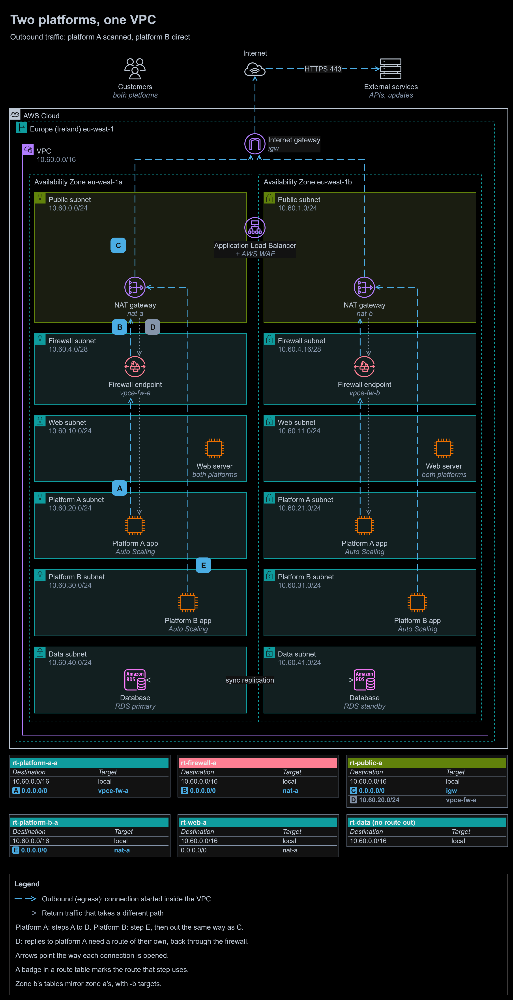
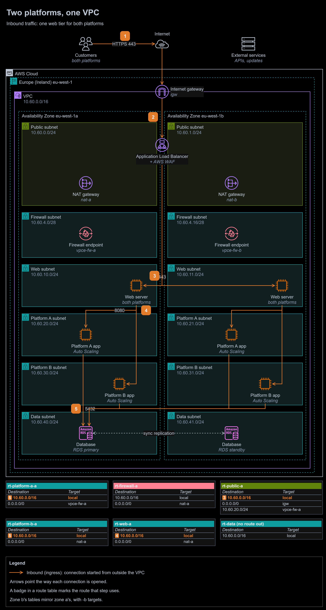

# Study 2 | Selective egress scanning for two platforms

**Exercise date:** 5 March 2026 | **Type:** design exercise, no AWS resources | **Status:** rebuilt and corrected

**At a glance**

- **Outcome:** two platforms share one VPC and one application tier, yet only platform A's outbound traffic passes a firewall, in both directions and in both Availability Zones, while platform B's goes straight out.
- **Built:** outbound and inbound traffic-flow diagrams, every route table, security groups, a network ACL for the data tier, the firewall's rules and three decision records.
- **Stack:** AWS Network Firewall, NAT gateways, Application Load Balancer with AWS WAF, Amazon EC2 Auto Scaling, Amazon RDS Multi-AZ.
- **Proof:** the return route my original answer missed is now in place, and AWS documents why it is needed: Network Firewall does not support asymmetric routing. Seven mistakes are corrected below.

To zoom in, right-click the diagram and open the image in a new tab. The editable source is [`diagrams/selective-egress.drawio`](diagrams/selective-egress.drawio). It has two pages: outbound (above) and inbound.

- **A.** A **platform A server** calls an external service. Its route table, `rt-platform-a-a`, sends `0.0.0.0/0` to the **Network Firewall endpoint** `vpce-fw-a` in the same zone.
- **B.** The firewall checks the packet against its rules: allowed domains and threat signatures. If it passes, `rt-firewall-a` sends `0.0.0.0/0` to the **NAT gateway** `nat-a`.
- **C.** The NAT gateway replaces the source address with its Elastic IP address, `rt-public-a` sends `0.0.0.0/0` to the **internet gateway**, and the request reaches the service on 443.
- **D.** The reply comes back to the NAT gateway. `rt-public-a` has a route of its own for platform A's subnet, `10.60.20.0/24` to `vpce-fw-a`, more specific than `local`, so the reply passes the same firewall endpoint. Without it, the reply would go straight to the server.
- **E.** A **platform B server's** route table, `rt-platform-b-a`, sends `0.0.0.0/0` straight to `nat-a`, and the request leaves as in C. No public route names platform B's subnets, so their replies return directly: platform B never reaches the firewall.

Inbound traffic: one web tier for both platforms

1. **Customers** of both platforms connect over HTTPS 443, each to their platform's own domain.
2. The **internet gateway** passes the request to the **Application Load Balancer** in the public subnets, where **AWS WAF** filters it. Inbound traffic is not scanned by the firewall; the rule covers platform A's outbound traffic only.
3. The load balancer chooses a rule by host name and forwards to a **web server** in either zone. `sg-web` admits 443 only from `sg-alb`.
4. The web servers call the **application servers** of the right platform on 8080. `sg-app-a` and `sg-app-b` each admit 8080 only from `sg-web`.
5. The application servers query the **RDS primary** on 5432. `sg-db` admits 5432 only from the two application security groups.

## The task, in my own words

A technology company runs two platforms, A and B, on application servers behind a web tier. Both use a shared application layer and a database. Its rule: outbound traffic from the application servers for platform A must be scanned before it leaves the VPC, and platform B's must not pass the scanner. The web servers and application servers must also be in separate subnets. Design the VPC: selective scanning, segmented subnets, and efficient traffic between the web, application and database tiers.

## What I did in the exercise

- Wrote a 13-slide design document: problem statement, inbound and outbound data-flow slides for each platform, a network diagram, a route table, security groups, a justification and a conclusion.
- Split a `/16` into eight equal `/19` subnets: a public edge, a private web tier, an application subnet for each platform, an inspection subnet and a database subnet, with two blocks spare.
- Sent platform A's application subnet's `0.0.0.0/0` to an inspection appliance, platform B's to the NAT gateway, and the inspection subnet's to the NAT gateway.
- Argued for intercepting traffic with route tables rather than in the applications, so that developers configure no proxies and a rogue application cannot bypass the scanner. That reasoning holds and is kept: it is [ADR-0001](decisions/0001-select-platform-a-traffic-by-source-subnet.md).

## The rebuilt solution

One VPC, `10.60.0.0/16` in eu-west-1, across two Availability Zones. Three decisions shape it:

- [ADR-0001](decisions/0001-select-platform-a-traffic-by-source-subnet.md): each platform's application servers get subnets of their own, because a route table chooses by destination and cannot see which platform sent a packet.
- [ADR-0002](decisions/0002-scan-with-aws-network-firewall.md): AWS Network Firewall does the scanning, with an endpoint in each zone.
- [ADR-0003](decisions/0003-put-the-firewall-before-the-nat-gateway.md): the firewall sits before the NAT gateway, where it can still tell the platforms apart, and the NAT gateway's subnet routes platform A's replies back through it.

### Tiers

| Tier | Subnets (zone a, zone b) | Holds | Route out of the VPC |
|---|---|---|---|
| Public | `10.60.0.0/24`, `10.60.1.0/24` | The load balancer's nodes and a NAT gateway | `0.0.0.0/0` to the internet gateway; replies for platform A through its zone's firewall endpoint |
| Firewall | `10.60.4.0/28`, `10.60.4.16/28` | One Network Firewall endpoint each, and nothing else: an endpoint cannot filter traffic for its own subnet | `0.0.0.0/0` to its zone's NAT gateway |
| Web | `10.60.10.0/24`, `10.60.11.0/24` | Web servers for both platforms, in an Auto Scaling group | `0.0.0.0/0` to its zone's NAT gateway |
| Platform A | `10.60.20.0/24`, `10.60.21.0/24` | Platform A's application servers, in an Auto Scaling group | `0.0.0.0/0` to its zone's firewall endpoint |
| Platform B | `10.60.30.0/24`, `10.60.31.0/24` | Platform B's application servers, in an Auto Scaling group | `0.0.0.0/0` to its zone's NAT gateway |
| Data | `10.60.40.0/24`, `10.60.41.0/24` | Amazon RDS for PostgreSQL, Multi-AZ | None |

Each tier's two subnets form one block (`10.60.20.0/23` for platform A, for example), so a network ACL rule can name a whole tier.

### Route tables

A route table belongs to the subnet that traffic is leaving and matches on the destination; the most specific match wins.

| Route table | Subnets | Destination | Target | Carries |
|---|---|---|---|---|
| `rt-platform-a-a` | Platform A, zone a | `10.60.0.0/16` | local | Platform A to the database (inbound step 5) |
| | | `0.0.0.0/0` | `vpce-fw-a` | Platform A's outbound traffic into the firewall (A) |
| `rt-firewall-a` | Firewall, zone a | `10.60.0.0/16` | local | Inspected replies on to platform A (D) |
| | | `0.0.0.0/0` | `nat-a` | Inspected requests on to the NAT gateway (B) |
| `rt-public-a` | Public, zone a | `10.60.0.0/16` | local | Load balancer to web servers (inbound step 3); replies to platform B |
| | | `0.0.0.0/0` | `igw` | Everything leaving the VPC (C) |
| | | `10.60.20.0/24` | `vpce-fw-a` | Replies to platform A, back through the firewall (D) |
| `rt-platform-b-a` | Platform B, zone a | `10.60.0.0/16` | local | Platform B to the database |
| | | `0.0.0.0/0` | `nat-a` | Platform B's outbound traffic, unscanned (E) |
| `rt-web-a` | Web, zone a | `10.60.0.0/16` | local | Web servers to both platforms (inbound step 4) |
| | | `0.0.0.0/0` | `nat-a` | Updates for the web servers |
| `rt-data` | Both data subnets | `10.60.0.0/16` | local | The database's replies only |

Zone b has the same tables with `vpce-fw-b`, `nat-b` and its own platform A subnet, `10.60.21.0/24`, in `rt-public-b`. A zone never uses the other zone's firewall endpoint or NAT gateway, so losing one zone leaves the other working, and every flow stays on one endpoint.

### Security groups

| Security group | Attached to | Inbound | Outbound |
|---|---|---|---|
| `sg-alb` | Application Load Balancer | 443 from `0.0.0.0/0` | 443 to `sg-web` |
| `sg-web` | Web servers | 443 from `sg-alb` | 8080 to `sg-app-a` and `sg-app-b`; 443 to `0.0.0.0/0` for updates |
| `sg-app-a` | Platform A servers | 8080 from `sg-web` | 5432 to `sg-db`; 443 to `0.0.0.0/0`, scanned by the firewall |
| `sg-app-b` | Platform B servers | 8080 from `sg-web` | 5432 to `sg-db`; 443 to `0.0.0.0/0`, direct |
| `sg-db` | RDS | 5432 from `sg-app-a` and `sg-app-b` | None: the default allow-all rule is removed |

### Network ACL on the data subnets

| Rule | Direction | Protocol | Ports | Source or destination | Action |
|---:|---|---|---|---|---|
| 100 | Inbound | TCP | 5432 | `10.60.20.0/23` (platform A) | Allow |
| 110 | Inbound | TCP | 5432 | `10.60.30.0/23` (platform B) | Allow |
| 120 | Inbound | All | All | `10.60.40.0/23` (both data subnets) | Allow |
| * | Inbound | All | All | `0.0.0.0/0` | Deny |
| 100 | Outbound | TCP | 1024-65535 | `10.60.20.0/23` | Allow |
| 110 | Outbound | TCP | 1024-65535 | `10.60.30.0/23` | Allow |
| 120 | Outbound | All | All | `10.60.40.0/23` | Allow |
| * | Outbound | All | All | `0.0.0.0/0` | Deny |

### What the firewall checks

The firewall policy uses stateful rule groups, evaluated in strict order:

1. **AWS managed threat signature rule groups:** known malware, botnet and command-and-control traffic is dropped and logged.
2. **A domain allow list:** the services platform A is allowed to call, matched on the HTTP Host header and the TLS server name.
3. **A default action** that drops and logs everything else.

Alert and flow logs go to Amazon CloudWatch Logs. TLS inspection, which would let the firewall see inside platform A's HTTPS, needs a certificate authority that platform A's servers trust, so it is the security team's decision.

### A gap to keep closed

A gateway endpoint for Amazon S3 or DynamoDB adds a route whose destination is the service's prefix list, which is more specific than `0.0.0.0/0`. If one were attached to platform A's route tables, platform A's traffic to that service would leave through the endpoint without passing the firewall. Platform A's route tables therefore have no gateway endpoint. Whether traffic to AWS services counts as leaving the VPC is the company's decision; if it does not, a gateway endpoint can be added later, knowingly.

## Mistakes I fixed

1. **Replies skipped the scanner.** My inspection subnet sent `0.0.0.0/0` to the NAT gateway, but nothing sent the replies back. The NAT gateway's subnet reached platform A's subnet through its `local` route, so every reply bypassed the appliance. AWS documents that Network Firewall does not support asymmetric routing, because its stateful inspection needs both directions at the same endpoint. `rt-public-a` now routes `10.60.20.0/24` to `vpce-fw-a`.
2. **A NAT gateway on the inbound path.** My network diagram ran the load balancer through the NAT gateway to the web servers. A NAT gateway only lets private resources start connections out to the internet; the load balancer reaches the web servers directly over the `local` route.
3. **One Availability Zone.** Everything sat in one zone. An Application Load Balancer needs subnets in at least two, and one zone's failure would have stopped both platforms. Every tier now has a subnet in each of two zones, with a firewall endpoint and a NAT gateway in each.
4. **A single scanning instance.** One security appliance on an EC2 instance was a single point of failure that could not scale. Network Firewall runs an endpoint in each zone and is scaled by AWS.
5. **Security group rules that allowed too much.** The application servers and the database allowed all traffic out to `0.0.0.0/0`, the load balancer and web servers allowed all traffic to the next tier, and the database admitted platform subnets by address range. Every rule now names one port and one security group, and the database has no outbound rule.
6. **An address plan sized for the wrong thing.** Eight `/19` subnets used the whole `/16`, 8,187 addresses each for a handful of servers, leaving only two blocks for anything new. `/24` subnets, and a `/28` for each firewall endpoint, leave most of the VPC free.
7. **Diagrams that contradicted the design.** The network diagram was AI-generated and drew platform B's outbound arrow ending at a platform A server, and the data-flow slides used generic clip art. Both diagrams are redrawn with the official AWS icons, from the route tables above.

## Design vs production

| Concern | In this design | Before going to production | Well-Architected pillar |
|---|---|---|---|
| Firewall rules | Threat signatures and a domain allow list | Run the allow list in alert-only mode for two weeks to learn platform A's real destinations, then drop | Security |
| Visibility inside HTTPS | Domain names only | Decide on TLS inspection with the security team; it needs a private certificate authority trusted by platform A's servers | Security |
| The return route | Two routes, one per zone | AWS Config rules, or Terraform checks, that every platform A subnet has its return route; VPC Reachability Analyzer run after every network change | Reliability, Operational Excellence |
| Logging | Firewall alert and flow logs | VPC Flow Logs, load balancer access logs, AWS CloudTrail and Amazon GuardDuty, in a central log account | Security, Operational Excellence |
| Zone failure | Firewall endpoint and NAT gateway in each zone | A game day that removes one zone's NAT gateway and checks the other zone carries on | Reliability |
| Cost | Firewall endpoint and NAT gateway in each zone | Only platform A's traffic is charged by the firewall; watch per-gigabyte charges; one NAT gateway in development environments | Cost Optimization |
| Throughput | Not sized | Network Firewall handles up to 100 Gbps per zone; scale the application groups on request count | Performance Efficiency |
| Efficiency | Not considered | Scale in at night; AWS Graviton instances | Sustainability |
| How it is built | Drawn by hand | Terraform, reviewed in pull requests (see modules 12 and 13) | Operational Excellence |

## What I learned

- A route table matches only the destination. To treat two sources differently, put them in different subnets.
- Every route into a middlebox needs a matching route for the reply. After a NAT gateway, the reply's path is decided by the NAT gateway's subnet, not the server's.
- A firewall placed after a NAT gateway no longer knows which server sent the traffic.

## Sources

- [Avoiding asymmetric routing with AWS Network Firewall](https://docs.aws.amazon.com/network-firewall/latest/developerguide/asymmetric-routing.html)
- Network Firewall [subnet](https://docs.aws.amazon.com/network-firewall/latest/developerguide/vpc-config-subnets.html) and [route table](https://docs.aws.amazon.com/network-firewall/latest/developerguide/vpc-config-route-tables.html) configuration, and the [architecture with an internet gateway and a NAT gateway](https://docs.aws.amazon.com/network-firewall/latest/developerguide/arch-igw-ngw.html)
- Routes more specific than `local`: [Example routing options, routing for a middlebox appliance](https://docs.aws.amazon.com/vpc/latest/userguide/route-table-options.html#route-tables-appliance-routing)
- Longest prefix match: [How route priority works](https://docs.aws.amazon.com/vpc/latest/userguide/route-tables-priority.html)
- [VPC Reachability Analyzer](https://docs.aws.amazon.com/vpc/latest/reachability/what-is-reachability-analyzer.html)
- Two zones for a load balancer: [Application Load Balancers](https://docs.aws.amazon.com/elasticloadbalancing/latest/application/application-load-balancers.html)
