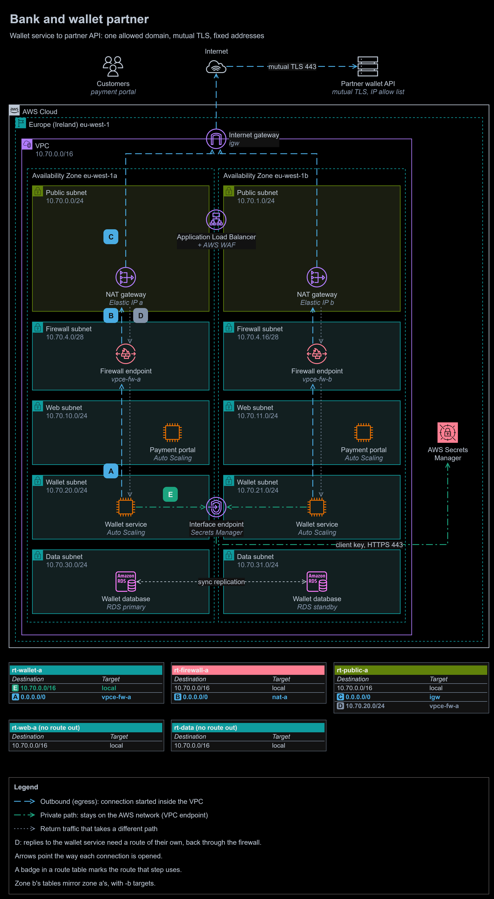
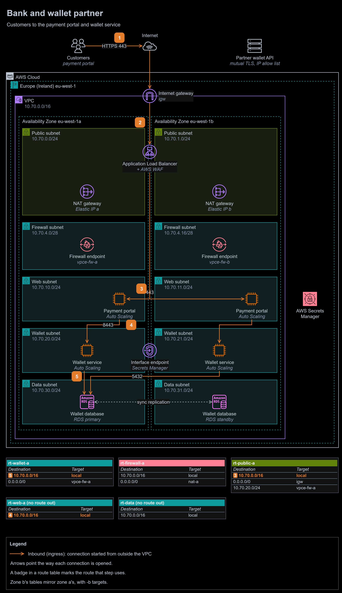

# Study 3 | Partner API integration for a bank's wallet service

**Question received:** 10 March 2026 | **Type:** design study, no AWS resources | **Status:** new answer, written after the programme

**At a glance**

- **Outcome:** a bank's wallet service calls a partner's wallet API over the internet with mutual TLS, from two fixed addresses the partner allowlists, through a firewall that lets it reach the partner and nothing else, while customers reach only the payment portal and the web and data tiers have no route out at all.
- **Built:** partner-call and customer traffic-flow diagrams, route tables, security groups, a network ACL for the data tier, the firewall's rules and two decision records.
- **Stack:** AWS Network Firewall, NAT gateways with Elastic IP addresses, an interface endpoint for AWS Secrets Manager, Application Load Balancer with AWS WAF, Amazon EC2 Auto Scaling, Amazon RDS Multi-AZ.
- **Proof:** every rule is checked against AWS documentation (sources below), including Network Firewall's own note that it matches host names from the TLS server name, not the address, which is why the design checks both.

To zoom in, right-click the diagram and open the image in a new tab. The editable source is [`diagrams/partner-api.drawio`](diagrams/partner-api.drawio). It has two pages: partner calls (above) and customer traffic.

- **A.** The **wallet service** opens a connection to the partner's API host. `rt-wallet-a` sends `0.0.0.0/0` to the **Network Firewall endpoint** `vpce-fw-a` in the same zone.
- **B.** The firewall lets it through only if the TLS server name is the partner's API host and the destination is in the partner's address ranges; anything else is dropped and logged. `rt-firewall-a` sends it on to the **NAT gateway**.
- **C.** The NAT gateway sends it from its **Elastic IP address**, which the partner allowlists, through the **internet gateway**. The wallet service and the partner then complete a **mutual TLS** handshake: each checks the other's certificate.
- **D.** Responses come back to the NAT gateway, and `rt-public-a`'s route for `10.70.20.0/24` returns them through the same firewall endpoint.
- **E.** At start-up, the wallet service fetches its client certificate's private key from **AWS Secrets Manager** through an **interface endpoint**, over the `local` route. The key never crosses the internet.

Customer traffic: the payment portal is the only way in

1. **Customers** open the payment portal over HTTPS 443.
2. The **internet gateway** passes the request to the **Application Load Balancer** in the public subnets. **AWS WAF** filters it, the listener accepts only TLS 1.2 and 1.3, and AWS Shield Standard protects the load balancer automatically.
3. The load balancer forwards to a **payment portal** server in either zone. `sg-portal` admits 443 only from `sg-alb`.
4. The portal calls the **wallet service** on 8443. `sg-wallet` admits 8443 only from `sg-portal`.
5. The wallet service reads and writes the **wallet database** on 5432. `sg-db` admits 5432 only from `sg-wallet`.

## The task, in my own words

A bank is modernising its payment services on AWS: a customer-facing payment portal and an application layer that processes wallet services. Because of persistent payment problems, it is integrating with a partner company whose backend processes wallet transactions. The bank's application servers must start secure API calls to the partner's backend over the internet and handle the responses, while keeping strict boundaries for customer traffic entering the portal and for the bank's internal traffic. Show how customer traffic enters securely, and how the application servers connect securely to the partner's API.

## Assumptions

- **The partner** exposes its API at one host name over HTTPS, can allowlist the bank's addresses, and can require client certificates, as payment APIs usually can. It may not run on AWS.
- **Region.** The question does not give one. I use Europe (Ireland) eu-west-1, as in the other studies; the bank's regulator would decide the real Region.
- **Callbacks.** The question describes calls from the bank to the partner only. If the partner must call the bank back (a webhook), that is a second inbound path, designed separately: through the load balancer with WAF and signed requests, never by opening the wallet subnets.

## The design

### Three boundaries

| Boundary | What crosses it | What enforces it |
|---|---|---|
| Customers into the bank | HTTPS to the payment portal only | The load balancer is the only internet-facing resource; AWS WAF, TLS 1.2 and later, `sg-alb` |
| Inside the bank | Portal to wallet service to database, one port each | A chain of security groups; the web and data subnets have no route out; a network ACL on the data subnets |
| The bank to the partner | The wallet service's calls to the partner's API host, nothing else | The firewall's allow rules ([ADR-0002](decisions/0002-allow-outbound-traffic-only-to-the-partner-api.md)), the partner's address allowlist and mutual TLS ([ADR-0001](decisions/0001-call-the-partner-with-mutual-tls-from-fixed-addresses.md)) |

### Tiers

| Tier | Subnets (zone a, zone b) | Holds | Route out of the VPC |
|---|---|---|---|
| Public | `10.70.0.0/24`, `10.70.1.0/24` | The load balancer's nodes and a NAT gateway with an Elastic IP address | `0.0.0.0/0` to the internet gateway; replies for the wallet service through its zone's firewall endpoint |
| Firewall | `10.70.4.0/28`, `10.70.4.16/28` | One Network Firewall endpoint each, and nothing else | `0.0.0.0/0` to its zone's NAT gateway |
| Web | `10.70.10.0/24`, `10.70.11.0/24` | Payment portal servers in an Auto Scaling group | None: updates come from patched images, and AWS Systems Manager is reached through its interface endpoints (not drawn) |
| Wallet | `10.70.20.0/24`, `10.70.21.0/24` | Wallet service servers in an Auto Scaling group, and the Secrets Manager interface endpoint | `0.0.0.0/0` to its zone's firewall endpoint |
| Data | `10.70.30.0/24`, `10.70.31.0/24` | Amazon RDS for PostgreSQL, Multi-AZ | None |

### Route tables

| Route table | Subnets | Destination | Target | Carries |
|---|---|---|---|---|
| `rt-wallet-a` | Wallet, zone a | `10.70.0.0/16` | local | Wallet service to database (5) and to the interface endpoint (E) |
| | | `0.0.0.0/0` | `vpce-fw-a` | Calls to the partner, into the firewall (A) |
| `rt-firewall-a` | Firewall, zone a | `10.70.0.0/16` | local | Inspected responses on to the wallet service (D) |
| | | `0.0.0.0/0` | `nat-a` | Allowed calls on to the NAT gateway (B) |
| `rt-public-a` | Public, zone a | `10.70.0.0/16` | local | Load balancer to portal (3) |
| | | `0.0.0.0/0` | `igw` | Everything leaving the VPC (C) |
| | | `10.70.20.0/24` | `vpce-fw-a` | Responses to the wallet service, back through the firewall (D) |
| `rt-web-a` | Web, zone a | `10.70.0.0/16` | local | Portal to wallet service (4); no route out |
| `rt-data` | Both data subnets | `10.70.0.0/16` | local | The database's replies only |

Zone b has the same tables with `vpce-fw-b`, `nat-b` and `10.70.21.0/24`. The return route matters for the same reason as in [study 2](../02-selective-egress-scanning/): Network Firewall needs a request and its reply to pass the same endpoint.

### Security groups

| Security group | Attached to | Inbound | Outbound |
|---|---|---|---|
| `sg-alb` | Application Load Balancer | 443 from `0.0.0.0/0` | 443 to `sg-portal` |
| `sg-portal` | Payment portal | 443 from `sg-alb` | 8443 to `sg-wallet` |
| `sg-wallet` | Wallet service | 8443 from `sg-portal` | 443 to `0.0.0.0/0` (the firewall narrows it to the partner); 443 to `sg-vpce`; 5432 to `sg-db` |
| `sg-vpce` | Secrets Manager interface endpoint | 443 from `sg-wallet` | None |
| `sg-db` | RDS | 5432 from `sg-wallet` | None |

The partner's responses need no inbound rule: they belong to connections the wallet service opened, and security groups allow replies automatically.

### Network ACL on the data subnets

| Rule | Direction | Protocol | Ports | Source or destination | Action |
|---:|---|---|---|---|---|
| 100 | Inbound | TCP | 5432 | `10.70.20.0/23` (both wallet subnets) | Allow |
| 110 | Inbound | All | All | `10.70.30.0/23` (both data subnets) | Allow |
| * | Inbound | All | All | `0.0.0.0/0` | Deny |
| 100 | Outbound | TCP | 1024-65535 | `10.70.20.0/23` | Allow |
| 110 | Outbound | All | All | `10.70.30.0/23` | Allow |
| * | Outbound | All | All | `0.0.0.0/0` | Deny |

### What the firewall allows

The policy uses strict order:

1. Pass TLS on 443 whose server name is the partner's API host.
2. Require the destination to be in the partner's published address ranges as well. The firewall reads the host name from the TLS handshake, not from the address, so a compromised server could send the partner's name to an attacker's address; this rule stops it.
3. AWS managed threat signature rule groups.
4. Drop and alert everything else.

### Handling the partner's responses

The network carries the responses back; the wallet service has to handle them safely:

- **An idempotency key on every wallet request,** so a request retried after a timeout is applied once.
- **Timeouts, retries with backoff and a circuit breaker,** so a slow or failing partner cannot tie up the wallet service or the portal.
- **Certificate checks both ways:** the wallet service validates the partner's certificate chain and host name, and presents its own client certificate.

## Traps I avoided

1. **"Secure" meaning only HTTPS.** HTTPS proves the partner's identity to the bank, not the bank's to the partner. Mutual TLS and the address allowlist prove both.
2. **Opening the wallet service to the partner.** The partner never connects in: its responses come back on the wallet service's own connections, so there is no inbound rule to misuse.
3. **Filtering by host name alone, or by address alone.** A name-only rule trusts whatever name the client sends; an address-only rule breaks when the partner's addresses change. The firewall checks both.
4. **Replies past the firewall.** Without the public route table's route for the wallet subnet, responses would bypass the firewall, which Network Firewall does not support.
5. **Changing the NAT addresses.** An Elastic IP address stays the same while it is allocated. Releasing one, or recreating a NAT gateway without it, would break the partner's allowlist and stop every payment, so both addresses are protected.
6. **Giving every tier a way out.** Only the wallet service needs the internet; the portal and the database get no route out at all.

## Design vs production

| Concern | In this design | Before going to production | Well-Architected pillar |
|---|---|---|---|
| Client certificate | Key in Secrets Manager, fetched through an interface endpoint | Renew with the partner well before expiry, with an alarm 30 days ahead; restrict the secret to the wallet service's role | Security, Reliability |
| DNS | Not filtered | Route 53 Resolver DNS Firewall allowing only the partner's domain and AWS service names for the wallet subnets | Security |
| Payment card data | Segmented tiers | PCI DSS v4.0.1 applies to a payment portal; segmentation supports Requirement 1, but meeting the standard takes all twelve requirements and an assessment | Security |
| Partner outages | Circuit breaker, retries | Agree service levels and a status channel with the partner; queue wallet requests while the partner is down | Reliability |
| Logging | Firewall alert and flow logs | VPC Flow Logs, load balancer and WAF logs, AWS CloudTrail and Amazon GuardDuty, in a central log account | Security, Operational Excellence |
| Better connectivity | Internet with mutual TLS | If the partner offers an AWS PrivateLink endpoint service, move to it (ADR-0001's preferred alternative) | Security, Reliability |
| Cost | Firewall endpoint and NAT gateway in each zone | Only the wallet service's traffic is charged by the firewall; one NAT gateway in development | Cost Optimization |
| Throughput | Not sized | Size the wallet service from peak payment volume; the firewall handles up to 100 Gbps per zone | Performance Efficiency |
| Efficiency | Not considered | Scale in at night; AWS Graviton instances | Sustainability |
| How it is built | Drawn by hand | Terraform, reviewed in pull requests (see modules 12 and 13) | Operational Excellence |

## What I learned

- A route to the internet is a route to everywhere. Restricting where it leads is a separate decision from creating it.
- Identity and network origin are separate checks; a partner integration should use both.
- Network Firewall's domain rules read the TLS server name, which the client chooses, so they need an address rule beside them.

## Sources

- [Stateful domain list rule groups in AWS Network Firewall](https://docs.aws.amazon.com/network-firewall/latest/developerguide/stateful-rule-groups-domain-names.html)
- [Avoiding asymmetric routing with AWS Network Firewall](https://docs.aws.amazon.com/network-firewall/latest/developerguide/asymmetric-routing.html)
- [NAT gateways](https://docs.aws.amazon.com/vpc/latest/userguide/vpc-nat-gateway.html) and [Elastic IP addresses](https://docs.aws.amazon.com/AWSEC2/latest/UserGuide/elastic-ip-addresses-eip.html)
- [Access AWS Secrets Manager through an interface endpoint](https://docs.aws.amazon.com/secretsmanager/latest/userguide/vpc-endpoint-overview.html)
- [Route 53 Resolver DNS Firewall](https://docs.aws.amazon.com/Route53/latest/DeveloperGuide/resolver-dns-firewall.html)
- [AWS PrivateLink concepts](https://docs.aws.amazon.com/vpc/latest/privatelink/concepts.html)
- PCI DSS v4.0.1: [PCI Security Standards Council document library](https://www.pcisecuritystandards.org/document_library/)
