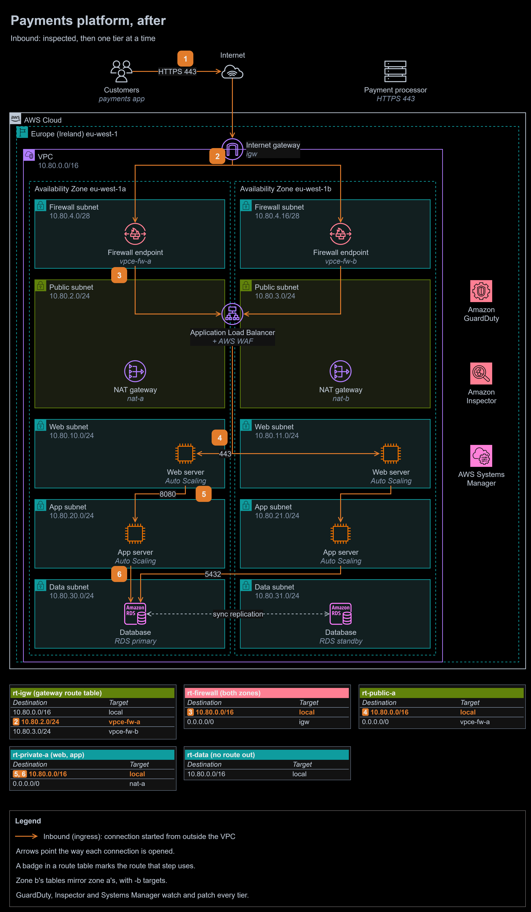
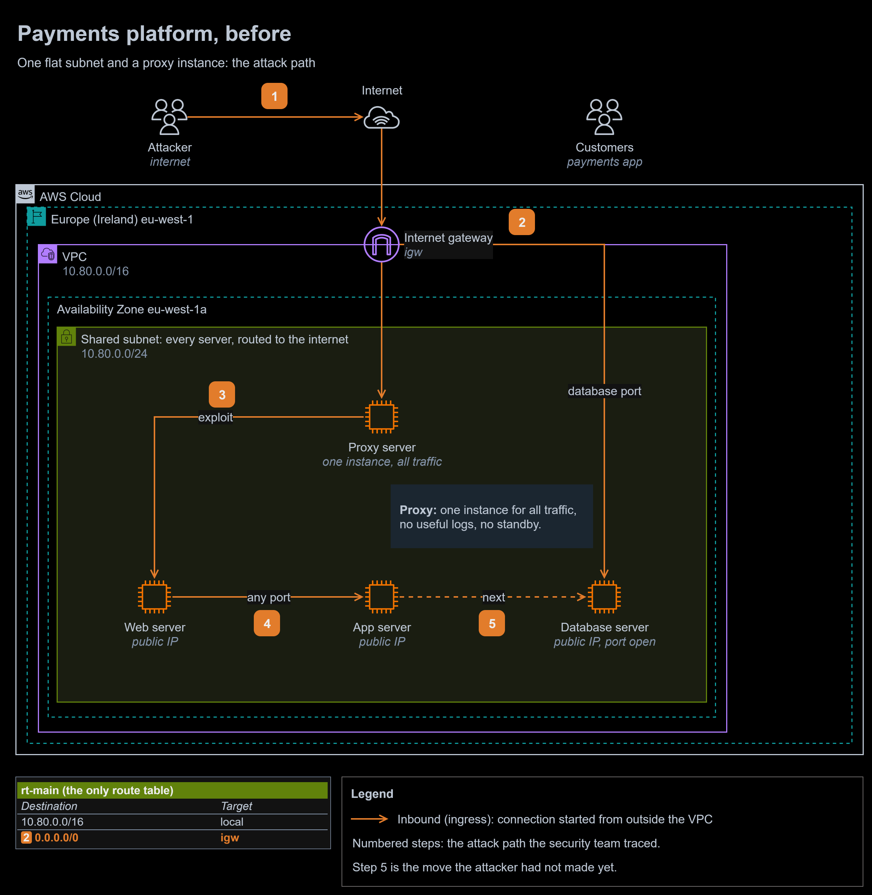
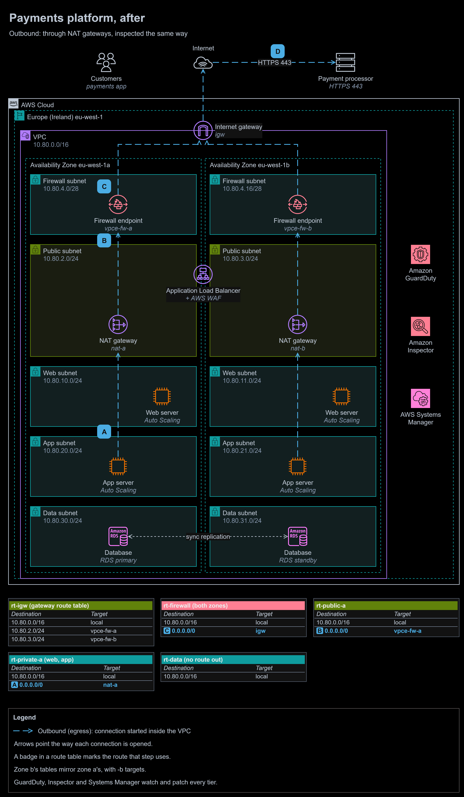

# Study 4 | Flat-network breach remediation for a payments company

**Question received:** 10 March 2026 | **Type:** design study, no AWS resources | **Status:** new answer, written after the programme

**At a glance**

- **Outcome:** a payments platform rebuilt from one flat subnet and a single proxy instance into tiered subnets across two zones. A compromised web server can now reach one port on the application tier and nothing else, the database cannot be reached from the internet by any route, and a managed firewall inspects and logs every connection in and out.
- **Built:** a before diagram with the attack path, after diagrams for inbound and outbound traffic, route tables, security groups, a network ACL, a containment checklist, a phased rebuild plan and three decision records.
- **Stack:** AWS Network Firewall, Application Load Balancer with AWS WAF, NAT gateways, Amazon EC2 Auto Scaling, Amazon RDS Multi-AZ, AWS Database Migration Service, Amazon GuardDuty, Amazon Inspector, AWS Systems Manager.
- **Proof:** each failure the security team found maps to a specific control below, and every routing rule is checked against AWS documentation.

To zoom in, right-click the diagram and open the image in a new tab. The editable source is [`diagrams/flat-network-remediation.drawio`](diagrams/flat-network-remediation.drawio). It has three pages: before, after inbound (above) and after outbound.

1. **Customers** open the payments app over HTTPS 443.
2. The **internet gateway's** own route table sends each public subnet's traffic to the **Network Firewall endpoint** in the same zone (`10.80.2.0/24` to `vpce-fw-a`).
3. The firewall checks it against threat signatures and logs it, and `rt-firewall`'s local route delivers it to the **Application Load Balancer's** node in that zone.
4. The load balancer, with **AWS WAF**, forwards to a **web server** in either zone. `sg-web` admits 443 only from `sg-alb`.
5. Web servers call the **app servers** on 8080. `sg-app` admits 8080 only from `sg-web`: this is the only path a compromised web server has.
6. App servers query the **RDS primary** on 5432. `sg-db` admits 5432 only from `sg-app`, and `nacl-data` only from the app subnets.

**Return traffic** retraces each request. Each public route table sends `0.0.0.0/0` to its own zone's firewall endpoint, so the load balancer's replies pass the same endpoint as the requests, as Network Firewall requires.

Before: one flat subnet, and the attack path

1. An **attacker** on the internet looks for a way in.
2. The **database server's** login port is reachable from the internet: the only route table sends `0.0.0.0/0` to the internet gateway, the server has a public address, and its security group allows the port from anywhere.
3. The attacker exploits a vulnerability in a **web server**, through the **proxy**.
4. From the web server, the attacker reaches the **app server** on any port: everything is in one subnet, and the security groups allow traffic inside it.
5. The database was one hop further.

After: outbound traffic, inspected the same way

- **A.** An app server calls the **payment processor**. `rt-private-a` sends `0.0.0.0/0` to `nat-a` in the same zone.
- **B.** The **NAT gateway** replaces the source address with its Elastic IP address, and `rt-public-a` sends `0.0.0.0/0` to `vpce-fw-a`. The firewall allows only the payment processor's and the update repositories' host names.
- **C.** `rt-firewall` sends `0.0.0.0/0` to the **internet gateway**.
- **D.** The request reaches the payment processor on 443. The reply comes back through `rt-igw`, the same firewall endpoint and the NAT gateway.

## The task, in my own words

A digital payments company launched its platform on AWS quickly: web, application and database servers all in one subnet, and one proxy server on EC2 for all inbound and outbound internet traffic. Within a month, its database was being probed with login attempts although it was never meant to be public, anyone who reached the web tier could reach the other tiers, and the proxy was overloaded, opaque and a single point of failure. Then an attacker exploited a web server and moved to the application tier. No critical data was stolen. Design the remediation.

## What went wrong, and what fixes it

| What the security team found | Why it happened | What fixes it |
|---|---|---|
| Login attempts on the database from the internet | The database had a public address, its subnet routed to the internet gateway, and its security group allowed its port from anywhere | Data subnets with no route out, RDS with "Publicly accessible" off, `sg-db` admitting only `sg-app`, a network ACL ([ADR-0002](decisions/0002-segment-the-tiers-and-chain-security-groups.md)) |
| Web to application lateral movement | One subnet, and security groups that allowed traffic inside it | A subnet per tier, and security groups that allow one port from the tier before, by reference ([ADR-0002](decisions/0002-segment-the-tiers-and-chain-security-groups.md)) |
| An overloaded, opaque proxy that could stop everything | One EC2 instance for all internet traffic | A load balancer with WAF in, NAT gateways out, and Network Firewall endpoints in each zone logging both directions ([ADR-0001](decisions/0001-replace-the-proxy-instance-with-managed-services.md)) |
| The breach itself | A web server with an exploitable vulnerability | Amazon Inspector finds vulnerable packages, Systems Manager patches them or servers are replaced from patched images, WAF managed rules block common exploits, GuardDuty raises the alarm |

## First 24 hours: contain

[ADR-0003](decisions/0003-contain-first-then-rebuild-tier-by-tier.md) puts containment before any rebuild, because the attacker may still be inside:

1. Remove the database server's public address and restrict its security group to the app servers. The probing stops.
2. Replace the broad rules inside the flat subnet with tier-to-tier rules by security group reference. Security groups apply per instance, so this works before anything moves.
3. Isolate the exploited web server with a security group that has no rules, snapshot its volumes for the investigation, and replace it with a server built from a patched image.
4. Rotate every credential the application tier held: database passwords, API keys and access keys.
5. Turn on Amazon GuardDuty, VPC Flow Logs, AWS CloudTrail and Amazon Inspector, and patch everything Inspector flags.

## The rebuilt network

### Tiers

| Tier | Subnets (zone a, zone b) | Holds | Route out of the VPC |
|---|---|---|---|
| Firewall | `10.80.4.0/28`, `10.80.4.16/28` | One Network Firewall endpoint each, and nothing else | `0.0.0.0/0` to the internet gateway |
| Public | `10.80.2.0/24`, `10.80.3.0/24` | The load balancer's nodes and a NAT gateway | `0.0.0.0/0` to its own zone's firewall endpoint |
| Web | `10.80.10.0/24`, `10.80.11.0/24` | Web servers in an Auto Scaling group | `0.0.0.0/0` to its own zone's NAT gateway |
| App | `10.80.20.0/24`, `10.80.21.0/24` | App servers in an Auto Scaling group | `0.0.0.0/0` to its own zone's NAT gateway |
| Data | `10.80.30.0/24`, `10.80.31.0/24` | Amazon RDS Multi-AZ | None |

The old flat subnet, `10.80.0.0/24`, stays until cutover and is then deleted, which is why the new public subnets start at `10.80.2.0/24`.

### Route tables

| Route table | Associated with | Destination | Target | Carries |
|---|---|---|---|---|
| `rt-igw` | The internet gateway (edge association) | `10.80.0.0/16` | local | Kept by every gateway route table |
| | | `10.80.2.0/24` | `vpce-fw-a` | Everything for public subnet a (step 2), and replies to `nat-a` |
| | | `10.80.3.0/24` | `vpce-fw-b` | Everything for public subnet b |
| `rt-firewall` | Both firewall subnets | `10.80.0.0/16` | local | Inspected traffic on to the load balancer and NAT gateways (step 3) |
| | | `0.0.0.0/0` | `igw` | Inspected traffic out to the internet (C) |
| `rt-public-a` | Public subnet a | `10.80.0.0/16` | local | Load balancer to web servers (step 4) |
| | | `0.0.0.0/0` | `vpce-fw-a` | Replies to customers, and the NAT gateway's outbound traffic (B) |
| `rt-private-a` | Web and app subnets a | `10.80.0.0/16` | local | Web to app (5), app to database (6) |
| | | `0.0.0.0/0` | `nat-a` | Calls to the payment processor and update repositories (A) |
| `rt-data` | Both data subnets | `10.80.0.0/16` | local | The database's replies only |

Zone b has `rt-public-b` and `rt-private-b`, the same with `vpce-fw-b` and `nat-b`.

### Security groups

| Security group | Attached to | Inbound | Outbound |
|---|---|---|---|
| `sg-alb` | Application Load Balancer | 443 from `0.0.0.0/0` | 443 to `sg-web` |
| `sg-web` | Web servers | 443 from `sg-alb` | 8080 to `sg-app`; 443 to `0.0.0.0/0` for updates, narrowed by the firewall's allow list |
| `sg-app` | App servers | 8080 from `sg-web` | 5432 to `sg-db`; 443 to `0.0.0.0/0` for the payment processor, narrowed by the firewall |
| `sg-db` | RDS | 5432 from `sg-app` | None |

No security group opens SSH or RDP: administrators use AWS Systems Manager Session Manager.

### Network ACL on the data subnets

| Rule | Direction | Protocol | Ports | Source or destination | Action |
|---:|---|---|---|---|---|
| 100 | Inbound | TCP | 5432 | `10.80.20.0/23` (both app subnets) | Allow |
| 110 | Inbound | All | All | `10.80.30.0/23` (both data subnets) | Allow |
| * | Inbound | All | All | `0.0.0.0/0` | Deny |
| 100 | Outbound | TCP | 1024-65535 | `10.80.20.0/23` | Allow |
| 110 | Outbound | All | All | `10.80.30.0/23` | Allow |
| * | Outbound | All | All | `0.0.0.0/0` | Deny |

## Rebuild plan

The timings are indicative; they depend on the size of the database and the team.

| Phase | When | Work | Done when |
|---|---|---|---|
| 0. Contain | First 24 hours | The five steps above | No server but the proxy answers from the internet; credentials rotated |
| 1. Foundations | Week 1 | New subnets, firewall endpoints, gateway route table, NAT gateways (one reusing the proxy's Elastic IP address), logging | Firewall and flow logs arrive; partners allowlist the second address |
| 2. Data | Weeks 1 to 2 | Amazon RDS Multi-AZ in the data subnets, kept in sync by AWS DMS | DMS validation shows the tables in sync |
| 3. Web and app | Week 2 | Auto Scaling groups from patched images behind the new load balancer and WAF | Health checks pass; Inspector shows no critical findings |
| 4. Cut over | Week 3 | Weighted DNS from 10% to 100% of customers; a short write freeze to cut the database over | Error rates and payment success unchanged |
| 5. Retire | Week 4 | Stop the proxy and old servers, keep their snapshots, delete the flat subnet | Reachability Analyzer finds no path from the internet to any tier |

## Traps I avoided

1. **Scaling the proxy instead of replacing it.** A bigger proxy, or a fleet of them, keeps the work that failed: patching, scaling and watching proxy servers. Managed services remove it.
2. **Rebuilding before containing.** A rebuild takes weeks; the database was exposed today, and the attacker may still be inside. Containment needs only security group and address changes.
3. **Destroying the evidence.** The exploited server is isolated and snapshotted before it is replaced, so the investigation can find how the attacker got in and what they touched.
4. **Thinking subnets alone stop lateral movement.** Every subnet in a VPC reaches every other through the `local` route. Subnets take the database off the internet; the security groups, one port per tier, are what stop movement between tiers.
5. **Forgetting who trusts the old address.** Partners may allowlist the proxy's address. Moving its Elastic IP address to a NAT gateway keeps them working.
6. **Leaving the database on a public address "for now".** It is the first thing containment fixes, not the last thing the rebuild does.

## Design vs production

| Concern | In this design | Before going to production | Well-Architected pillar |
|---|---|---|---|
| Detection | GuardDuty, Inspector, flow logs | Findings sent to AWS Security Hub and the on-call channel; a runbook for each finding type | Security, Operational Excellence |
| Patching | Patched images and Systems Manager | A monthly patch baseline with Patch Manager, and Inspector scans on every new image | Security |
| Edge rules | Threat signatures, WAF managed rules, an outbound allow list | Rate-based WAF rules on login and payment endpoints; review firewall alerts weekly | Security |
| Payment card data | Segmented tiers | PCI DSS v4.0.1 applies; segmentation supports Requirement 1, but meeting the standard takes all twelve requirements and an assessment | Security |
| Zone failure | Two zones, a NAT gateway and firewall endpoint in each | A game day that stops one zone | Reliability |
| Database | RDS Multi-AZ | Automated backups with point-in-time recovery; credentials in Secrets Manager with rotation | Reliability, Security |
| Cost | Firewall endpoints, NAT gateways, a load balancer and old servers running together for a few weeks | Retire the old servers promptly; gateway endpoints for Amazon S3 so that AWS traffic skips NAT charges | Cost Optimization |
| Throughput | Not sized | Size from the proxy's peak load; Auto Scaling on request count | Performance Efficiency |
| Efficiency | Not considered | Scale in at night; AWS Graviton instances | Sustainability |
| How it is built | Drawn by hand | Terraform, so the new network is reviewed and repeatable (see modules 12 and 13) | Operational Excellence |

## What I learned

- A flat network makes every single mistake fatal. Segmentation is about making each mistake survivable.
- Subnets and security groups do different jobs: route tables decide what can reach the internet, security groups decide what can reach what inside the VPC.
- In an incident, contain first with the controls that apply instantly, then rebuild properly.

## Sources

- [Gateway route tables](https://docs.aws.amazon.com/vpc/latest/userguide/gateway-route-tables.html) and [VPC route table configuration for AWS Network Firewall](https://docs.aws.amazon.com/network-firewall/latest/developerguide/vpc-config-route-tables.html)
- [Security group rules](https://docs.aws.amazon.com/vpc/latest/userguide/security-group-rules.html) and [network ACLs](https://docs.aws.amazon.com/vpc/latest/userguide/vpc-network-acls.html)
- [AWS Security Incident Response Guide](https://docs.aws.amazon.com/whitepapers/latest/aws-security-incident-response-guide/aws-security-incident-response-guide.html)
- [Amazon GuardDuty](https://docs.aws.amazon.com/guardduty/latest/ug/what-is-guardduty.html), [Amazon Inspector](https://docs.aws.amazon.com/inspector/latest/user/what-is-inspector.html) and [AWS Systems Manager Patch Manager](https://docs.aws.amazon.com/systems-manager/latest/userguide/patch-manager.html)
- [AWS Database Migration Service](https://docs.aws.amazon.com/dms/latest/userguide/Welcome.html)
- [AWS WAF managed rule groups](https://docs.aws.amazon.com/waf/latest/developerguide/aws-managed-rule-groups.html)
- [VPC Reachability Analyzer](https://docs.aws.amazon.com/vpc/latest/reachability/what-is-reachability-analyzer.html)
