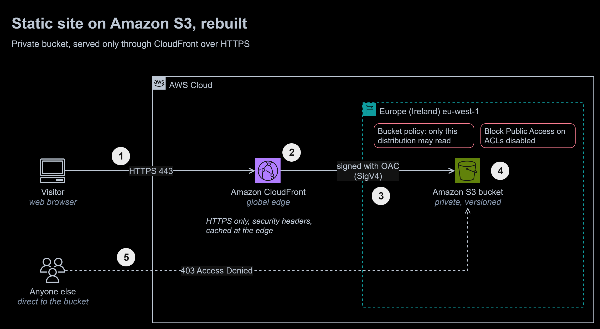
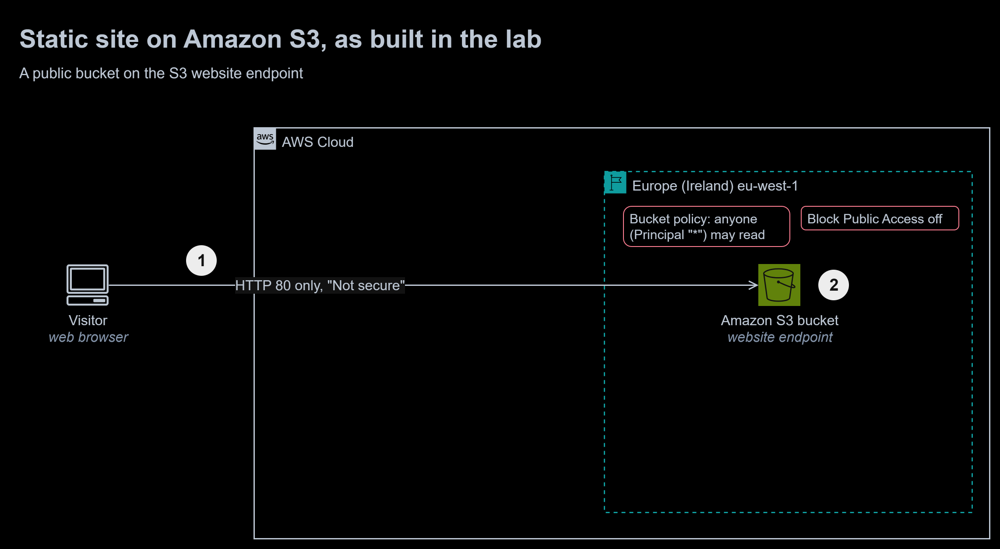

# 10 | S3 Static Website

**Exercise date:** 27 March 2026 | **Type:** hands-on lab in a training account | **Status:** rebuilt in Terraform, deployed and tested in my own AWS account

**At a glance**

- **Outcome:** the lab's public, HTTP-only S3 website rebuilt as a private bucket that only CloudFront can read, served over HTTPS with security headers, entirely in Terraform.
- **Built:** a Terraform configuration of 11 resources, two original pages, an 11-check live smoke test, a GitHub Actions workflow and a before-and-after diagram.
- **Stack:** Terraform 1.16, AWS provider 6.69, Amazon S3, Amazon CloudFront with Origin Access Control, tflint, checkov, GitHub Actions.
- **Proof:** deployed to my own account on 17 October 2026, where all 11 live checks passed: HTTPS, the HTTP redirect, the 404 page, the security headers, and the bucket refusing direct requests. On every push, CI runs `terraform fmt` and `validate`, tflint, and checkov (33 checks passed, 0 failed, 11 skipped with written reasons).



To zoom in, right-click the diagram and open the image in a new tab. The editable source is [`diagrams/s3-static-site.drawio`](diagrams/s3-static-site.drawio). It has two pages: rebuilt (above) and the lab as built.

1. A visitor's browser connects to the nearest **CloudFront** edge location over HTTPS 443. A request over plain HTTP gets a 301 redirect to HTTPS.
2. CloudFront answers from its cache when it can, and adds security headers from the AWS managed `SecurityHeadersPolicy`: `Strict-Transport-Security`, `X-Content-Type-Options`, `X-Frame-Options` and `Referrer-Policy`.
3. On a cache miss, CloudFront signs its request to the bucket with **Origin Access Control** (SigV4).
4. The **bucket policy** lets only this distribution read objects, by its ARN. Block Public Access is on, ACLs are disabled, and a second statement refuses any request not made over TLS.
5. **Anyone else** going straight to the bucket gets 403 Access Denied, over HTTPS or HTTP.

<details>
<summary>The lab as built: a public bucket on the S3 website endpoint</summary>



1. The browser reached the bucket's **website endpoint** over HTTP only, and marked the page "Not secure".
2. The bucket was readable by anyone: Block Public Access was off and the bucket policy allowed `s3:GetObject` to every principal.

</details>

## The task, in my own words

Host a static website on Amazon S3: create a bucket, upload a site with a home page and an error page, turn on static website hosting, make the site readable from the internet, and show the home page and the error page in a browser.

## What I did in the lab

- Created a bucket in eu-west-1 whose name included the training account's ID.
- Turned off Block Public Access and added this bucket policy (bucket name redacted):

  ```json
  {
    "Version": "2012-10-17",
    "Statement": [
      {
        "Sid": "PublicReadGetObject",
        "Effect": "Allow",
        "Principal": "*",
        "Action": "s3:GetObject",
        "Resource": "arn:aws:s3:::<bucket-name>/*"
      }
    ]
  }
  ```

- Turned on static website hosting with `index.html` and `error.html`, and uploaded the "Paradigm Shift" template by [HTML5 UP](https://html5up.net/), unchanged. HTML5 UP templates are licensed under [Creative Commons Attribution 3.0](https://html5up.net/license); the design is theirs and is not included in this repository.
- Opened the site on the S3 website endpoint, which the browser marked "Not secure", and showed that a missing page displayed the error page.

## The rebuilt solution

| File | What it does |
|---|---|
| [`terraform/versions.tf`](terraform/versions.tf) | Terraform 1.10 or later and the AWS provider 6.x. [`.terraform.lock.hcl`](terraform/.terraform.lock.hcl) pins 6.69.1, with hashes for Linux, Windows and macOS |
| [`terraform/providers.tf`](terraform/providers.tf) | The Region (eu-west-1 by default) and tags on every resource |
| [`terraform/variables.tf`](terraform/variables.tf) | Region, bucket name prefix, CloudFront price class and the site folder, each validated |
| [`terraform/main.tf`](terraform/main.tf) | The bucket and its settings, the bucket policy, the site files, Origin Access Control and the distribution |
| [`terraform/outputs.tf`](terraform/outputs.tf) | The site's address, the distribution ID, the bucket name and the bucket's own endpoint |
| [`terraform/.tflint.hcl`](terraform/.tflint.hcl) | tflint with the recommended Terraform rules and the AWS ruleset |
| [`site/`](site/) | `index.html` and `error.html`, written for this module |
| [`tests/smoke_test.sh`](tests/smoke_test.sh) | The live checks against a deployed site |

### What keeps the bucket private

- **Block Public Access**, all four settings on, and **ACLs disabled** (`BucketOwnerEnforced`). No policy or ACL can make an object public, even by mistake. Terraform applies the bucket policy only after Block Public Access is in place.
- **The bucket policy** grants `s3:GetObject` to the CloudFront service principal, on one condition: `AWS:SourceArn` must be this distribution. A second statement denies every request where `aws:SecureTransport` is false.
- **No website endpoint.** S3 website endpoints serve only HTTP, and CloudFront can use Origin Access Control only with the bucket's REST endpoint. So static website hosting stays off, and CloudFront's `default_root_object` serves `index.html` instead.
- **No account ID anywhere.** `bucket_prefix` lets AWS add a random suffix, so neither the bucket name nor any URL reveals the account.

### Details that matter

- **Missing pages.** CloudFront has no permission to list the bucket, so S3 answers a request for a missing object with 403, not 404. The distribution maps both codes to `/error.html` with status 404, so visitors see a proper "not found" page.
- **Versions.** Versioning is on, so an overwritten or deleted page can be restored. A lifecycle rule deletes old versions after 30 days, and incomplete uploads after 7.
- **Caching.** The AWS managed `CachingOptimized` policy caches at the edge and compresses responses; each page is uploaded with `Cache-Control: public, max-age=300`.
- **Encryption.** Every object is encrypted with SSE-S3.

### Running it

```bash
cd 10-s3-static-website/terraform
terraform init
terraform plan -out=tfplan
terraform apply tfplan          # about 3 minutes: CloudFront deploys to its edge locations
bash ../tests/smoke_test.sh     # reads the addresses from terraform output
terraform destroy               # removes everything, including the bucket's object versions
```

The state is kept locally and is excluded from git; [module 13](../README.md#modules) moves it to an S3 backend with locking. At this site's traffic, the cost stays within the AWS Free Tier, which includes 1 TB of CloudFront data transfer and 10 million requests every month.

## How it is tested

**On every push** (the [`terraform`](../.github/workflows/terraform.yml) workflow, with no AWS credentials):

| Check | Result |
|---|---|
| `terraform fmt -check` | Pass |
| `terraform init -backend=false -lockfile=readonly` and `terraform validate` | Pass |
| tflint 0.64.0 with the AWS ruleset 0.49.0 | No issues |
| checkov 3.3.21 | 33 passed, 0 failed, 11 skipped, each with a reason in [`main.tf`](terraform/main.tf) |

The skipped checks are things this site deliberately does without, all listed under [Design vs production](#design-vs-production): AWS WAF, access logs, a custom domain with a TLS 1.2 minimum, KMS keys, cross-Region replication, origin failover, geographic restriction and S3 event notifications.

**Against the live deployment**, 17 October 2026: `terraform apply` created 11 resources in 176 seconds, a second `terraform plan` reported no changes, and the smoke test passed. Afterwards, `terraform destroy` removed everything; `terraform apply` recreates it in about 3 minutes.

```console
$ bash tests/smoke_test.sh
PASS  home page over HTTPS returns 200
PASS  home page is this site's page
PASS  plain HTTP is redirected (301)
PASS  the redirect points to HTTPS
PASS  a missing page returns 404
PASS  a missing page shows the error page
PASS  Strict-Transport-Security is set
PASS  X-Content-Type-Options is nosniff
PASS  X-Frame-Options is set
PASS  the bucket refuses a direct HTTPS request (403)
PASS  the bucket refuses a direct HTTP request (403)

11 passed, 0 failed
```

The response headers, from the same deployment (the distribution's host name shortened):

```console
$ curl -sI https://dxxxxxxxxxxxxx.cloudfront.net/
HTTP/2 200
content-type: text/html; charset=utf-8
x-cache: Hit from cloudfront
x-xss-protection: 1; mode=block
x-frame-options: SAMEORIGIN
referrer-policy: strict-origin-when-cross-origin
x-content-type-options: nosniff
strict-transport-security: max-age=31536000
```

## Mistakes I fixed

1. **A public bucket.** Block Public Access was off and the bucket policy let any principal read every object, so anything uploaded by mistake would have been public too. The bucket is now private, and Block Public Access stops a public policy from ever being applied.
2. **HTTP only.** S3 website endpoints do not support HTTPS, so the browser marked the site "Not secure". CloudFront now serves it over HTTPS and redirects HTTP.
3. **The account ID in public view.** The bucket name included the account ID, and the website endpoint put that name in every URL. The new name has a random suffix instead.
4. **A borrowed design.** The site was an unchanged template. The pages are now my own, and the template's authors are credited above.
5. **Built by hand.** The console steps left no record that could be reviewed, repeated or removed cleanly. Terraform now builds, checks and destroys the whole site, and CI checks the code on every push.
6. **No way back.** Without versioning, an overwritten page was gone. Versioning keeps 30 days of history.

## Design vs production

| Concern | In this module | Before going to production | Well-Architected pillar |
|---|---|---|---|
| Domain and TLS | The default `cloudfront.net` address and certificate | A custom domain with an ACM certificate in us-east-1, a `TLSv1.2_2021` minimum, and a Route 53 alias record | Security |
| Edge protection | Security headers only | AWS WAF with AWS managed rule groups and a rate-based rule; a Content-Security-Policy in a custom response headers policy | Security |
| Logging | None | CloudFront standard logs to S3 or CloudWatch Logs; CloudWatch alarms on the 4xx and 5xx error rates | Operational Excellence, Reliability |
| State and deployment | Local state, applied from a workstation | Remote state in S3 with locking; plan on pull request and a gated apply through GitHub Actions with OIDC, plus a cache invalidation after each content change (modules 12 and 13) | Operational Excellence |
| Cost | `PriceClass_100`, caching | An AWS Budgets alert; a wider price class only if visitors outside North America and Europe need it | Cost Optimization |
| Performance | Edge caching and compression | Longer cache lifetimes with versioned file names for assets | Performance Efficiency |
| Efficiency | Cached at the edge, small pages | Keep pages and images small; the cache already spares the origin most requests | Sustainability |

## What I learned

- S3 website endpoints cannot serve HTTPS. For HTTPS and a private bucket, CloudFront reads the bucket's REST endpoint with Origin Access Control.
- Without permission to list the bucket, S3 answers a missing object with 403, so the error page has to be mapped from 403 as well as 404.
- Block Public Access is the safety net: with it on, a mistaken public policy cannot be applied at all.

## Sources

- [Website endpoints](https://docs.aws.amazon.com/AmazonS3/latest/userguide/WebsiteEndpoints.html) (no HTTPS support)
- [Restricting access to an Amazon S3 origin with Origin Access Control](https://docs.aws.amazon.com/AmazonCloudFront/latest/DeveloperGuide/private-content-restricting-access-to-s3.html)
- [Blocking public access to your Amazon S3 storage](https://docs.aws.amazon.com/AmazonS3/latest/userguide/access-control-block-public-access.html)
- CloudFront [managed cache policies](https://docs.aws.amazon.com/AmazonCloudFront/latest/DeveloperGuide/using-managed-cache-policies.html) and [managed response headers policies](https://docs.aws.amazon.com/AmazonCloudFront/latest/DeveloperGuide/using-managed-response-headers-policies.html)
- [Amazon CloudFront pricing and Free Tier](https://aws.amazon.com/cloudfront/pricing/)
- [Terraform AWS provider](https://registry.terraform.io/providers/hashicorp/aws/latest/docs), [tflint](https://github.com/terraform-linters/tflint) and [checkov](https://www.checkov.io/)
