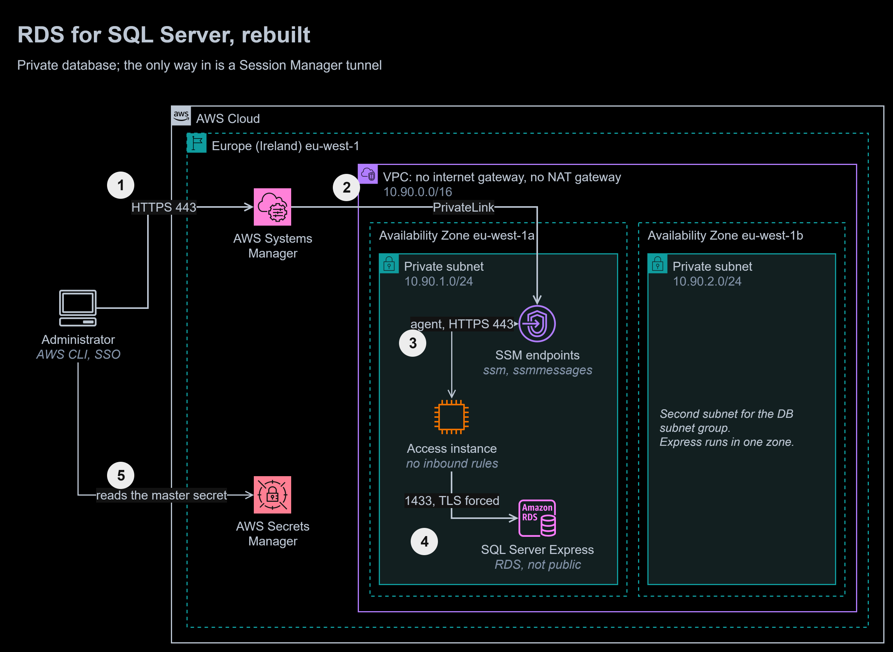
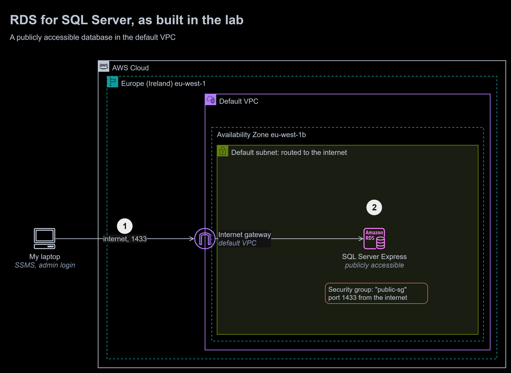

# 11 | RDS for SQL Server

**Exercise date:** 27 March 2026 | **Type:** hands-on lab in a training account | **Status:** rebuilt in Terraform, deployed and tested in my own AWS account

**At a glance**

- **Outcome:** the lab's internet-facing SQL Server database rebuilt as a private RDS instance in an isolated VPC. The only way in is a Session Manager tunnel, every connection is encrypted, and no password appears in any file, state file or command line.
- **Built:** a Terraform configuration of 28 resources, five SQL scripts rewritten to be repeatable and to enforce their own rules, a least-privilege application login, a SQL test suite that runs in CI against SQL Server in a container and against RDS through the tunnel, and a before-and-after diagram.
- **Stack:** Terraform, Amazon RDS for SQL Server 2022 Express, AWS Secrets Manager, AWS Systems Manager Session Manager, VPC interface endpoints, Docker, sqlcmd, GitHub Actions.
- **Proof:** on every push, 13 SQL checks run against SQL Server 2022 Express in a container, and checkov passes 93 Terraform checks with none failing. Deployed to my own account on 18 October 2026: 5 network and access checks and 14 SQL checks passed through the tunnel, twice in a row.



To zoom in, right-click the diagram and open the image in a new tab. The editable source is [`diagrams/rds-sql-server.drawio`](diagrams/rds-sql-server.drawio). It has two pages: rebuilt (above) and the lab as built.

1. The **administrator** starts a port-forwarding session with the AWS CLI, signed in through AWS IAM Identity Center. The request goes to **AWS Systems Manager** over HTTPS.
2. Systems Manager reaches the VPC through **interface endpoints** (AWS PrivateLink): the VPC has no internet gateway and no NAT gateway, and its route table has only the local route.
3. The SSM Agent on the **access instance** keeps an outbound HTTPS connection to the endpoints, and the session travels over it. The instance has no public address and no inbound rules.
4. The instance opens TCP 1433 to **SQL Server**. The database's security group admits only the access instance's security group, and the `rds.force_ssl` parameter makes the server encrypt every connection.
5. The administrator's password is the master user's, kept and rotated by RDS in **AWS Secrets Manager**. The test script reads it into an environment variable, never onto a command line.

<details>
<summary>The lab as built: a publicly accessible database</summary>



1. My laptop connected with SQL Server Management Studio across the internet, as the master user.
2. The instance sat in the default VPC's subnets, which route to the internet gateway, with "Publicly accessible" set to Yes and a security group open on port 1433.

</details>

## The task, in my own words

Create a SQL Server database on Amazon RDS, connect to it from a SQL client, create a database and a table, insert some rows and query them back, and document the instance's configuration.

## What I did in the lab

- Created an RDS for SQL Server 2019 Express instance (`15.00.4455.2.v1`) on `db.t3.micro` in eu-west-1b, with 20 GiB of gp2 storage, encryption on, and storage autoscaling up to 1,000 GiB.
- Accepted the default VPC and its default DB subnet group, set "Publicly accessible" to Yes, and attached a security group created for public access.
- Kept the default master user name and copied the generated password from the console, which shows it only once. IAM database authentication, Performance Insights and Enhanced Monitoring were off.
- Connected from SQL Server Management Studio on my laptop and ran a script that created a project database and a table of five fantasy-football players, inserted the rows and read them back with `SELECT *`.

## The rebuilt solution

| File | What it does |
|---|---|
| [`terraform/network.tf`](terraform/network.tf) | An isolated VPC with two private subnets in pinned zones and only the local route; three security groups that name each other; the three Session Manager interface endpoints |
| [`terraform/rds.tf`](terraform/rds.tf) | The DB subnet group, a parameter group with `rds.force_ssl = 1`, the Enhanced Monitoring role, and the SQL Server 2022 Express instance |
| [`terraform/access.tf`](terraform/access.tf) | The access instance: Amazon Linux 2023, no public address, no inbound rules, IMDSv2 only, an encrypted disk and the Session Manager instance profile |
| [`terraform/app_login.tf`](terraform/app_login.tf) | The application login's password, generated as an ephemeral value and stored in Secrets Manager as a write-only argument, so it never reaches the Terraform state |
| [`terraform/variables.tf`](terraform/variables.tf), [`outputs.tf`](terraform/outputs.tf), [`versions.tf`](terraform/versions.tf) | Validated inputs, the values the tests need, and pinned providers ([`.terraform.lock.hcl`](terraform/.terraform.lock.hcl)) |
| [`sql/`](sql/) | `01_database` to `05_best_value`: the lab's script, rewritten |
| [`tests/sql_test.sh`](tests/sql_test.sh) | 13 checks of the SQL, against any SQL Server: a container in CI, RDS through the tunnel |
| [`tests/rds_test.sh`](tests/rds_test.sh) | Checks the network, opens the tunnel, reads the passwords from Secrets Manager and runs `sql_test.sh` through it |

### Keeping the database private

- **No route.** The VPC has no internet gateway and no NAT gateway; its route table has only the local route.
- **No public address.** `publicly_accessible = false`, so the endpoint's DNS name resolves to a private address.
- **One security group rule.** Port 1433 is open only to the access instance's security group, by reference, never to an address range.
- **No bastion host.** Administrators reach the database through a Session Manager port-forwarding session. No SSH key exists, no inbound port is open anywhere, and every session is authorised by IAM and logged.

### Credentials

- **The master password is managed by RDS** in AWS Secrets Manager and rotated automatically (`manage_master_user_password`). Nobody copies it from the console.
- **The application has its own login,** `squad_app`, which can read, add and update players, and nothing else: no `DELETE` and no right to change the schema. Its password is generated by Terraform as an ephemeral value and written to Secrets Manager through a write-only argument, so it never appears in the state or the plan.
- **Passwords travel only in environment variables.** The test scripts never put a password on a command line, where other processes could read it.

### The SQL, rewritten

| Script | What changed from the lab |
|---|---|
| [`01_database.sql`](sql/01_database.sql) | Creates the database only if it is missing, so the script can run again |
| [`02_schema.sql`](sql/02_schema.sql) | A `fantasy` schema; `NVARCHAR` names, so "Ødegaard" keeps its letter; check constraints on position, price and points; a unique constraint on player and club; a creation timestamp. Every object is created only if missing |
| [`03_seed.sql`](sql/03_seed.sql) | `MERGE` instead of `INSERT`: running it again updates players instead of failing or duplicating them |
| [`04_app_access.sql`](sql/04_app_access.sql) | The `squad_app` login, a `squad_writer` role with `SELECT`, `INSERT` and `UPDATE` on the schema, and the password taken from a sqlcmd variable, never written in the file |
| [`05_best_value.sql`](sql/05_best_value.sql) | A report with named columns instead of `SELECT *`: points per million, best value first |

### Running it

```bash
cd 11-rds-sql-server/terraform
terraform init
terraform plan -out=tfplan
terraform apply tfplan         # about 25 to 45 minutes: SQL Server instances are slow to create
bash ../tests/rds_test.sh      # needs the Session Manager plugin and Docker
terraform destroy
```

In eu-west-1 this costs about $0.07 an hour while it runs: $0.023 for the SQL Server Express instance (its licence is free), $0.0114 for the access instance and $0.033 for the three interface endpoints, plus storage. Destroy it when the tests have passed.

## How it is tested

**On every push**, with no AWS credentials:

| Workflow | Check | Result |
|---|---|---|
| [`sql`](../.github/workflows/sql.yml) | The 13 checks in `sql_test.sh`, against SQL Server 2022 Express in a container started for the run, with passwords generated for that run only | 13 passed |
| [`terraform`](../.github/workflows/terraform.yml) | `terraform fmt`, `validate`, tflint with the AWS ruleset | Pass, no issues |
| | checkov 3.3.21 | 93 passed, 0 failed, 9 skipped, each with a reason in the code |

The skipped checks are things SQL Server Express or this lab cannot have, each listed under [Design vs production](#design-vs-production): Multi-AZ and Performance Insights (not available on this edition and class), IAM database authentication (not supported by RDS for SQL Server), deletion protection (off so the lab can be removed), VPC flow logs, a customer managed KMS key and rotation for the application secret, and detailed monitoring on the access instance.

The SQL checks:

```console
$ bash tests/sql_test.sh
PASS  the scripts run
PASS  the scripts run again without duplicating anything
PASS  a name with a non-English letter is stored intact
PASS  an unknown position is refused
PASS  a price below 3.5 is refused
PASS  negative points are refused
PASS  the same player at the same club twice is refused
PASS  the app login can read the squad
PASS  the app login can add a player
PASS  the app login cannot delete
PASS  the app login cannot create tables
PASS  the best value report puts Ollie Watkins first
PASS  this connection is encrypted

13 passed, 0 failed
```

**Against the live deployment**, 18 October 2026:

- `terraform apply` created 28 resources in 1,210 seconds; the SQL Server instance alone took 19 minutes 46 seconds.
- A second `terraform plan` reported no changes.
- The state file holds no application password: `secret_string` is empty and the write-only `secret_string_wo` is null.
- `rds_test.sh` passed twice in a row. The second run executed every script again against the data the first run left, which shows they are repeatable on the real database, and it found no tunnel left over from the first.
- Afterwards, `terraform destroy` removed everything.

```console
$ bash tests/rds_test.sh
PASS  the instance is not publicly accessible
PASS  its DNS name resolves to a private address
PASS  its security group admits no address range, only the access instance's group
PASS  a direct connection from here fails
PASS  a Session Manager tunnel is open on 127.0.0.1:11433

PASS  the scripts run
PASS  the scripts run again without duplicating anything
PASS  a name with a non-English letter is stored intact
PASS  an unknown position is refused
PASS  a price below 3.5 is refused
PASS  negative points are refused
PASS  the same player at the same club twice is refused
PASS  the app login can read the squad
PASS  the app login can add a player
PASS  the app login cannot delete
PASS  the app login cannot create tables
PASS  the best value report puts Ollie Watkins first
PASS  this connection is encrypted
PASS  the server encrypts even when the client does not ask (rds.force_ssl)

14 passed, 0 failed

network and access: 5 passed, 0 failed
```

## Mistakes I fixed

1. **A database on the internet.** The instance was publicly accessible, in subnets that route to the internet gateway, behind a security group open on port 1433: anyone could try to log in. It now has no public address, no route out and one security group rule.
2. **The master user for everything.** I created tables and inserted data as the master user. The application now has its own login with only the rights it needs, and it cannot delete data or change the schema.
3. **A password copied by hand.** The console showed the master password once, and I copied it. RDS now keeps and rotates it in Secrets Manager, and the application's password never appears in any file or in the Terraform state.
4. **A script that worked once.** `CREATE DATABASE` failed on a second run, and the inserts would have duplicated every player. Every script is now safe to run again, and the tests run them twice.
5. **No rules on the data.** Any text was accepted as a position, points could be negative, the same player could be added twice, and `VARCHAR` would have lost letters outside English. Constraints and `NVARCHAR` now enforce the rules, and the tests try to break each one.
6. **`SELECT *`.** The report now names its columns, so a new column can never change what it returns.
7. **Encryption left to the client.** Nothing stopped a client from connecting without TLS. `rds.force_ssl` now makes the server encrypt every connection, and the live test proves it with a client that does not ask for encryption.
8. **Generous storage settings.** gp2 storage and an autoscaling ceiling of 1,000 GiB for a 20 GiB lab database. Storage is now gp3, with a ceiling of 100 GiB.

## Design vs production

| Concern | In this module | Before going to production | Well-Architected pillar |
|---|---|---|---|
| Availability | Express edition, one zone | Standard or Enterprise edition with Multi-AZ, so a zone failure fails over automatically | Reliability |
| Authentication | SQL logins | Windows authentication through AWS Managed Microsoft AD (Kerberos); RDS for SQL Server does not support IAM database authentication | Security |
| Encryption keys | The AWS managed RDS and Secrets Manager keys | Customer managed KMS keys, with key policies that name who may decrypt | Security |
| Certificate checking | The tunnel ends at 127.0.0.1, so clients trust the server certificate (`-C`) | Applications in the VPC connect to the RDS host name and verify the certificate against the RDS CA bundle | Security |
| Application secret | Created once | A Secrets Manager rotation function for the `squad_app` login | Security |
| Backups | 7 days of automated backups | A final snapshot, deletion protection, and snapshot copies to a second Region | Reliability |
| Monitoring | Enhanced Monitoring and the error log in CloudWatch Logs | CloudWatch alarms on CPU, free storage and connections; Database Insights on a supported class | Operational Excellence |
| Access path | One access instance in one zone | An access instance per zone, or AWS Client VPN; session logs sent to S3 or CloudWatch Logs | Security, Reliability |
| Cost | Express edition, smallest class | Licence-included Standard edition costs far more: size it from real load, and stop development instances out of hours | Cost Optimization |
| Performance | gp3 baseline | Right-size the class from CloudWatch metrics; raise gp3 IOPS only if the metrics show a need | Performance Efficiency |
| Efficiency | Destroyed after testing | Stop non-production instances when idle | Sustainability |
| State | Local | Remote state in S3 with locking, applied by a gated pipeline (module 13) | Operational Excellence |

## What I learned

- "Publicly accessible" is only one of four settings that expose a database; a private design removes the route, the address and the open rule as well.
- A test suite that runs the same SQL against a container in CI and against the real database proves both the code and the deployment.
- Terraform 1.11's ephemeral values and write-only arguments keep a generated password out of the state file altogether.

## Sources

- [Amazon RDS for Microsoft SQL Server](https://docs.aws.amazon.com/AmazonRDS/latest/UserGuide/CHAP_SQLServer.html) and [using SSL with a SQL Server DB instance](https://docs.aws.amazon.com/AmazonRDS/latest/UserGuide/SQLServer.Concepts.General.SSL.Using.html)
- [Password management with Amazon RDS and AWS Secrets Manager](https://docs.aws.amazon.com/AmazonRDS/latest/UserGuide/rds-secrets-manager.html)
- [Multi-AZ deployments for Amazon RDS for SQL Server](https://docs.aws.amazon.com/AmazonRDS/latest/UserGuide/USER_SQLServerMultiAZ.html)
- [Session Manager port forwarding to remote hosts](https://docs.aws.amazon.com/systems-manager/latest/userguide/session-manager-working-with-sessions-start.html#sessions-remote-port-forwarding) and [VPC endpoints for Systems Manager](https://docs.aws.amazon.com/systems-manager/latest/userguide/setup-create-vpc.html)
- Terraform [ephemeral values and write-only arguments](https://developer.hashicorp.com/terraform/language/resources/ephemeral)
- [SQL Server Linux container images](https://learn.microsoft.com/en-us/sql/linux/sql-server-linux-docker-container-deployment)
