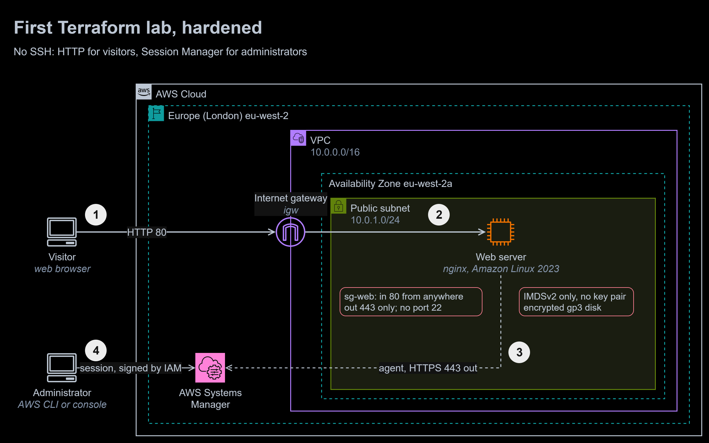
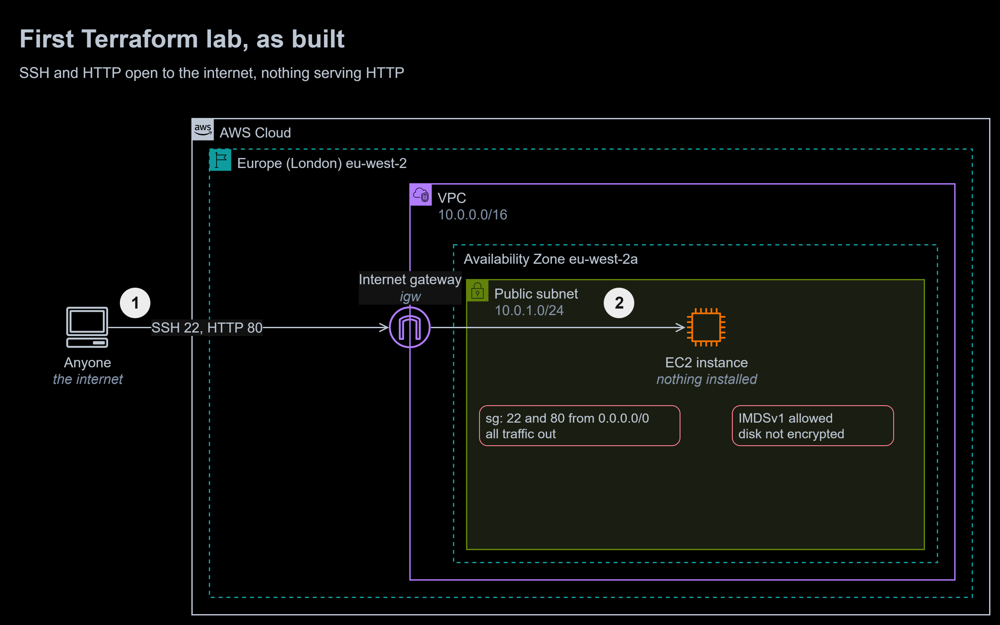

# 12 | Terraform: VPC and EC2

**Exercise date:** 2 April 2026 | **Type:** my first Terraform lab | **Status:** rebuilt and hardened, deployed and tested in my own AWS account

**At a glance**

- **Outcome:** my first Terraform configuration, a VPC with one web server, rebuilt so that nothing is open that should not be: no SSH key or port, Session Manager for administration, IMDSv2 only, an encrypted disk, outbound traffic limited to HTTPS, and a web server that actually serves the port it opens.
- **Built:** a Terraform configuration of 14 resources, a user data script that installs nginx and publishes a page, an 11-check live test, and a before-and-after diagram.
- **Stack:** Terraform 1.16, AWS provider 6.69, Amazon VPC, Amazon EC2 with Amazon Linux 2023, nginx, AWS Systems Manager, tflint, checkov, GitHub Actions.
- **Proof:** deployed to my own account on 18 October 2026, where all 11 live checks passed: from the internet, from the AWS API, and from inside the instance through Systems Manager Run Command. CI runs `terraform fmt` and `validate`, tflint and checkov (43 passed, 0 failed, 4 skipped with reasons) on every push.



To zoom in, right-click the diagram and open the image in a new tab. The editable source is [`diagrams/terraform-vpc-ec2.drawio`](diagrams/terraform-vpc-ec2.drawio). It has two pages: hardened (above) and the lab as built.

1. A **visitor** requests the page over HTTP on port 80, through the **internet gateway**.
2. **nginx** on the web server answers. User data installed it at first boot and wrote the page. `sg-web` admits port 80 only; no rule mentions port 22.
3. The **SSM Agent** on the instance keeps an outbound HTTPS connection to **AWS Systems Manager**. HTTPS is the only traffic the security group lets out.
4. An **administrator** opens a shell with Session Manager, authorised by IAM and logged, instead of SSH. No key pair exists.

<details>
<summary>The lab as built: SSH and HTTP open, nothing serving HTTP</summary>



1. The security group let **anyone** reach ports 22 and 80, and every port out.
2. The **instance** ran nothing on port 80, accepted IMDSv1 requests, and had an unencrypted disk.

</details>

## The task, in my own words

Write a first Terraform configuration that builds a VPC, an internet gateway, a public subnet with its route table, a security group and an EC2 instance; use variables and outputs; then run `init`, `plan`, `apply` and `destroy`, and show the results in the console.

## What I did in the lab

- Wrote `main.tf`, `variables.tf` and `outputs.tf` for a VPC (`10.0.0.0/16`), an internet gateway, one public subnet (`10.0.1.0/24`) in eu-west-2a, a route table, a security group and a `t3.micro` instance running the latest Amazon Linux 2023 image, with common tags in a variable.
- Ran `terraform init`, `plan`, `apply` and `destroy`, and checked each resource in the console. Destroying the lab the same night was the right habit, and it is kept.
- The security group, as written:

  ```hcl
  ingress {
    from_port   = 22
    to_port     = 22
    protocol    = "tcp"
    cidr_blocks = ["0.0.0.0/0"]
  }
  ingress {
    from_port   = 80
    to_port     = 80
    protocol    = "tcp"
    cidr_blocks = ["0.0.0.0/0"]
  }
  egress {
    from_port   = 0
    to_port     = 0
    protocol    = "-1"
    cidr_blocks = ["0.0.0.0/0"]
  }
  ```

## The rebuilt solution

| File | What it does |
|---|---|
| [`terraform/network.tf`](terraform/network.tf) | The lab's VPC, internet gateway, public subnet and route table, plus a default security group with no rules, and `sg-web` with one rule in (80) and one out (443), as separate rule resources |
| [`terraform/compute.tf`](terraform/compute.tf) | The instance: the Amazon Linux 2023 image from AWS's public SSM parameter, an IAM role for Session Manager, IMDSv2 required, an encrypted gp3 disk, no key pair |
| [`terraform/user_data.sh`](terraform/user_data.sh) | Installs nginx and writes the page at first boot; a change to it replaces the instance (`user_data_replace_on_change`) |
| [`terraform/variables.tf`](terraform/variables.tf), [`outputs.tf`](terraform/outputs.tf), [`providers.tf`](terraform/providers.tf), [`versions.tf`](terraform/versions.tf) | Validated inputs; the site address and the Session Manager command; tags set once with `default_tags`; Terraform 1.10 or later and the AWS provider 6.x, pinned by [`.terraform.lock.hcl`](terraform/.terraform.lock.hcl) |
| [`tests/smoke_test.sh`](tests/smoke_test.sh) | The 11 live checks |

### Running it

```bash
cd 12-terraform-vpc-ec2/terraform
terraform init
terraform plan -out=tfplan
terraform apply tfplan          # under a minute
bash ../tests/smoke_test.sh
terraform output -raw session_command   # a shell on the instance, without SSH
terraform destroy
```

While it runs, it costs about $0.02 an hour in eu-west-2: $0.0114 for the `t3.micro` instance and $0.005 for its public IPv4 address.

## How it is tested

**On every push** (the [`terraform`](../.github/workflows/terraform.yml) workflow, with no AWS credentials): `terraform fmt -check`, `terraform validate`, tflint with the AWS ruleset (no issues), and checkov (43 passed, 0 failed, 4 skipped). The skips, each with a reason in the code, are the instance's public address and port 80 open to the internet (both the point of this lab, with a load balancer as the production answer), detailed monitoring, and VPC flow logs.

**Against the live deployment**, 18 October 2026: `terraform apply` created 14 resources in 37 seconds, a second `terraform plan` reported no changes, and the test passed. The last two checks run inside the instance through Systems Manager Run Command, with no SSH involved:

```console
$ bash tests/smoke_test.sh
PASS  the page is served over HTTP (200)
PASS  the page is the one user data wrote
PASS  port 22 does not answer
PASS  the instance has no SSH key pair
PASS  the metadata service requires IMDSv2 tokens
PASS  the root disk is encrypted
PASS  the root disk is gp3
PASS  no security group rule mentions port 22
PASS  the instance is online in Systems Manager
PASS  nginx is running (checked through Run Command)
PASS  an IMDSv1 request without a token is refused (401)

11 passed, 0 failed
```

## Mistakes I fixed

1. **SSH open to the internet.** Port 22 accepted connections from every address, and there was no key pair, so it was all risk and no use. There is now no port 22 rule and no key pair; administrators use Session Manager, which IAM authorises and CloudTrail records.
2. **A port open with nothing behind it.** Port 80 was open, but no web server was installed. User data now installs nginx and publishes the page, and the test checks that it is served.
3. **Every port out.** The instance could reach anything on the internet. It now has one outbound rule, HTTPS 443, for package updates and Systems Manager.
4. **IMDSv1 allowed.** Any process tricked into requesting a URL could read the instance role's credentials from the metadata service. IMDSv2 is now required, and the test proves an IMDSv1 request gets 401.
5. **An unencrypted disk.** The root volume is now encrypted gp3.
6. **An image found by name.** The AMI filter `al2023-ami-2023.*-x86_64` relied on a naming pattern. AWS's public SSM parameter for Amazon Linux 2023 names the current image directly.
7. **Public addresses for everything.** `map_public_ip_on_launch = true` gave any instance launched in the subnet a public address. The subnet no longer does; the web server asks for one explicitly.
8. **Tags merged by hand.** Every resource merged the common tags itself, and the `ManagedBy` tag held my name. The provider's `default_tags` now tag every resource once, and a provider pin, a lock file and `required_version` make every run use the same versions.

## Design vs production

| Concern | In this module | Before going to production | Well-Architected pillar |
|---|---|---|---|
| HTTPS | HTTP on the instance's public address | An Application Load Balancer with an ACM certificate in front, the instances in private subnets (the design from [module 04](../04-public-private-subnets/)) | Security |
| Availability | One instance in one zone | An Auto Scaling group across two zones behind the load balancer | Reliability |
| Patching | The image current at launch | A Systems Manager patch baseline, or new images rolled out by the Auto Scaling group | Security, Operational Excellence |
| Logging | None | VPC Flow Logs, nginx logs shipped by the CloudWatch agent, Session Manager logs to S3 | Operational Excellence |
| State | Local | Remote state in S3 with locking, applied by a gated pipeline (module 13) | Operational Excellence |
| Cost | `t3.micro`, destroyed after testing | AWS Graviton (`t4g`) instances, and a budget alert | Cost Optimization |
| Performance | One small instance | Size from load tests; scale on request count | Performance Efficiency |
| Efficiency | Destroyed when not in use | Scale in out of hours | Sustainability |

## What I learned

- An open port is a promise: if nothing should answer on it, close it, and if something should, check that it does.
- Session Manager replaces SSH completely: no key to lose, no port to scan, and every session tied to an IAM identity.
- IMDSv2 is a one-line setting that closes a whole class of credential theft.

## Sources

- [Session Manager](https://docs.aws.amazon.com/systems-manager/latest/userguide/session-manager.html) and [Run Command](https://docs.aws.amazon.com/systems-manager/latest/userguide/run-command.html)
- [Use IMDSv2](https://docs.aws.amazon.com/AWSEC2/latest/UserGuide/configuring-IMDS-existing-instances.html)
- [Finding the Amazon Linux 2023 AMI with Systems Manager parameters](https://docs.aws.amazon.com/linux/al2023/ug/ec2.html)
- [Amazon EBS encryption](https://docs.aws.amazon.com/ebs/latest/userguide/ebs-encryption.html)
- [Public IPv4 address pricing](https://aws.amazon.com/vpc/pricing/)
- Terraform [`default_tags`](https://registry.terraform.io/providers/hashicorp/aws/latest/docs#default_tags-configuration-block) and [`user_data_replace_on_change`](https://registry.terraform.io/providers/hashicorp/aws/latest/docs/resources/instance#user_data_replace_on_change)
