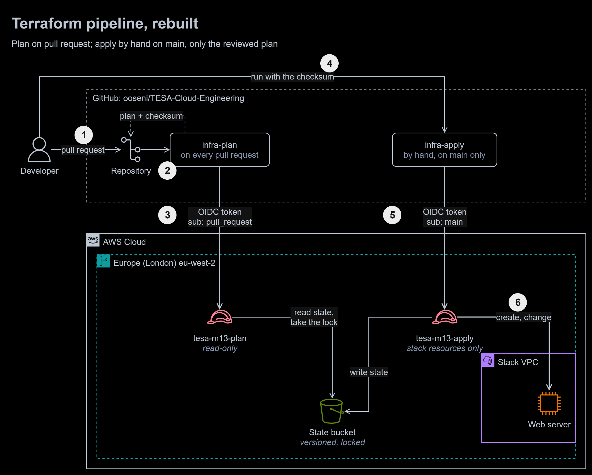
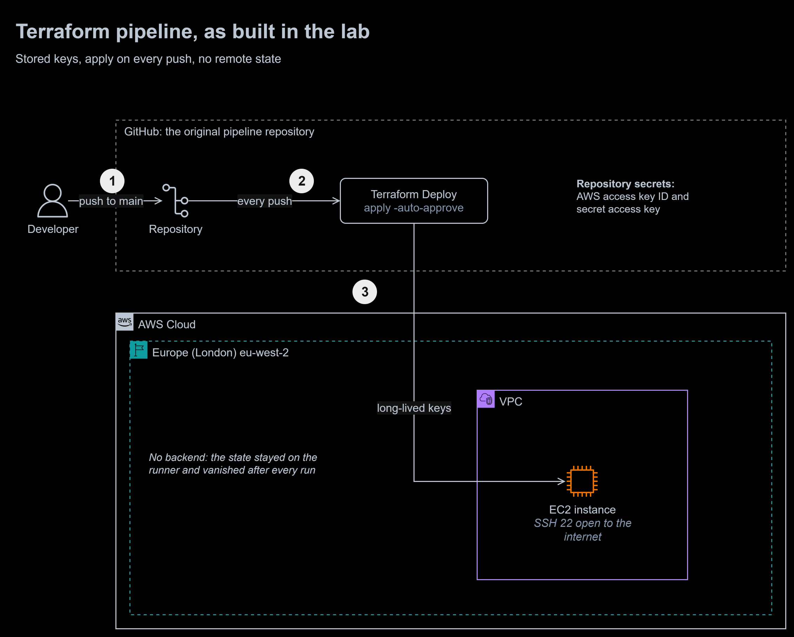

# 13 | Infrastructure as code: CI/CD for Terraform

**Exercise date:** 2 April 2026 | **Type:** lab, Terraform deployed by GitHub Actions | **Status:** rebuilt, deployed through its own pipeline and tested in my own AWS account

**At a glance**

- **Outcome:** a Terraform pipeline that holds no AWS keys, plans every pull request with a read-only role, and applies only by hand, only from `main`, and only the exact plan that was reviewed. It replaces a lab pipeline that stored access keys, applied every push without review and forgot its state after every run.
- **Built:** a bootstrap configuration (state bucket, GitHub OIDC provider, two least-privilege roles), the stack it deploys (a VPC and a hardened web server), two workflows (`infra-plan`, `infra-apply`), a 17-check IAM test and a 12-check live test, and a before-and-after diagram.
- **Stack:** Terraform 1.16, AWS provider 6.69, GitHub Actions, OpenID Connect, AWS IAM and STS, Amazon S3 (state with native locking), Amazon VPC, Amazon EC2, tflint, checkov, actionlint.
- **Proof:** on 18 October 2026 the pipeline deployed the stack from [pull request #1](https://github.com/ooseni/TESA-Cloud-Engineering/pull/1), refused a wrong checksum and a replayed one, served the page, passed all 12 live checks, and destroyed the stack through the same two-step review. The IAM test passes 17 of 17, after it caught a trust policy that GitHub's tokens would never have matched (see [Mistakes I fixed](#mistakes-i-fixed), 2). CI runs `terraform fmt` and `validate`, tflint and checkov on both configurations on every push (bootstrap 66 passed, stack 24 passed, 0 failed).



To zoom in, right-click the diagram and open the image in a new tab. The editable source is [`diagrams/iac-cicd.drawio`](diagrams/iac-cicd.drawio). It has two pages: the rebuilt pipeline (above) and the lab as built.

1. The **developer** opens a pull request that changes [`stack/`](stack/).
2. **infra-plan** runs `terraform fmt`, `validate` and `plan`.
3. GitHub gives the run an **OIDC token** whose subject says "a pull request of this repository". AWS STS exchanges it for one hour credentials of **tesa-m13-plan**, which can read the state and the resources and take the state lock, but cannot change anything. The run posts the plan and its **checksum** on the pull request.
4. After review and merge, the developer starts **infra-apply** by hand on `main` and types the checksum of the plan they reviewed.
5. This run's token says "main of this repository", the only subject **tesa-m13-apply** trusts. The run plans again and stops, changing nothing, unless the new plan's checksum matches the one typed in.
6. It applies that plan: the stack's resources are created or changed, the state is written back to the **versioned, locked bucket**, and the run checks that the site answers.

<details>
<summary>The lab as built: stored keys, apply on every push, no remote state</summary>



1. Every **push to main** started the workflow.
2. **Terraform Deploy** ran `plan`, then `apply -auto-approve` straight after, with no one reading the plan.
3. It signed in with **long-lived access keys** stored as repository secrets and built an instance with **SSH open to the internet**. The state stayed on the runner and was deleted with it.

</details>

## The task, in my own words

Put the Terraform configuration from the first Terraform lab ([module 12](../12-terraform-vpc-ec2/)) in a GitHub repository, and write a GitHub Actions workflow that runs `terraform init`, `plan` and `apply` when changes reach `main`, so infrastructure is deployed by the pipeline instead of from a laptop.

## What I did in the lab

- Created a repository with `main.tf` (a VPC, a subnet, an internet gateway, a route table, a security group and an instance), `variables.tf` and `outputs.tf`, and a workflow named **Terraform Deploy**.
- Created an access key for my lab IAM user and stored the key ID, the secret and the Region as repository secrets.
- The workflow ran on every push to `main`. Its first run failed; the next one, 43 minutes later, applied the stack.
- The workflow's core, as written (abridged):

  ```yaml
  on:
    push:
      branches:
        - main

  env:
    AWS_ACCESS_KEY_ID: ${{ secrets.AWS_ACCESS_KEY_ID }}
    AWS_SECRET_ACCESS_KEY: ${{ secrets.AWS_SECRET_ACCESS_KEY }}

  steps:
    - uses: actions/checkout@v4
    - uses: hashicorp/setup-terraform@v3
    - run: terraform init
    - run: terraform plan
    - run: terraform apply -auto-approve
  ```

- On 27 September 2026, adding a licence file to that repository ran the pipeline again, nearly six months later. It failed at `plan` only because the stored key no longer existed (`InvalidClientTokenId`). With a working key and no saved state, Terraform would have planned the whole stack as new, and a licence commit would have deployed a second VPC and instance.

## The rebuilt solution

**How the gate works.** GitHub's built-in approval gate, an environment with required reviewers, is available on private repositories only with GitHub Enterprise, so this repository builds its own from three parts:

- **Who can start it:** `infra-apply` has no automatic trigger. Only someone with write access can run it, from the Actions tab or `gh workflow run`, and its job runs only on `main`.
- **Who AWS lets in:** the apply role trusts one OIDC subject, `main` of this repository. A run on any other branch, in a fork or in another repository gets no credentials, whatever its workflow file says.
- **What it may apply:** the plan text's SHA-256 (first 16 characters) is posted on the pull request. `infra-apply` plans again and applies only if the checksums match. If `main` has moved, someone changed the infrastructure by hand, or a newer image has been published since the review, the plan differs and the run stops before changing anything, showing the new plan and its checksum. A destroy is reviewed the same way: the first destroy run is refused and shows the destroy plan; the second, with that plan's checksum, runs it.

| File | What it does |
|---|---|
| [`bootstrap/state.tf`](bootstrap/state.tf) | The state bucket: private, versioned, encrypted, TLS only, old versions expire after 90 days |
| [`bootstrap/oidc.tf`](bootstrap/oidc.tf) | The GitHub OIDC provider and the two roles: each trusts one exact subject; plan reads, apply also writes the state and manages the stack's EC2 and VPC resources in one Region, with no IAM permissions at all |
| [`bootstrap/variables.tf`](bootstrap/variables.tf), [`outputs.tf`](bootstrap/outputs.tf) | Validated inputs, including the repository's OIDC subject prefix; the four values the workflows read as repository variables |
| [`stack/main.tf`](stack/main.tf), [`user_data.sh`](stack/user_data.sh) | The stack: the lab's VPC and web server, hardened as in [module 12](../12-terraform-vpc-ec2/), but immutable: no SSH, no key pair and no instance role, so the apply role never needs IAM permissions |
| [`stack/versions.tf`](stack/versions.tf) | The S3 backend with `use_lockfile = true`: Terraform's native S3 locking, no DynamoDB table; the bucket, key and Region are passed by the workflows |
| [`infra-plan.yml`](../.github/workflows/infra-plan.yml) | On pull requests that change `stack/`: plan with the read-only role, post the plan and its checksum |
| [`infra-apply.yml`](../.github/workflows/infra-apply.yml) | By hand on `main`: plan, refuse any plan but the reviewed one, apply, check the site |
| [`tests/iam_test.sh`](tests/iam_test.sh) | 17 checks of the roles (IAM policy simulator), their trust policies and the state bucket |
| [`tests/smoke_test.sh`](tests/smoke_test.sh) | 12 checks of the deployed stack, from the internet, the AWS API and the state bucket |

Both workflows pin every action to a full commit SHA, share one concurrency group so a plan never races an apply, install the same Terraform release, run `terraform init -lockfile=readonly` so the provider versions cannot drift from the committed lock file, and pass inputs through environment variables rather than straight into scripts.

### Running it

The bootstrap runs once, from a laptop, with administrator credentials. Everything after it runs in the pipeline.

```bash
cd 13-iac-cicd/bootstrap
terraform init
terraform apply                 # 12 resources
bash ../tests/iam_test.sh

# the workflows read these four repository variables; none of them is a secret
gh variable set TF_STATE_BUCKET   --body "$(terraform output -raw state_bucket)"
gh variable set TF_PLAN_ROLE_ARN  --body "$(terraform output -raw plan_role_arn)"
gh variable set TF_APPLY_ROLE_ARN --body "$(terraform output -raw apply_role_arn)"
gh variable set AWS_REGION        --body "$(terraform output -raw region)"
```

Then: change `stack/` on a branch and open a pull request; read the plan the workflow posts; merge; run **Actions > infra-apply > Run workflow** on `main` with operation `apply` and the posted checksum. To remove the stack, run it with operation `destroy` twice: the first run shows the destroy plan and its checksum, the second applies it.

While the stack runs, it costs about $0.02 an hour in eu-west-2 ($0.0114 for the `t3.micro` instance, $0.005 for its public IPv4 address). The bootstrap costs well under a cent a month: IAM roles and the OIDC provider are free, and the bucket holds a few kilobytes.

## How it is tested

**On every push** (the [`terraform`](../.github/workflows/terraform.yml) workflow, with no AWS credentials): `terraform fmt -check`, `terraform validate`, tflint with the AWS ruleset (no issues) and checkov on both configurations. Bootstrap: 66 passed, 0 failed, 5 skipped. Stack: 24 passed, 0 failed, 5 skipped. Each skip has its reason in the code: for example, `ec2:Describe*` cannot be limited to resources, create actions cannot name resources that do not exist yet (a Region condition limits them instead), and the web server deliberately has no IAM role.

**The roles**, 18 October 2026. The IAM policy simulator evaluates each role's policies without calling anything, and the trust checks compare each role's subject with the prefix GitHub reports for this repository:

```console
$ bash tests/iam_test.sh
PASS  plan role can read the state
PASS  plan role can list the state bucket (init lists the workspaces)
PASS  plan role can take the state lock
PASS  plan role can describe EC2 resources
PASS  plan role cannot write the state
PASS  plan role cannot launch an instance
PASS  apply role can write the state
PASS  apply role can launch an instance in eu-west-2
PASS  apply role cannot launch an instance in us-east-1
PASS  apply role cannot create IAM roles
PASS  apply role cannot delete the state
PASS  apply role cannot read other objects in the bucket
PASS  only pull request runs of this repository can assume the plan role
PASS  only runs on main of this repository can assume the apply role
PASS  the state bucket blocks all public access
PASS  the state bucket keeps every version
PASS  the state bucket refuses requests without TLS

17 passed, 0 failed
```

**The pipeline itself**, 18 October 2026, in order:

| Run | Input | Result |
|---|---|---|
| `infra-plan` on [pull request #1](https://github.com/ooseni/TESA-Cloud-Engineering/pull/1) | the pull request | Signed in with the plan role through OIDC and posted the plan (11 to add) with checksum `ee89f6e787324a7b`, in 31 seconds. The same plan, made on my workstation with my own credentials, had the same checksum, so the checksum depends on the plan and nothing else |
| `infra-apply` | `apply`, a wrong checksum | Refused: "Nothing was changed. This plan's checksum is ee89f6e787324a7b, not 0000000000000000." Apply skipped; AWS showed no instance and no VPC |
| `infra-apply` | `apply`, `ee89f6e787324a7b` | Applied: 11 added in 1 minute 27 seconds for the whole run, and the site check passed |
| `infra-apply` | `apply`, `ee89f6e787324a7b` again | Refused: the plan was now "No changes" (`f13fa1c59cb83003`), so a reviewed plan cannot be replayed once it is applied |
| `infra-apply` | `destroy`, `review` | Refused, as designed: the run printed the destroy plan (11 to destroy, `c8a61d3deb668ad7`) for review |
| `infra-apply` | `destroy`, `c8a61d3deb668ad7` | Destroyed the 11 resources in 1 minute 15 seconds for the whole run. AWS showed no instance, VPC, security group or network interface left |

Between the apply and the destroy, the live test checked the stack from my workstation:

```console
$ bash tests/smoke_test.sh
PASS  exactly one web server is running
PASS  the page is served over HTTP (200)
PASS  the page is the one the pipeline deployed
PASS  port 22 does not answer
PASS  the instance has no SSH key pair
PASS  the instance has no IAM role
PASS  the metadata service requires IMDSv2 tokens
PASS  the root disk is encrypted
PASS  the instance is tagged as managed by the pipeline
PASS  the state is in the state bucket
PASS  the state lock was released
PASS  the state names the running instance

12 passed, 0 failed
```

## Mistakes I fixed

1. **Long-lived keys in the repository.** An access key and its secret sat in repository secrets, valid until someone deleted them, with every permission of the IAM user that owned them. The workflows now hold no secret at all: each run trades a GitHub OIDC token for credentials that expire within an hour.
2. **A trust policy is only as good as its subject.** The first version of the rebuilt trust policies used the subject format `repo:OWNER/REPO:...`. GitHub gives repositories created after 15 July 2026 immutable subjects that include the owner's and the repository's numeric IDs, so no token would ever have matched. The IAM test compares each role's subject with the prefix GitHub reports for the repository, caught it (14 passed, 2 failed), and passed once the bootstrap trusted the immutable prefix. The IDs also protect the roles from anyone who later creates a repository with the same name.
3. **A list permission too narrow for `init`.** The first policies allowed `s3:ListBucket` only under the state's prefix. `terraform init` lists workspaces under `env:/`, and without the list permission S3 answers 403 instead of 404 for a state file that does not exist yet, so the first run would have failed. I caught it in review before the first run; the roles now list the bucket, which holds this state only, and the IAM test checks it.
4. **Apply without review.** `apply -auto-approve` ran straight after `plan` on every push, so nobody read a plan before it changed the account. Plans now run on pull requests and are posted for review, and only the reviewed plan can be applied, by a person, from `main`.
5. **No state.** Without a backend, the state stayed on the runner and was deleted with it, so every run planned the stack from nothing. The state now lives in a versioned, encrypted S3 bucket with native locking, so two runs cannot change it at once and any earlier state can be restored.
6. **Every push deployed.** Even the licence commit ran Terraform. `infra-plan` runs only when `stack/` or the workflow changes, and `infra-apply` only when started.
7. **One identity for everything.** The same keys planned and applied, with all of their user's permissions. Planning now uses a read-only role; applying uses a role that can manage only the stack's EC2 and VPC resources, in one Region, with no IAM permissions, so even a malicious change to the stack cannot create users or roles.
8. **Moving parts left unpinned.** The actions were referenced by tags (`@v4`, `@v3`), which their owners can move, and neither Terraform nor the provider was pinned. Actions are now pinned to commit SHAs, both pipeline workflows install the same Terraform release (1.16.6), and the provider is pinned by a committed lock file that the workflows will not update.
9. **The lab's instance, unchanged.** The pipeline deployed the same weaknesses as the module 12 lab: SSH and every outbound port open, no setting for IMDSv2 or disk encryption, and an AMI ID hard-coded for one Region. The stack now carries module 12's fixes, takes the image from AWS's public SSM parameter, and is immutable: changes ship as new instances through the pipeline.
10. **Names that said nothing.** Resources were named `MyIGW`, `MySubnet` and `MyRouteTable`, and the instance carried a person's name. Every resource is now named `tesa-m13-...` and tagged once with `default_tags`, including `ManagedBy = "Terraform, GitHub Actions"`.

## Design vs production

| Concern | In this module | Before going to production | Well-Architected pillar |
|---|---|---|---|
| Approval | A manual run on `main` with the reviewed plan's checksum; anyone with write access can start it | An environment with required reviewers and a `main`-only deployment rule (needs a public repository, or GitHub Enterprise for a private one), and the apply role trusting `...:environment:production` instead of `main` | Security, Operational Excellence |
| Review before merge | A pull request, with the plan posted on it | Branch protection or a ruleset that requires an approving review and a passing plan (GitHub Pro or above for a private repository) | Security |
| Code that runs during plan | A pull request's own code runs in the plan job, so the plan role is read-only, and forks get no token | The same, plus a policy check (checkov or OPA) on the plan's JSON before it is posted | Security |
| Drift | Seen only when someone plans | A scheduled plan with `-detailed-exitcode` that opens an issue when the account no longer matches the code | Operational Excellence |
| State | SSE-S3 encryption, versioning, 90-day history | A customer managed KMS key whose policy names the two roles, and CloudTrail data events on the bucket | Security |
| Environments | One stack, one environment | A state key and a pair of roles per environment, promoted through the same pipeline | Reliability |
| Cost | Destroyed after testing | A cost estimate in the plan comment, and a budget alert | Cost Optimization |
| Pipeline speed | The provider is downloaded on every run | A provider plugin cache | Performance Efficiency |
| Efficiency | Runs only when the stack changes | Test environments destroyed on a schedule | Sustainability |

## What I learned

- `apply -auto-approve` on push turns every merge into a deployment nobody reviewed. The thing to approve is the plan, and the pipeline should apply exactly that plan or nothing.
- With OIDC there is no secret to store, rotate or leak. The trust policy's subject becomes the access control, so it has to be exact, and it has to be tested against what GitHub actually issues: the format changed for new repositories in 2026.
- Terraform without remote state forgets what it built. A pipeline that throws its state away is one stray commit from building everything twice.

## Sources

- GitHub: [Configuring OpenID Connect in Amazon Web Services](https://docs.github.com/en/actions/security-for-github-actions/security-hardening-your-deployments/configuring-openid-connect-in-amazon-web-services) and the [OpenID Connect reference](https://docs.github.com/en/actions/reference/openid-connect-reference) (subject formats, including immutable subjects)
- GitHub: [Deployments and environments](https://docs.github.com/en/actions/reference/workflows-and-actions/deployments-and-environments) (which plans offer required reviewers on private repositories)
- GitHub: [Secure use reference](https://docs.github.com/en/actions/reference/security/secure-use) (pinning actions to commit SHAs)
- Terraform: [S3 backend](https://developer.hashicorp.com/terraform/language/backend/s3) (`use_lockfile`, the permissions the lock file needs, bucket versioning)
- AWS: [IAM policy simulator](https://docs.aws.amazon.com/IAM/latest/UserGuide/policies_policy-simulator-how-to.html) and [`simulate-principal-policy`](https://docs.aws.amazon.com/cli/latest/reference/iam/simulate-principal-policy.html)
- AWS: [Public IPv4 address pricing](https://aws.amazon.com/vpc/pricing/)
