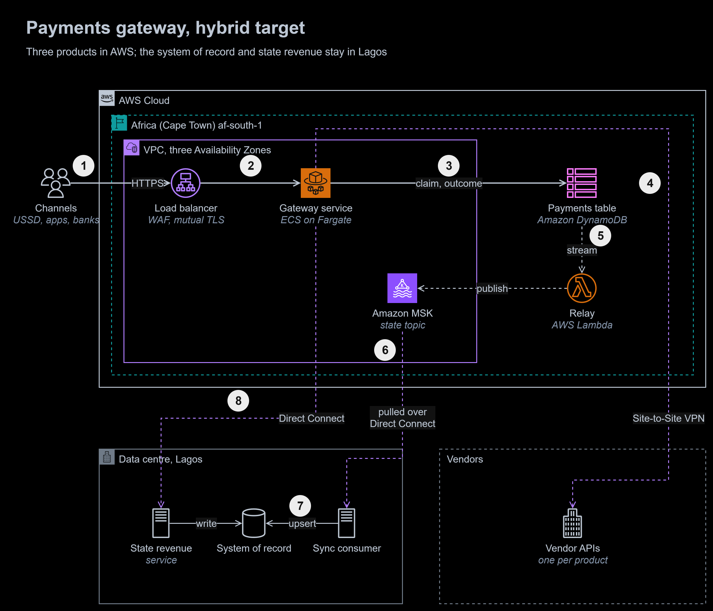
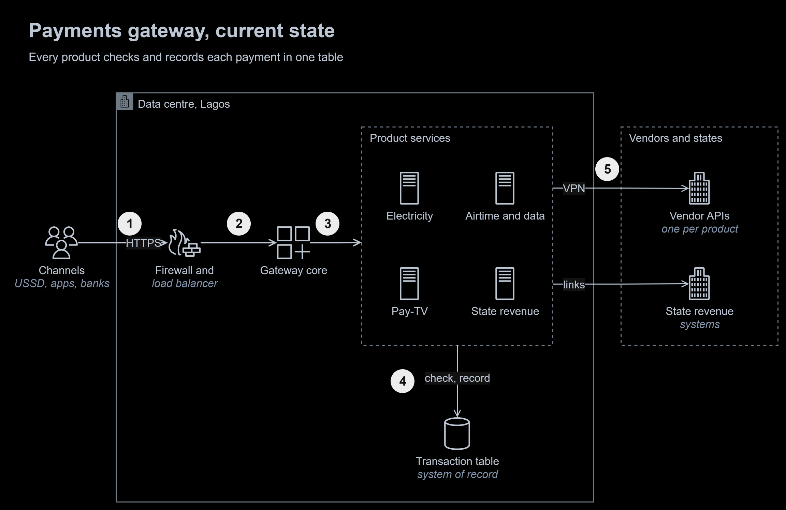
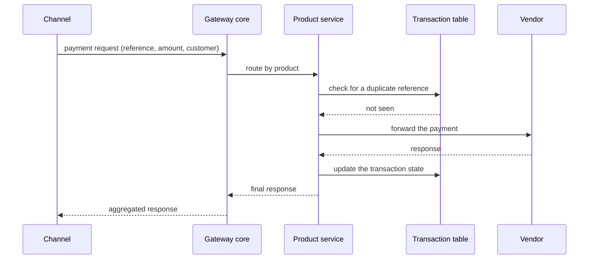
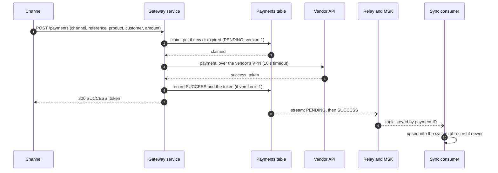
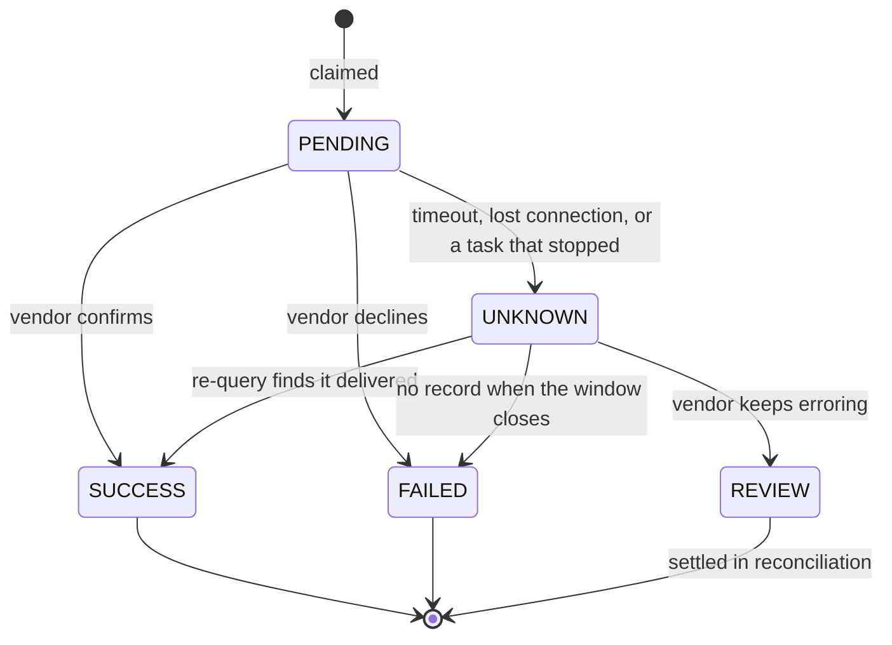
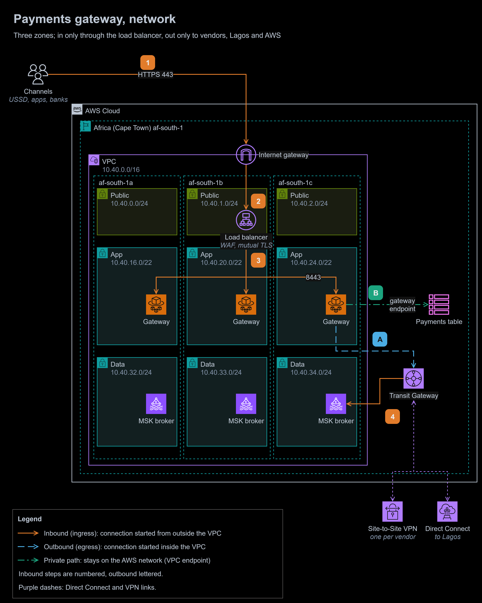

# 14 | Capstone: hybrid modernisation of a payments gateway

**Capstone:** 10 to 14 April 2026 | **Type:** TeSA capstone, an internship week with a cloud consultancy; the client is not named | **Status:** design complete, proven in a runnable demo and in a live run on AWS

**At a glance**

- **Outcome:** a hybrid target design for a Nigerian payment processor's bill and top-up gateway. Three products move to AWS; the system of record and state revenue stay in Lagos. No payment can be delivered twice, none is lost once accepted, and payments keep flowing when the link to Lagos is down.
- **Built:** the target, network and current-state diagrams; five decision records; requirements I set, a failure-handling table and a monthly cost estimate; the current and target payment flows as sequence diagrams; a demo of the payment path in Docker Compose, with 27 tests; and a Terraform live run that runs the same code and tests on real AWS services.
- **Stack:** Application Load Balancer with AWS WAF and mutual TLS, Amazon ECS on AWS Fargate, Amazon DynamoDB with DynamoDB Streams, AWS Lambda, Amazon MSK, AWS Transit Gateway, AWS Site-to-Site VPN, AWS Direct Connect, IAM Roles Anywhere; for the demo, Python, FastAPI, DynamoDB Local, Apache Kafka, PostgreSQL and pytest; for the live run, Terraform and Systems Manager Run Command.
- **Proof:** on 18 October 2026 the same 27 tests passed on AWS, against DynamoDB, the Lambda relay on the table's stream and Amazon MSK with IAM authentication: 75 relay invocations, 0 errors, then everything destroyed. They also pass locally and in GitHub Actions on every change: twenty identical requests at once are delivered once; late, lost and failing vendors settle exactly as ADR-0004 says; the system of record catches up after an outage, and replaying the whole topic changes nothing. Every design claim is checked against AWS documentation, and every price comes from the AWS Price List API (about $2,690 a month at 3 million payments a day).



To zoom in, right-click the diagram and open the image in a new tab. The editable source is [`diagrams/payments-gateway.drawio`](diagrams/payments-gateway.drawio). It has three pages: the target (above), the network and the current state.

1. A **channel** (USSD, an app, an agent's terminal or a partner bank) sends the payment over HTTPS with its client certificate. **AWS WAF** filters it and the **load balancer** checks the certificate.
2. The **gateway service** on Amazon ECS with AWS Fargate validates the payment and picks its product: electricity, airtime and data, or pay-TV.
3. It **claims** the payment in the **payments table** with one conditional write: the first request with a channel's reference wins, and a duplicate gets the first one's outcome back ([ADR-0001](decisions/0001-claim-each-payment-once-with-a-dynamodb-conditional-write.md)). After the vendor answers, it records the **outcome** on the same item.
4. It sends the payment to the **vendor** over the vendor's own Site-to-Site VPN, then answers the channel. A vendor that does not answer in time is asked again, never sent the payment twice ([ADR-0004](decisions/0004-resolve-unknown-outcomes-by-re-querying-never-by-re-sending.md)).
5. **DynamoDB Streams** records each change to the item, and the **relay**, an AWS Lambda function, publishes it to a topic on **Amazon MSK**, keyed by payment ([ADR-0002](decisions/0002-sync-the-system-of-record-through-dynamodb-streams-and-amazon-msk.md)).
6. The **sync consumer** in the Lagos data centre pulls the topic over Direct Connect.
7. It writes each change to the **system of record**, only when it is newer than the row it holds.
8. **State revenue** payments go to the state revenue service in Lagos over Direct Connect, which checks them and writes them to the system of record itself, as it does today ([ADR-0003](decisions/0003-keep-state-revenue-payments-on-premises.md)).

<details>
<summary>The current state: one data centre, one table on every payment's path</summary>



1. **Channels** reach the data centre over HTTPS.
2. The **firewall and load balancer** in the DMZ pass requests to the **gateway core**.
3. The core routes each payment to its **product service**.
4. Every product service checks the **transaction table** for a duplicate, and later records the payment's state there: two round trips to one database for every payment.
5. Product services call **vendors** over VPN, and the state revenue integrations call **state systems** over their own links.

</details>

## The task, in my own words

A Nigerian payment processor runs a gateway that sells electricity tokens, airtime and data, and pay-TV subscriptions, and collects state taxes and levies, for channels such as USSD, mobile apps, agents' terminals and partner banks. Review the gateway's current architecture, describe how a payment flows through it, and propose a hybrid target state on AWS.

## What I did in the capstone

The capstone was an internship week with a cloud consultancy, reviewing one of its clients' systems. I produced:

- a **current-state analysis**: a four-layer service model (channels, the gateway core, product services, vendors) and the data centre's zoning (a DMZ with a firewall and load balancer in front of isolated subnets);
- two **current-state sequences**: a status query (15 steps) and a payment (26 steps), with each step typed as microservice, database or middleware, and the link it uses, VPN or internet;
- a **hybrid target sequence** (27 steps): duplicate checks in a Redis cache in the cloud, transaction-state logs on a cloud Kafka queue copied asynchronously to the on-premises database, vendors over VPN, and state revenue kept on premises;
- a **review deck** with AS-IS, sequence and TO-BE sections.

None of these is published here. The workbooks and the deck name the client's internal components, and the deck reused the consultancy's template and slides. Everything on this page is redrawn with generic names. The deck's contents listed a TO-BE infrastructure section that I never wrote; this module is that section, and the rest of the target design.

<details>
<summary>The current-state payment, as I sequenced it (generic names)</summary>



The status query follows the same route, without the table: the product service forwards the query to the vendor and returns its answer.

</details>

## Requirements I set

The throughput and latency columns of my original sequences were empty. These are the targets the design is built to.

| Requirement | Target | How the design meets it |
|---|---|---|
| Volume | 3 million payments a day; a design peak of 300 a second on salary days and at month end | Fargate tasks scale on request count; DynamoDB on demand; 12 partitions on the topic |
| Duplicates | None delivered, ever | A claim before every vendor call ([ADR-0001](decisions/0001-claim-each-payment-once-with-a-dynamodb-conditional-write.md)); no re-sends ([ADR-0004](decisions/0004-resolve-unknown-outcomes-by-re-querying-never-by-re-sending.md)) |
| Accepted payments | None lost (recovery point zero) | The claim is durable in several Availability Zones before the vendor is called |
| Latency added by the gateway | 95th percentile at most 300 ms, excluding the vendor's own time | One conditional write and one update; at least 96 ms of it is the two crossings between Lagos and Cape Town |
| Availability of the cloud tier | 99.95% a month | Three Availability Zones for the tasks and brokers; DynamoDB and Lambda are multi-zone by design |
| System of record | 99% of changes within 5 seconds; nothing lost in a link outage of up to 7 days | The topic keeps seven days ([ADR-0002](decisions/0002-sync-the-system-of-record-through-dynamodb-streams-and-amazon-msk.md)) |
| Unknown outcomes | Settled within 15 minutes, or passed to operations | The re-query worker ([ADR-0004](decisions/0004-resolve-unknown-outcomes-by-re-querying-never-by-re-sending.md)) |
| Data held in the cloud | Claims 48 hours, events 7 days, nothing longer | Time to live and topic retention ([ADR-0005](decisions/0005-run-the-cloud-tier-in-cape-town-with-seven-day-retention.md), proposed) |

## The design

### Where each part runs

| Part | Runs in | Why there |
|---|---|---|
| Load balancer, AWS WAF | af-south-1, public subnets in three zones | The only way in from the internet |
| Gateway service and re-query worker | Amazon ECS on AWS Fargate, app subnets | Stateless, scales with load, no servers to patch |
| Payments table | Amazon DynamoDB, af-south-1 | Durable, atomic claims and outcomes ([ADR-0001](decisions/0001-claim-each-payment-once-with-a-dynamodb-conditional-write.md)) |
| Relay | AWS Lambda, on the table's stream | Publishes each change once it is written ([ADR-0002](decisions/0002-sync-the-system-of-record-through-dynamodb-streams-and-amazon-msk.md)) |
| `transaction-state` topic | Amazon MSK, three brokers, data subnets | Ordered per payment, seven days of replay |
| Sync consumer, system of record | Data centre, Lagos | Records stay in Nigeria; the database zone only connects out |
| State revenue service and integrations | Data centre, Lagos | Every state's link trusts the data centre ([ADR-0003](decisions/0003-keep-state-revenue-payments-on-premises.md)) |

The cloud tier runs in Africa (Cape Town), the nearest Region with every service it needs ([ADR-0005](decisions/0005-run-the-cloud-tier-in-cape-town-with-seven-day-retention.md)). That decision stays proposed until the processor's compliance team approves it in writing.

### A payment, step by step



A duplicate stops at step 2: the claim fails, and the gateway returns the stored outcome if the request is the same, or `409 Conflict` if the same reference now carries a different payment.

### A payment's states



### When things fail

| What fails | What happens | What the customer sees |
|---|---|---|
| A channel retries, or sends the same payment twice at once | One claim succeeds; every duplicate gets the same outcome | The same answer each time |
| The same reference arrives with a different amount | `409 Conflict`; nothing is sent | An error from the channel |
| The vendor times out | `UNKNOWN`; the worker re-queries for 15 minutes ([ADR-0004](decisions/0004-resolve-unknown-outcomes-by-re-querying-never-by-re-sending.md)) | "Pending", then the result by SMS or in the app |
| A gateway task stops mid-payment | The claim stays `PENDING`; after 60 seconds the worker treats it as `UNKNOWN` | "Pending", then the result |
| An Availability Zone fails | Tasks and brokers in the other two zones carry on; DynamoDB and Lambda are unaffected | Nothing |
| Direct Connect fails | The backup VPN carries Lagos traffic; if both fail, the three cloud products continue, state revenue stops, and the system of record catches up later | State revenue unavailable, only if both links are down |
| The relay fails | Changes wait in the stream for up to 24 hours; an alarm on the relay's iterator age fires within five minutes | Nothing |
| The sync consumer or the system of record is down | Changes wait on the topic for up to seven days, then the consumer catches up | Nothing; status checks read DynamoDB |
| The Region fails | During the migration, channels switch back to the on-premises gateway, which stays ready until the last product has moved and a month end has passed. After that, see [design vs production](#design-vs-production) | Payments through the old path |

### Network



1. **Channels** connect over HTTPS 443 to the **internet gateway**, the only way in.
2. It delivers to the **load balancer** in the public subnets. `sg-alb` admits 443 from anywhere, AWS WAF filters the request, and the load balancer's trust store checks the client certificate (mutual TLS in verify mode).
3. The load balancer forwards to a **gateway task** in any zone on 8443. `sg-gateway` admits 8443 only from `sg-alb`.
4. The **sync consumer** in Lagos connects to an **MSK broker** on 9098 (IAM authentication over TLS) through Direct Connect and the **Transit Gateway**. It resolves the brokers' names through a Route 53 Resolver inbound endpoint and gets short-lived credentials from IAM Roles Anywhere, with no stored keys.

- **A.** Gateway tasks reach the **vendors** and the **state revenue service** through the Transit Gateway: each vendor over its own Site-to-Site VPN, Lagos over Direct Connect with a VPN as backup.
- **B.** Gateway tasks reach the **payments table** through a **gateway endpoint**, and ECR, CloudWatch Logs, Secrets Manager, AWS KMS and IAM Roles Anywhere through interface endpoints. None of this crosses the internet.

There is no NAT gateway, and no route to `0.0.0.0/0` outside the public subnets: the gateway can reach its vendors, Lagos and AWS, and nothing else.

| Route table | Destination | Target |
|---|---|---|
| `rt-public` (all public subnets) | `10.40.0.0/16` | `local` |
| | `0.0.0.0/0` | the internet gateway |
| `rt-app-a`, `-b`, `-c` | `10.40.0.0/16` | `local` |
| | `10.0.0.0/12` (data centre, Lagos) | the Transit Gateway |
| | `pl-vendors` (each vendor's ranges) | the Transit Gateway |
| | `pl-dynamodb`, `pl-s3` | the gateway endpoints |
| `rt-data` (all data subnets) | `10.40.0.0/16` | `local` |
| | `10.0.0.0/12` | the Transit Gateway (replies to the sync consumer) |
| Transit Gateway | `10.40.0.0/16` | the VPC attachment |
| | `10.0.0.0/12` | the Direct Connect gateway; the backup VPN is preferred only when Direct Connect is down |
| | each vendor's ranges | that vendor's VPN attachment |

| Security group | In | Out |
|---|---|---|
| `sg-alb` | 443 from `0.0.0.0/0` | 8443 to `sg-gateway` |
| `sg-gateway` | 8443 from `sg-alb` | 443 to `pl-vendors`, the state revenue service and `sg-endpoints`; `pl-dynamodb` |
| `sg-relay` (the Lambda function) | none | 9098 to `sg-msk` |
| `sg-msk` | 9098 from `sg-relay` and the sync consumer's hosts in Lagos | none |
| `sg-endpoints` | 443 from `sg-gateway` and `sg-relay` | none |

### Security

- **Who may call:** each channel has a client certificate, checked by the load balancer, and a rate limit in AWS WAF.
- **No stored keys:** tasks and the relay use IAM roles; the sync consumer uses IAM Roles Anywhere certificates; vendor credentials live in AWS Secrets Manager.
- **Encryption:** TLS on every hop, including to the brokers. The table, the topic, the logs and the secrets are encrypted with customer managed AWS KMS keys in af-south-1.
- **Least reach:** no internet egress from the app and data subnets, one security group per role, and a system of record that only connects out.
- **Detection:** AWS CloudTrail, Amazon GuardDuty, VPC Flow Logs and AWS Config, with a service control policy that keeps every resource in af-south-1.

### Moving there

Products move one at a time, as in [module 08](../08-cloud-migration-strategies/README.md): connectivity and the landing zone first, once compliance has approved ADR-0005; then pay-TV, airtime and data, and electricity, each switched by the channels' configuration and switchable back. The on-premises gateway stays ready as the fallback until all three have run through a month end in the cloud. State revenue does not move.

### Cost

On-demand prices for af-south-1 from the AWS Price List API, 18 October 2026, for 3 million payments a day:

| Item | Assumption | A month |
|---|---|---|
| Amazon MSK | 3 `kafka.m7g.large` brokers, 300 GB of storage | $631 |
| AWS Direct Connect | 2 dedicated 1 Gbps ports in Lagos, 200 GB out | $460 |
| AWS Transit Gateway | 8 attachments (the VPC, Direct Connect, 6 vendor VPNs), 600 GB | $362 |
| AWS Site-to-Site VPN | 6 vendors and 1 backup to Lagos | $256 |
| Amazon ECS on AWS Fargate | 6.5 Graviton vCPUs and 13 GB on average | $253 |
| Route 53 Resolver inbound endpoint | 2 network interfaces | $183 |
| Interface VPC endpoints | 6 services in 3 zones | $173 |
| Amazon DynamoDB | 180 million writes, 20 million reads, point-in-time recovery | $158 |
| AWS WAF, load balancer, internet transfer, CloudWatch Logs, AWS KMS, Lambda | | $218 |
| **Total** | | **about $2,690, or $0.03 per 1,000 payments** |

Connectivity (Direct Connect, Transit Gateway, the VPNs and the Resolver endpoint) is 47% of the bill, more than compute and data together. The cost estimate leaves out AWS Support, colocation and cross-connect fees in Lagos, and the vendors' side of each VPN.

## The demo

The [demo](demo/) runs the payment path from the decisions on one machine, and its tests prove each row of the failure table above.

| Container | Stands for |
|---|---|
| `gateway` | The gateway service: claims each payment, calls the vendor once, records the outcome ([`gateway.py`](demo/paygate/gateway.py), [`store.py`](demo/paygate/store.py), [`vendors.py`](demo/paygate/vendors.py)) |
| `requery` | The re-query worker ([`requery.py`](demo/paygate/requery.py)) |
| `relay` | The Lambda relay. Its `handler` takes Lambda's event; locally a loop reads DynamoDB Local's stream and calls the same function ([`relay.py`](demo/paygate/relay.py)) |
| `consumer` | The sync consumer in Lagos, with the version guard and the dead-letter topic ([`consumer.py`](demo/paygate/consumer.py)) |
| `dynamodb` | The payments table: DynamoDB Local 3.1, with its stream and the re-query index |
| `kafka` | Amazon MSK: Apache Kafka 3.9.1, one broker, 12 partitions |
| `sor` | The system of record: PostgreSQL 17 ([`schema.sql`](demo/paygate/schema.sql)) |
| `vendor` | The vendors' APIs. The customer reference picks a behaviour: `OK`, `DECLINE`, `SLOW` (delivers, answers too late), `LOST` (never arrives), `FLAKY` (status queries fail) ([`vendor_mock.py`](demo/paygate/vendor_mock.py)) |

The timings are shortened so the tests take about a minute: a 2-second vendor timeout, re-queries after 1, 1 and 2 seconds within an 8-second window, and a claim counted as stale after 4 seconds. The production values are the defaults in [`config.py`](demo/paygate/config.py).

### Running it

```bash
cd 14-capstone-payments-gateway/demo
docker compose up --detach --build --wait gateway vendor requery relay consumer
python3 -m venv .venv && .venv/bin/pip install -r requirements-test.txt
REQUIRE_DEMO=1 .venv/bin/python -m pytest
docker compose down --volumes
```

It needs about 1.5 GB of memory. The [`capstone-demo`](../.github/workflows/capstone-demo.yml) workflow does the same on every push that changes the demo.

### What the tests prove

| Test | Proves |
|---|---|
| A payment succeeds and reaches the system of record | The whole path: claim, vendor, outcome, stream, relay, topic, consumer |
| Twenty identical requests at once are delivered once | One claim wins ([ADR-0001](decisions/0001-claim-each-payment-once-with-a-dynamodb-conditional-write.md)): the vendor counts one delivery, and all twenty answers carry the same payment |
| A retry gets the original answer | Channels can retry safely |
| A reference reused for a different payment is refused | `409 Conflict`, and nothing is sent |
| A declined payment fails | `FAILED`, recorded in the system of record |
| A late answer after delivery is settled by a re-query | `UNKNOWN`, then `SUCCESS` from the re-query, with one delivery ([ADR-0004](decisions/0004-resolve-unknown-outcomes-by-re-querying-never-by-re-sending.md)) |
| A payment lost on the way fails when the window closes | `UNKNOWN`, then `FAILED`, with no delivery |
| A vendor that keeps erroring sends the payment to review | `REVIEW`, for operations |
| A claim left by a stopped task is recovered | A stale `PENDING` claim ends `FAILED`, with nothing sent |
| An older version never overwrites a newer one | The consumer's version guard ([ADR-0002](decisions/0002-sync-the-system-of-record-through-dynamodb-streams-and-amazon-msk.md)) |
| A reference reused after the window is flagged, not lost | The system of record's unique key catches it, and the payment is kept aside for reconciliation |
| A malformed message goes to the dead-letter topic | One bad message does not stop the consumer |
| The system of record catches up after an outage | Five payments taken while the consumer is stopped all arrive once it starts again |
| Replaying the whole topic changes nothing | With the consumer's offsets reset to the start, a first replay brings the system of record up to date, and a second leaves it exactly as it was |

Thirteen unit tests cover the rest: the request hash, how vendor answers are classified, the rule that a request which never left fails but one that may have arrived is unknown, the back-off, every re-query decision, and the relay's message mapping. On 18 October 2026 the suite passed in five consecutive runs on one machine, three before the dead-letter test was added and two after, with no container restarting:

```console
$ REQUIRE_DEMO=1 .venv/bin/python -m pytest -q
...........................                                              [100%]
27 passed in 66.68s (0:01:06)
```

### What the tests caught while I built it

1. **A consumer that would not let go.** Stopped with SIGTERM, the sync consumer was killed without leaving its Kafka group, so it held its partitions until its session timed out, 45 seconds by default in kafka-python 3. Its replacement sat idle, and the outage test failed on its second run. It now leaves the group when it receives SIGTERM, which is also how Amazon ECS stops a task.
2. **A setup that could not run twice.** Turning on time to live for a table that already has it is an error, so a second run of the setup failed. It now checks first.

### What the demo leaves out

State revenue ([ADR-0003](decisions/0003-keep-state-revenue-payments-on-premises.md)), mutual TLS, AWS WAF, the network and IAM. The Lambda event source mapping and IAM authentication to Kafka are covered by the live run.

## The live run on AWS

The demo stands in for three AWS services. The [live run](aws-run/) replaces those stand-ins with the real services, runs the same code, and runs the same 27 tests against them.

| Part | In the run | In the design |
|---|---|---|
| Payments table | Amazon DynamoDB, on demand, with its stream, the re-query index, time to live and point-in-time recovery | The same, encrypted with a customer managed key |
| Relay | The demo's `paygate.relay.handler`, unchanged, as an AWS Lambda function in the VPC, fed by an event source mapping on the table's stream, with an Amazon SQS queue for batches it cannot publish | The same |
| Event log | Amazon MSK, Kafka 3.9, 2 `kafka.t3.small` brokers in two zones, IAM authentication over TLS only | 3 `kafka.m7g.large` brokers in three zones |
| Gateway, re-query worker, sync consumer, vendor mock, system of record | The demo's containers on one Ubuntu instance, with no inbound rule, driven through Systems Manager Run Command; credentials from its instance role | ECS on Fargate; the consumer and database in Lagos |
| Region and links | Europe (London) eu-west-2; the host reaches the brokers inside the VPC | Africa (Cape Town), with Direct Connect to Lagos ([ADR-0005](decisions/0005-run-the-cloud-tier-in-cape-town-with-seven-day-retention.md), proposed) |

The Region differs because opting this account into Cape Town is an account setting change; nothing in the run depends on the Region.

### Running it

```bash
cd 14-capstone-payments-gateway/aws-run
bash bundle.sh                       # the Lambda zip and the demo bundle, reproducible byte for byte
cd terraform
terraform init && terraform apply    # 42 resources; Amazon MSK takes about 35 minutes
cd .. && bash run.sh                 # the whole suite on the host, through Run Command
cd terraform && terraform destroy    # about 25 minutes, most of it waiting for Lambda's network interfaces
```

While it runs, it costs about $0.16 an hour in eu-west-2: $0.103 for the two brokers, $0.047 for the `t3.medium` host and $0.005 for its public IPv4 address. DynamoDB, Lambda, SQS and S3 cost pennies. The run on 18 October 2026 was up for about two hours, about $0.35.

### Results

On 18 October 2026 the suite passed against the real services, then everything was destroyed:

```console
$ bash run.sh
running the suite on i-0c996f4bab300b152
tests/test_demo.py::test_a_payment_succeeds_and_reaches_the_system_of_record PASSED
tests/test_demo.py::test_twenty_identical_requests_at_once_are_delivered_once PASSED
...
tests/test_demo.py::test_the_system_of_record_catches_up_after_an_outage PASSED
tests/test_demo.py::test_replaying_the_whole_topic_changes_nothing PASSED
...
============================= 27 passed in 55.28s ==============================
command status: Success
```

From AWS's own metrics for the run: the relay ran 75 times with 0 errors, the oldest change waited at most 2.1 seconds in the stream before it was published, the failure queue stayed empty, and the event source mapping ended `Enabled` with its last result `OK`. After `terraform destroy`, AWS reported no table, cluster, function, VPC, bucket, role, log group or network interface left from the run.

### What the live run caught

The suite passed on the third run. Each of these was found by running it, and is fixed in the code:

1. **The wrong import for IAM authentication.** kafka-python 3 moved its token provider to `kafka.net.sasl.oauth`, so the IAM path would have crashed on its first connection. Importing it from the built Lambda zip before deploying caught it.
2. **Credentials set to nothing.** Blanking the demo's placeholder keys for AWS would have stopped boto3 from falling back to the instance role: an empty `AWS_ACCESS_KEY_ID` is an error, not an absence. The code now passes placeholder keys only when it talks to DynamoDB Local.
3. **A tag value most services refuse.** A semicolon in the `Purpose` tag passed EC2 but failed DynamoDB, S3, IAM, CloudWatch Logs and SQS, which allow only letters, digits, spaces and `_ . : / = + - @`.
4. **No small KRaft brokers.** MSK offers `kafka.t3.small` only for ZooKeeper-based clusters, so the run uses Kafka 3.9 in that mode; clients see the same protocol.
5. **Run Command's shell.** Run Command uses `/bin/sh`, which on Ubuntu has no `pipefail`, and keeps only the first 24,000 characters of output; the host script now logs its set-up to a file and prints only the results.
6. **A test that assumed a fresh topic.** The second run reset the system of record but not the topic, so replaying the topic added 13 payments the reset database had missed: the recovery [ADR-0002](decisions/0002-sync-the-system-of-record-through-dynamodb-streams-and-amazon-msk.md) promises, but not what the test expected. The test now replays twice: the first replay brings the system of record up to date, and the second must change nothing.

## Decisions

| ID | Decision | Status |
|---|---|---|
| [ADR-0001](decisions/0001-claim-each-payment-once-with-a-dynamodb-conditional-write.md) | Claim each payment once with a DynamoDB conditional write | accepted |
| [ADR-0002](decisions/0002-sync-the-system-of-record-through-dynamodb-streams-and-amazon-msk.md) | Sync the system of record through DynamoDB Streams and Amazon MSK | accepted |
| [ADR-0003](decisions/0003-keep-state-revenue-payments-on-premises.md) | Keep state revenue payments on premises | accepted |
| [ADR-0004](decisions/0004-resolve-unknown-outcomes-by-re-querying-never-by-re-sending.md) | Resolve unknown outcomes by re-querying, never by re-sending | accepted |
| [ADR-0005](decisions/0005-run-the-cloud-tier-in-cape-town-with-seven-day-retention.md) | Run the cloud tier in Cape Town, holding payment data for at most seven days | proposed |

## Mistakes I fixed

These were in my own capstone work.

1. **Check, then act.** My target read the cache for a duplicate and forwarded the payment in a separate step, so two identical requests arriving together could both be sent. A single conditional write now checks and claims at once.
2. **A cache that can forget.** Redis replicates to its replica asynchronously, and AWS warns that a failover can lose recent writes. A claim lost that way lets its retry through. DynamoDB acknowledges a write only once it is durable.
3. **Two writes that can disagree.** Each service was to update the state and then publish it to Kafka. A crash between the two loses the change. The service now writes once, and the stream carries the change to Kafka.
4. **No rule for an unknown outcome.** A vendor timeout had no path in any of my sequences, and the state was logged only after the vendor answered. The claim is now recorded before the call, and an unknown outcome is re-queried, never re-sent.
5. **A target with no network under it.** My hybrid design named a cloud cache and queue, but no VPC, links, zones or recovery. The design now has all four, with route tables and security groups.
6. **Empty throughput and latency columns.** Every step's TPS and response time was blank. The requirements above set the targets.
7. **State revenue steps one hop off.** In my query sequence, step 8 started from the channel instead of the gateway core, step 9 stopped one component short, and step 10's response ran backwards; in the payment sequence, step 9's duplicate check pointed at the state systems instead of the transaction table. The sequences on this page are redrawn and checked.

## Design vs production

| Concern | In this design | Before going to production | Well-Architected pillar |
|---|---|---|---|
| Data residency | Proposed: Cape Town, at most seven days ([ADR-0005](decisions/0005-run-the-cloud-tier-in-cape-town-with-seven-day-retention.md)) | Compliance's written approval | Security |
| Proof | The failure handling proven in the demo, and again on DynamoDB, Lambda and Amazon MSK in a live run | A load test at 300 payments a second with each vendor's real latency | Performance Efficiency |
| Region failure | The on-premises gateway as fallback during the migration | A decision on a second Region, which raises residency again | Reliability |
| Vendors | Assumes every vendor offers a status query and logs every request | Both written into each vendor's contract, with its status window | Reliability |
| Operations | Alarms named in the decisions | Dashboards, tracing, service level objectives and runbooks for `REVIEW` and for link failures | Operational Excellence |
| Cost | An on-demand estimate | A Compute Savings Plan for Fargate; the Kinesis option revisited six months after go-live ([ADR-0002](decisions/0002-sync-the-system-of-record-through-dynamodb-streams-and-amazon-msk.md)) | Cost Optimization |
| Efficiency | Graviton tasks that scale with load | Brokers right-sized from measured traffic | Sustainability |

## What I learned

- A duplicate check that is not atomic is not a duplicate check. The question to ask of any idempotency store is what it remembers after a failover.
- Writing the same fact to two places is a promise to reconcile them. Write it once and derive the rest.
- In a hybrid design, the links can cost more than the compute. Pricing every component early changed which questions mattered.
- An honest target design names what it does not decide: here, where payment data may live is compliance's call, so that record stays proposed.

## Sources

- AWS: [DynamoDB condition expressions](https://docs.aws.amazon.com/amazondynamodb/latest/developerguide/Expressions.ConditionExpressions.html), [read consistency and durable writes](https://docs.aws.amazon.com/amazondynamodb/latest/developerguide/HowItWorks.ReadConsistency.html), [working with expired items](https://docs.aws.amazon.com/amazondynamodb/latest/developerguide/ttl-expired-items.html)
- AWS: [DynamoDB Streams](https://docs.aws.amazon.com/amazondynamodb/latest/developerguide/Streams.html), [Kinesis Data Streams for DynamoDB](https://docs.aws.amazon.com/amazondynamodb/latest/developerguide/kds.html), [Lambda with DynamoDB](https://docs.aws.amazon.com/lambda/latest/dg/with-ddb.html), [the transactional outbox pattern](https://docs.aws.amazon.com/prescriptive-guidance/latest/cloud-design-patterns/transactional-outbox.html)
- AWS: [ElastiCache failover with Multi-AZ](https://docs.aws.amazon.com/AmazonElastiCache/latest/dg/AutoFailover.html), [MemoryDB consistency](https://docs.aws.amazon.com/memorydb/latest/devguide/consistency.html)
- AWS: [Direct Connect location in Lagos](https://aws.amazon.com/about-aws/whats-new/2023/05/aws-direct-connect-location-lagos-nigeria/), [AWS Local Zones features](https://aws.amazon.com/about-aws/global-infrastructure/localzones/features/)
- AWS: [Price List Query API](https://docs.aws.amazon.com/awsaccountbilling/latest/aboutv2/using-price-list-query-api.html), queried for af-south-1 on 18 October 2026
